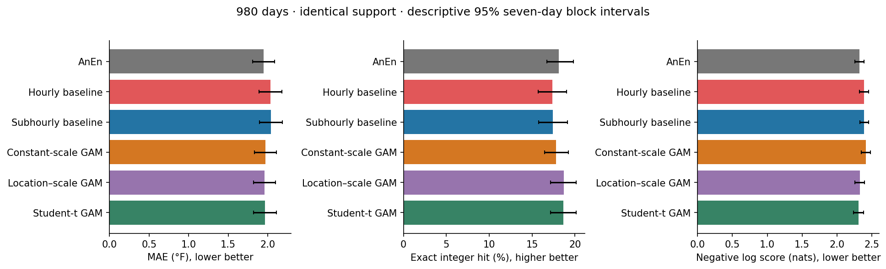
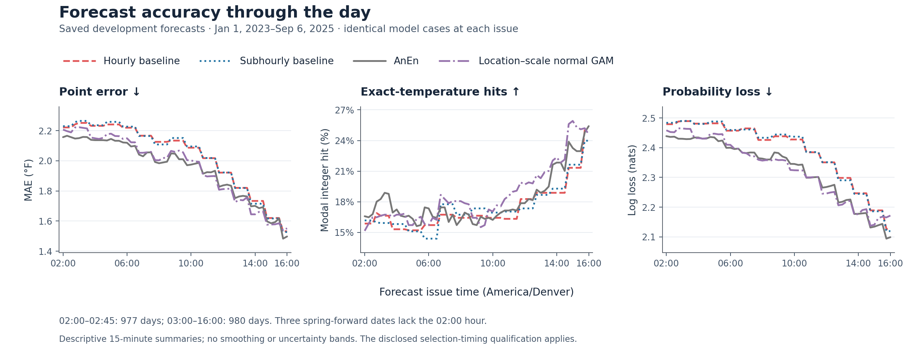

# KDEN v3.75

Scientific data engineering and historical evaluation of HRRR forecast
post-processing for Denver International Airport.

Independent research by Wazeen Hoq. Evidence snapshot: October 23, 2026.
This is a curated public evidence release: source, tests, scientific design
records, selected saved results, and reproducible figures. The large working
archive and individual outcome tables are not included.

[Research and design](publication/RESEARCH_INDEX.md) ·
[Decisions, code, and tests](publication/DECISION_EVIDENCE_MAP.md) ·
[Completed findings](universal_issue_state/experiments/r14_first_model_comparison_v1/reports/s5_v1/INTERPRETATION.md) ·
[Data guide](universal_issue_state/README.md)

## The question

Can meteorologically informed post-processing improve HRRR daily maximum
temperature forecasts, and can its probabilities reliably identify the cases
where those forecasts are more precise?

HRRR is NOAA's High-Resolution Rapid Refresh numerical weather prediction
system. The work spans source acquisition, audited labels, reusable features,
chronological modeling, and confidence evaluation. Temperature prediction
markets motivated the research; they do not make a forecasting gain a trading
edge.

**The completed studies found modest average forecasting gains, but confidence
did not transfer consistently across periods. No profitable trading strategy
or operational forecasting service is claimed.**

## What was built


The upper path builds reusable forecast inputs; the lower path preserves the
audited daily maximum-temperature outcomes. They meet only through an
authorized date-based join for fitting and scoring—not by adding the outcome
to the weather features. [Figure source and evidence](publication/figures/README.md#system-overview).

| Accepted weather-data release | Scope |
|---|---:|
| Target-date coverage | January 1, 2021–September 11, 2026 |
| Target days | 2,080 |
| Issue-time states | 118,536 |
| Deterministic weather/context features per state | 433 |
| Hourly/subhourly trajectory references | 8,919,598 |

An issue-time state represents what the system could use to issue a forecast at
a particular time. The grid runs every 15 minutes from 02:00 through 16:00
America/Denver, with nonexistent spring-forward times omitted. Multiple
forecasts for the same day are not independent weather events. Trajectory
references index forecast-field/time states, not separate downloaded files.

### Source acquisition and scientific scope

A resumable Python pipeline retrieves selected HRRR GRIB messages using verified
byte ranges, persistent HTTPS, and a bounded eight-worker pool. It extracts
station, neighborhood, and regional summaries without retaining whole-domain
files. Confirmed archive gaps remain distinct from network or selection errors.

The **R14** source union contains 12 dynamic hourly fields, static terrain, and
one native quarter-hourly temperature field. Selection balanced thermal,
moisture, wind, mixing, snow, radiation, and modeled-weather information against
acquisition cost. R14 names 14 source identities—not 14 feature columns. It is
a scientific tradeoff, not a proven lossless reduction.

### Audited outcomes and a reusable dataset

The label pipeline adopted the prior audited NWS daily/monthly climate-report
(CLI/CF6) package, preserved its corrections, and audited five additional dates.
Raw IEM parsed values remain candidates, not unquestioned truth. The development
interval contains 1,707 usable labels and three unresolved dates.

Weather features, labels, date-grouped folds, and model outputs are physically
separate. Versioned Parquet/JSON releases preserve units, missingness, stable
issue keys, trajectory references, and SHA-256 lineage. Hourly/subhourly cycles
are selected independently under an initialization-plus-105-minute availability
emulator, not an archive of exact original arrival timestamps.

### Models and evaluation

The completed experiments compare residual-distribution baselines, analog
ensembles, location–scale generalized additive models, XGBoost quantiles, and
NGBoost normal forecasts. Models use explicit subsets of the feature universe.
The baselines translate historical residual distributions onto the current
HRRR temperature-path maximum; the other methods model those errors using
forecast-state information.

Chronological folds group all issues from a day together. Evaluation includes
point error, integer probability loss, distributional scores, calibration,
intervals, seasonal/issue-time slices, and same-case baseline comparisons.
Uncertainty estimates resample calendar blocks with whole days kept together.
The selection-timing qualification below remains attached to the results.

## Completed forecasting results

The baseline/AnEn/GAM comparison covers **980 audited development days and
55,848 checkpoints per model**, from January 1, 2023 through September 6, 2025.
All four models below have identical support across the 02:00–16:00 issue grid.
These are inspected historical outcomes; the selection-timing qualification
below applies to this table.

| Forecast | MAE °F ↓ | Exact-integer hit ↑ | Reported log loss, nats ↓ |
|---|---:|---:|---:|
| Hourly residual baseline | 2.035 | 17.35% | 2.390 |
| Subhourly residual baseline | 2.037 | 17.41% | 2.391 |
| Analog ensemble | 1.948 | 18.14% | 2.325 |
| Location–scale normal GAM | 1.959 | 18.68% | 2.329 |

MAE uses the integer predictive median; exact hits use the modal integer.
Ordinary scores average issues within each day, then weight days equally.
These reported log losses use the declared finite-support probability
convention with a 1e-6 floor and renormalization for scoring, not for fitting.



The figure also includes constant-scale and Student-t GAM diagnostics.
Its error bars are descriptive 95% seven-day block intervals; formal paired
comparisons and multiplicity adjustments are reported separately. This
publication copy changes only the hourly-baseline bar fill to red for contrast;
the saved values, intervals, layout, and black error bars are unchanged.

The analog ensemble reduced MAE by 0.089°F relative to the corrected subhourly
baseline. The normal GAM increased modal hit rate by 1.27 percentage points.
Those are useful measurable differences, but not the project's practical
precision objective. The paired probability-loss comparison did not establish
a winner between the analog ensemble and the normal GAM.

A separate [boosted-model comparison](universal_issue_state/experiments/r14_boosted_comparison_v1/runs/r14-boost-20260927T093806Z/REPORT.md)
used the same 980-day/55,848-checkpoint support. XGBoost quantiles achieved
1.959°F MAE and 17.71% exact hits; NGBoost normal achieved 1.971°F and 18.02%.
The [full primary scorecard](universal_issue_state/experiments/r14_first_model_comparison_v1/runs/r14-s5-20260927T024658Z/REPORT.md)
contains uncertainty, diagnostic models, and failure slices; none of these
results constitutes commercial promotion.

### How accuracy changes through the day



Later issue times generally have lower errors, but the size—and sometimes
direction—of the post-processing gain varies through the day. Neither
improvement nor the model ranking is uniform. These curves describe historical
performance; they do not isolate the value of a particular HRRR update.

Each point averages one forecast per contributing day. All four models use the
same cases at each time: 977 days at 02:00–02:45 and 980 from 03:00 onward,
because three spring-forward dates lack the 02:00 hour. Lines connect the saved
15-minute point estimates without smoothing; uncertainty bands are omitted for
legibility, and the selection-timing qualification still applies.
[Data, definitions, and reproduction](publication/figures/README.md#accuracy-through-the-day).

### Why better averages were not enough


The upper panels show what happened as each model retained fewer, more
confident forecasts. The lower panels check the strictest registered rule in
each assessment period. Green shows observed hit rates, orange shows predicted
hit probabilities, and blue shows the baseline on those same admitted rows.
AnEn and GAM have their own selections. Whiskers show saved
descriptive 95% calendar-block intervals, not paired tests of model advantage.
[Definitions, saved inputs, and reproduction](publication/figures/README.md#confidence-and-reliability).

The normal GAM's strict confidence selector achieved a pooled 27.74% exact-hit
rate, but admitted only 5.88% of day-weighted checkpoints. On those identical
cases, the subhourly baseline already achieved 26.00%. In the partial 2025
period, the selected GAM forecasts achieved 16.18% against a predicted 28.08%,
across only 55 admitted days. Selection and easy-case effects therefore matter
as much as the headline hit rate.

A separate conditional-reliability experiment asked whether confidence,
calendar, and weather could improve the probability that an unchanged modal
forecast would hit. Across **615 days and 35,047 checkpoints**, none of the
three learned reliability versions beat native confidence on pooled Brier
score for either base model. The registered readiness requirements were not
met. This is evidence against that specification and training schedule, not
proof that conditional reliability modeling is impossible.

Read the [forecast interpretation](universal_issue_state/experiments/r14_first_model_comparison_v1/reports/s5_v1/INTERPRETATION.md)
and [reliability findings](universal_issue_state/experiments/r14_first_model_comparison_v1/reports/cr1_v1/INTERPRETATION.md)
for the complete reasoning and denominators.

## Research design and decision records

The specifications are part of the project, not incidental attachments. They
record how physical questions became acquisition rules, computational
algorithms, acceptance tests, and evaluation criteria.

- **Problem formulation and baseline history.** The [original research reading
  route](publication/RESEARCH_INDEX.md#1-from-a-narrow-thermal-study-to-an-issue-time-forecasting-problem)
  explains the earlier fixed-checkpoint and observation-aware studies that
  preceded v3.75. Their populations and results are not relabeled as R14 work.
- **Scientific acquisition design.** The [feature-panel scientific specification](docs/research/universal_feature_specification_v2_2.md)
  connects meteorological mechanisms to field identities and spatial/temporal
  operators. It is the broader historical design, not the final R14 field list.
- **Algorithms and execution contracts.** The [implementation manual](docs/research/implementation_manual_v1_5.md)
  translates requirements into bounded steps, artifact schemas, acceptance
  checks, and restart behavior. Its historical status is explained in the index.
- **Truth and feature selection.** The [truth-audit lineage](publication/RESEARCH_INDEX.md#2-establishing-a-defensible-outcome-rather-than-trusting-one-parsed-row)
  and [accepted R14 handoff](reports/STEP_04_5_R14_ACQUISITION_HANDOFF.md)
  show why source values and source-field choices needed scientific scrutiny.
- **Model-comparison design.** The [R14 comparison plan](universal_issue_state/R14_MODEL_COMPARISON_PLAN_V1.md)
  builds on the already-frozen dataset and specifies the questions, models,
  chronological comparisons, support requirements, and diagnostics. Later
  amendments identify the actual fitted feature choices.

Use the [research index](publication/RESEARCH_INDEX.md) for the full annotated collection,
and the [decision-to-evidence map](publication/DECISION_EVIDENCE_MAP.md) to trace twelve
decisions into their code, tests, saved acceptance records, and findings.
Historical instructions are preserved as research records, not commands to
execute or declarations that every proposed system was completed.

## Evidence boundaries

- **Inspected historical data, not a new blind test.** These assessment periods
  informed later research; related projects also inspected overlapping dates.
  Keeping a local reserved interval does not restore project-wide blindness.
- **A disclosed timing defect.** The initial comparison selected January 1
  settings using a December 31 tuning label despite a two-day lag. Outer fits
  respected the lag, and excluding the late label retained all 18 settings.
  That sensitivity limits the apparent effect but does not erase the
  nonconformance. A successor implemented and tested the corrected boundary.
- **Neural evaluation is unfinished.** TabICL/TabDPT contexts and emitted-error
  corrections were implemented with fixed neural weights. The saved replay is
  paused after 212 scored days; it has no final development acceptance or
  recipe lock. Its later 02:00–14:00 primary window and unfloored full-law
  scoring differ from the completed comparisons above. No flagship neural
  result is promoted into this table.
- **Prediction is not profitability.** These reports do not evaluate
  contemporaneous executable prices, actual contracts, fees, or fills. They do
  not establish a trading edge or prove that KDEN or HRRR is intrinsically
  unforecastable.

## Inspect the work

| Interest | Start here |
|---|---|
| Scientific reasoning | [Research index](publication/RESEARCH_INDEX.md) |
| Decision, implementation, and test traceability | [Evidence map](publication/DECISION_EVIDENCE_MAP.md) |
| Data objects, units, and frozen boundaries | [Universal dataset guide](universal_issue_state/README.md) |
| Acquisition engineering | [Source processing](src/kden_v375/acquisition/source.py) and [verified HTTP ranges](src/kden_v375/io/http_range.py) |
| Label-audit semantics | [Audit rules](src/kden_v375/prefit/p02_rules.py) and [coverage report](truth/kden_tmax/v1/reports/P02_TRUTH_COVERAGE_QC.md) |
| Chronological scoring and uncertainty | [Full comparison report](universal_issue_state/experiments/r14_first_model_comparison_v1/runs/r14-s5-20260927T024658Z/REPORT.md) |
| What did not work | [Conditional-reliability interpretation](universal_issue_state/experiments/r14_first_model_comparison_v1/reports/cr1_v1/INTERPRETATION.md) |

The implementation uses Python, requests, ecCodes, NumPy, SciPy, PyArrow,
scikit-learn, XGBoost, NGBoost, and PyTorch across separately pinned workflows.
Tests cover timing, missingness, atomic publication, and altered-file rejection;
the evidence map points to their implementations without claiming every defect
was prevented.

## Try the public evidence

From a fresh clone, Python 3.12 can inspect the compact saved evidence and run
the figure-input checks without downloading weather data or fitting models:

```sh
git clone https://github.com/1wxzeen/KDEN-v3.75.git
cd KDEN-v3.75
python3.12 examples/quickstart.py
python3.12 -m unittest discover -s publication/figures -p 'test_*.py'
python3.12 tools/check_publication.py
```

To regenerate the three statistical figures, install the small public-figure
environment and follow [REPRODUCIBILITY.md](REPRODUCIBILITY.md). The workflow
uses the bundled aggregate results, not individual forecast or outcome pages.
The system diagram also has an editable SVG source.

This repository is **not a one-command reproduction of the full study**.
Saved PASS records document historical acceptance; their original full
archives are not supplied by cloning this repository. See
[data availability](DATA_AVAILABILITY.md), the
[publication audit](publication/PUBLICATION_AUDIT.md), and the
[file manifest](publication/PUBLIC_MANIFEST.json) for exact scope and edits.
No acquisition, training, or full-archive acceptance scan was rerun to prepare
this release. Historical start commands in research documents are records,
not recommended quickstart commands.

## Project direction

This release concludes my current HRRR-based KDEN forecasting effort. My
subsequent research explores KMIA and KPHX using LAMP after more promising
experience there. That is a research direction, not a controlled demonstration
that LAMP is universally better than HRRR or that Denver cannot be forecast.

## Development approach

Research drafting and implementation were AI-assisted, under owner-led
scientific direction and iterative review. The specifications, decision
records, code, tests, and qualified results document what was designed,
implemented, and evaluated; no sole manual-authorship claim is implied.

Original code and documentation are released under the [MIT license](LICENSE).
See [NOTICE.md](NOTICE.md) for third-party and data boundaries.
