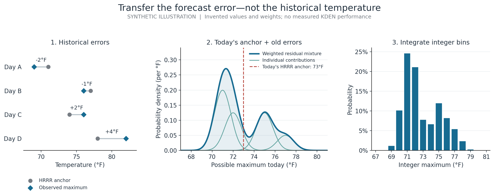
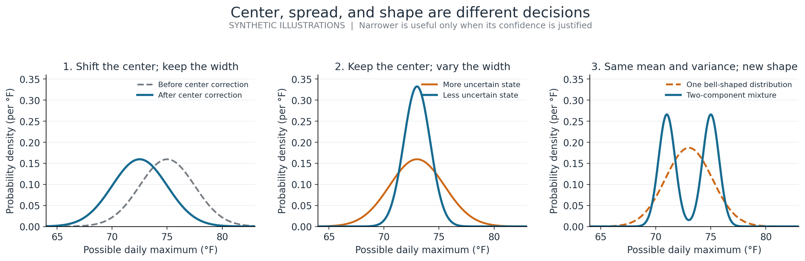

# From HRRR forecasts to probability distributions

Mathematical companion to the [project overview](../README.md).
Published October 26, 2026; empirical evidence snapshot October 23, 2026.

This companion explains the mathematics of the completed R14 forecasting and
conditional-reliability studies. It follows the published implementation, not
every model mentioned in earlier research plans. The established methods are
not claimed as new inventions: the project contribution is the design,
implementation, and critical evaluation of a coherent forecasting system.

The central idea is:

> Use a physical forecast as the starting point. Estimate how it can be wrong
> under the information available at forecast time. Express that uncertainty
> as a probability distribution, and test both accuracy and confidence on
> later dates.

The numerical results, their disclosed selection-timing defect, and the limits
of the evidence remain those in the [published findings][findings]. A
mathematically appealing mechanism is a reason to test a model—not evidence
that it worked.

## 1. Define the thing being predicted

Let $d$ denote a target date, $t$ the time a forecast is issued, and $Y_d$
the audited integer-Fahrenheit daily maximum at Denver International Airport.
The climate day is the fixed UTC interval

$$
\mathcal C_d=[07{:}00Z_d,\;07{:}00Z_{d+1}).
$$

The objective is a conditional probability distribution:

$$
p_{d,t}(k)
=\Pr(Y_d=k\mid X_{d,t}),\qquad k\in\mathbb Z,
$$

where $X_{d,t}$ contains eligible HRRR forecasts and deterministic context,
not the eventual observed maximum.

**In plain language.** At 06:15, the task is not just to say “73°F.” It is to
say how plausible 71°F, 72°F, 73°F, and the other outcomes are, using only what
that forecast could have known.

### Four clocks that cannot be interchanged

| Clock | Meaning | Why it matters |
|---|---|---|
| Issue time $t$ | When this system emits a forecast | Defines the information cutoff |
| Initialization $c$ | When a particular HRRR run starts | Identifies the forecast vintage |
| Valid time $v$ | The physical time HRRR predicts | Determines what part of the day a value describes |
| Lead $v-c$ | Distance from initialization to valid time | Distinguishes short- and long-lead predictions of the same hour |

Historical availability is emulated by

$$
c+105\text{ minutes}\le t.
$$

This is a delay applied to hourly HRRR initializations, **not an HRRR update
every 105 minutes**. Hourly and subhourly products select their eligible cycles
independently; a product's trajectory is not stitched from convenient pieces
of different cycles. Actual original delivery timestamps are not claimed.

The dataset has 118,536 issue states across 2,080 target days. Those are many
forecast opportunities, not 118,536 independent weather events. The complete
issue grid runs every 15 minutes from 02:00 through 16:00 America/Denver,
omitting nonexistent spring-forward times. [Data and time contracts][data-guide]

## 2. Separate the physical forecast from its statistical error

Let $B^H_{d,t}$ and $B^Q_{d,t}$ be the hourly and quarter-hourly HRRR
temperature-path maxima retained by the dataset's target-day contract.
Temperatures are converted from Kelvin to Fahrenheit before these become
forecast anchors.

For a historical case $i$, define a residual

$$
r_i^P=Y_i-B_i^P,\qquad P\in\{H,Q\}.
$$

Then model the current outcome as

$$
Y_d=B^P_{d,t}+R_{d,t}.
$$

**In plain language.** If HRRR expects a maximum near 73°F, the statistical
question is whether comparable situations tend to finish a little warmer,
cooler, or with unusually large uncertainty.

The anchor uses the retained native forecast path. It is not an observed
running high, and the experiment does not impose a MADIS-derived temperature
floor. This matters because a forecast-only baseline and an observation-aware
nowcast answer different questions.

## 3. The baseline already corrects historical errors

The hourly and subhourly baselines are not bare HRRR numbers. Each forms an
equally weighted distribution of historical residuals, matched to the exact
local issue time and a circular seasonal window:

$$
F_{\mathrm{base}}(y\mid d,t)
=\frac{1}{n}\sum_{i\in\mathcal E_{d,t}}
\Phi\!\left(\frac{y-B^P_{d,t}-r_i^P}{s}\right).
$$

Here $\Phi$ is the standard normal CDF; $\mathcal E_{d,t}$ is the eligible
historical set; and $s>0$, measured in °F, smooths the residual distribution.
The calendar window wraps around New Year. Window and smoothing choices are
tuned on earlier data, with a minimum-history requirement.

**Why this could help.** A systematic cold bias appears as positive residuals
and shifts the forecast upward. A difficult season produces a wider error
distribution. This establishes a meaningful comparator: a more complex model
must add value beyond a simple, season- and issue-aware error correction.

This is a mixture of normal kernels centered at historical errors, not a
single fitted normal distribution. [Baseline implementation][baseline-code]

## 4. Analog ensembles: transfer errors from comparable forecast states

The analog model asks a more specific question:

> Which previous days looked similar in the HRRR information available at
> this exact forecast time, and how wrong was HRRR on those days?

### 4.1 Define “similar” using physical groups

The fitted implementation uses ten forecast-state coordinates grouped into
six physical themes:

| Theme | Coordinates used | Intended information—not a causal claim |
|---|---|---|
| Surface evolution | Forecast temperature near issue time; remaining heating potential | Current modeled thermal state and headroom |
| Low-level structure | Forecast 850-hPa temperature; 850-hPa/surface thermal contrast | Thermal structure above the surface |
| Solar forcing | Integrated remaining shortwave energy | Available modeled radiative input |
| Mixing and ventilation | Maximum boundary-layer depth; mean wind speed | Mixing and ventilation conditions |
| Moisture | Dew-point depression | Modeled near-surface dryness |
| Forecast consistency | Hourly/subhourly temperature difference; cycle revision magnitude | Disagreement and forecast instability |

These are derived HRRR quantities, not direct observations. Wind speed alone
does not resolve wind direction or identify a downslope event. Correlated
products are not independent ensemble members.

Each coordinate is scaled from eligible training data at the same issue time.
The primary scale is the interquartile range, with declared fallbacks for
degenerate coordinates. Constant coordinates are removed. For active
coordinate $j$,

$$
z_j(x)=\frac{x_j-m_j}{s_j}.
$$

The group-balanced squared distance is

$$
D^2(x,x_i)=
\frac{1}{|\mathcal G|}
\sum_{g\in\mathcal G}
\frac{1}{|g|}
\sum_{j\in g}\bigl[z_j(x)-z_j(x_i)\bigr]^2.
$$

Only active groups and coordinates appear in this expression.

**Why group balancing matters.** Adding two related thermal coordinates
should not automatically give thermal structure twice the influence of solar
forcing. Equal group totals address that bookkeeping problem. They do not
prove that the coordinates are independent or remove all redundancy.

The original comparison plan described a smaller thermal subset; the actual
ten-coordinate implementation is recorded in its later amendment.
[Feature and distance decisions][s3-decisions] · [Distance implementation][anen-code]

### 4.2 Select eligible days and weight their errors

Candidates must have the same local issue time, lie in the declared seasonal
window, and come from the eligible earlier training history. Each historical
day contributes at most one candidate to that query.

After selecting the nearest $K$ eligible days, use

$$
h=\max\{bD_{(K)},10^{-12}\},\qquad
a_i=\frac{\exp[-D_i^2/(2h^2)]}
{\sum_{j=1}^{K}\exp[-D_j^2/(2h^2)]}.
$$

Here $b$ controls how quickly weight falls with distance. $h$ is a
forecast-state distance bandwidth; it is **not** the temperature smoothing
parameter $s$.

The forecast distribution is

$$
F_{\mathrm{AnEn}}(y\mid x)
=\sum_{i=1}^{K}a_i
\Phi\!\left(\frac{y-B^Q_{d,t}-r_i^Q}{s}\right).
$$

**In plain language.** The model borrows “HRRR was 2°F too cold in situations
like this,” not “the historical day reached 80°F.” It transfers the old error
onto today's physical forecast, preserving today's temperature level.

Before integer binning, the mixture has

$$
\mathbb E[Y\mid x]=B^Q_{d,t}+\bar r_a,\qquad
\operatorname{Var}(Y\mid x)
=s^2+\sum_i a_i(r_i^Q-\bar r_a)^2,
\quad \bar r_a=\sum_i a_i r_i^Q.
$$

The uncertainty combines smoothing around each analog with disagreement
among analog errors. Different clusters of residuals can produce an
asymmetric or multimodal distribution.

An effective-sample-size diagnostic,

$$
N_{\mathrm{eff}}=\frac{1}{\sum_i a_i^2},
$$

distinguishes 30 roughly equal analogs from 30 neighbors whose weight is
dominated by two days. Missing inputs or inadequate history cause an explicit
abstention, not an undocumented replacement model.

*Synthetic illustration only. The temperatures, analog weights, and curves
are invented to explain the calculation; they are not KDEN forecasts or
evidence of measured improvement.*

## 5. GAMs: learn smooth corrections to location and uncertainty

The primary generalized additive model predicts a normal conditional law:

$$
Y^*_{d,t}\mid X_{d,t}
\sim \mathcal N\!\left(\mu_{d,t},\sigma_{d,t}^2\right),
\qquad
\mu_{d,t}=B^Q_{d,t}+A(X_{d,t})^\top\beta.
$$

$Y^*$ denotes the continuous working law whose probability is integrated
into integer outcomes. $A(X)$ is a low-rank additive basis: smooth weather
effects, a noncyclic issue-time effect, seasonal Fourier terms, and linear
context terms.

**In plain language.** Keep HRRR's physical forecast, but learn corrections
such as “under this modeled mixing state, the forecast tends to be too warm.”
Smooth effects let nearby conditions receive nearby corrections instead of
treating every value as an unrelated category.

The location–scale version also models forecast spread. With
$\eta=C(X)^\top\gamma$, its implemented link is

$$
\log\sigma
=\log(0.25)+
\bigl[\log(20)-\log(0.25)\bigr]\operatorname{logistic}(\eta).
$$

The 0.25°F and 20°F limits are numerical safeguards, not physical guarantees
about temperature errors. The scale basis is smaller than the location basis.
It allows uncertainty to vary with the modeled situation rather than assuming
that every forecast deserves the same width.

### Fitting the actual integer outcome

The GAM minimizes a day-weighted native integer negative log likelihood with
coefficient penalties:

$$
\mathcal L(\beta,\gamma)=
-\sum_{d,t}\omega_{d,t}
\log p_{\beta,\gamma}(Y_d\mid X_{d,t})
+\frac{\lambda_\mu}{2}\|\beta_{\neg 0}\|_2^2
+\frac{\lambda_\sigma}{2}\|\gamma_{\neg 0}\|_2^2.
$$

Intercepts are not penalized. The low-rank spline basis and ridge penalties
control flexibility; this is not an integrated-curvature smoothing penalty.
Training-only basis construction and numerical fit acceptance are part of
the model contract. Query values outside fitted basis boundaries are clipped
for correction terms and flagged; the underlying HRRR anchor is not clipped.

Two fitted diagnostics separate modeling choices:

- **Constant-scale normal GAM:** change the center but keep a shared spread.
- **Student-$t_5$ location–scale GAM:** allow heavier tails. Its scale is not
  its standard deviation; $\mathrm{SD}=\sigma\sqrt{5/3}$.

There are no fitted random effects in these models, so the public explanation
should call them GAMs, not GAMMs. A fitted smooth is an association within this
forecasting system, not evidence that changing that weather quantity causes
a change in forecast error. [GAM implementation][gam-code] · [Basis construction][basis-code]

*Synthetic illustrations, not fitted KDEN distributions. Narrower is better
only when the corresponding confidence is justified.*

## 6. Boosted models: test more flexible residual relationships

The boosted comparison retains the subhourly HRRR anchor and models its
residual. It uses training-derived imputation and missingness indicators, with
equal total training weight per target day.

### XGBoost quantiles

For each registered quantile level $\tau$, estimate a conditional residual
quantile $q_\tau(X)$ using pinball loss:

$$
\rho_\tau(u)=u\bigl(\tau-\mathbf1\{u<0\}\bigr),
\qquad u=r-q_\tau(X).
$$

**In plain language.** Instead of assuming a bell-shaped distribution, predict
several points on the distribution: a low outcome, the middle, high outcomes,
and the tails.

The implementation predicts nine residual quantiles. It sorts crossing
predictions, enforces a minimum 0.05°F separation around the median, adds the
HRRR anchor, interpolates the CDF between quantiles, and attaches exponential
tails. These repairs and tail assumptions are part of the predictive model,
not cosmetic plotting decisions.

### NGBoost normal

NGBoost learns conditional residual location and scale with boosted trees:

$$
R\mid X\sim
\mathcal N\!\left(\mu_R(X),\sigma_R(X)^2\right),
\qquad Y^*=B^Q+\mu_R(X)+\sigma_R(X)Z.
$$

Here $Z$ is standard normal. Natural-gradient updates account for the geometry of distributional parameters.
Trees permit interactions and nonlinear partitions beyond the additive GAM
structure. The experiment fits the continuous normal log score and then
integrates the result into integer probabilities; this is **not** the GAM's
native integer fitting objective.

**Why include these alternatives?** A modest GAM gain might reflect an
insufficiently flexible correction, or it might reflect limited recoverable
signal. Flexible tree models test the former possibility; they do not
guarantee recovery of information HRRR did not supply.
[Boosted implementation][boost-code] · [NGBoost method][ngboost-paper]

## 7. Convert every completed forecast into a comparable integer PMF

For an interior integer $k$,

$$
p(k)=F(k+0.5)-F(k-0.5).
$$

The completed comparison uses the finite support
$\mathcal S=\{-40,-39,\ldots,120\}$. Its endpoint bins absorb the tails:

$$
p(-40)=F(-39.5),\qquad p(120)=1-F(119.5).
$$

**In plain language.** A continuous curve's height at 73 is not the chance of
73°F. The probability is the area assigned to the entire 73°F bin. This gives
every model the same object to evaluate: nonnegative masses summing to one.

These half-degree bins are a statistical representation of the integer target,
not a claim about an undocumented instrument or market rounding procedure.
The endpoint treatment is a scoring guardrail, not an assertion that the
physical atmosphere cannot exceed these temperatures.

Three summaries answer different questions:

$$
\widehat y_{\mathrm{mean}}=\sum_k kp(k),\qquad
\widehat y_{\mathrm{median}}=\min\left\{k:\sum_{j\le k}p(j)\ge0.5\right\},\qquad
\widehat y_{\mathrm{mode}}=\arg\max_k p(k).
$$

The implementation resolves modal ties toward the lowest integer. Mean,
median, and mode need not agree; choosing the most likely integer is not the
same objective as minimizing absolute error. [Probability interface][probability-code]

## 8. Score accuracy without counting the same day dozens of times

Ordinary comparisons average within each target day and then across days.
For $D$ days and $n_d$ evaluated issues on day $d$,

$$
\omega_{d,t}=\frac{1}{D\,n_d}.
$$

On matched support, the principal summaries are

$$
\mathrm{MAE}=\sum_{d,t}\omega_{d,t}
|\widehat y_{\mathrm{median},d,t}-Y_d|,
$$

$$
\mathrm{RMSE}=
\sqrt{\sum_{d,t}\omega_{d,t}
(\widehat y_{\mathrm{mean},d,t}-Y_d)^2},
$$

$$
\mathrm{Hit}=\sum_{d,t}\omega_{d,t}
\mathbf1\{\widehat y_{\mathrm{mode},d,t}=Y_d\}.
$$

For reported log loss only, the completed study uses

$$
\widetilde p(k)=
\frac{\max\{p(k),10^{-6}\}}
{\sum_{j\in\mathcal S}\max\{p(j),10^{-6}\}},
\qquad
\mathrm{NLL}=-\sum_{d,t}\omega_{d,t}\log\widetilde p_{d,t}(Y_d).
$$

The floor is not applied to GAM fitting or native confidence. It prevents
unbounded reported losses but must remain visible when interpreting tails.
Discrete CRPS additionally compares the cumulative integer probabilities.
Writing $C(k)=\sum_{j\le k}p(j)$,

$$
\mathrm{CRPS}(p,y)=
\sum_{k=-40}^{119}
\left[C(k)-\mathbf1\{y\le k\}\right]^2(1^\circ\mathrm F).
$$

**Why several scores?** MAE evaluates a useful point forecast; exact hit
evaluates the most likely integer; log loss and CRPS evaluate probability
quality. A model can improve one and worsen another.

Comparisons use the same feasible dates/issues. Uncertainty calculations
resample calendar blocks while retaining whole days, rather than pretending
that nearby intraday forecasts are independent.
[Score implementation][scoring-code]

## 9. Test confidence rather than assuming it

For an unchanged base forecast, let

$$
q(X)=\max_k p(k\mid X),\qquad
Z=\mathbf1\{\widehat y_{\mathrm{mode}}=Y\}.
$$

Native confidence $q$ says how often the modal integer should be right.
The conditional-reliability experiment asks whether a separate model can
estimate that event more reliably:

$$
r(X)=\Pr(Z=1\mid U(X))
=\operatorname{logistic}\!\left(\alpha+U(X)^\top\beta\right).
$$

The tested input sets add information progressively: native confidence alone;
confidence plus calendar/issue context; and those inputs plus weather context.
Parameters are fitted with day-weighted penalized binary log loss using
earlier committed base forecasts.

**In plain language.** This is a second question: “When this model sounds
confident, how much should we believe it?” It does not change the temperature
forecast or repair the full temperature PMF.

A selector can admit forecasts with $r(X)\ge\tau$, where $\tau$ was chosen
on an earlier threshold period. Its actual later coverage may differ from the
intended coverage. The comparison baseline must be evaluated on precisely
those same admitted cases: otherwise selecting easy cases can masquerade as
a model improvement.

Reliability is assessed through predicted-versus-observed hit rates, Brier
score, actual coverage, and chronological stability. Selection summaries
retain the registered within-day checkpoint weights; they are not a fresh
equal weighting of only the admitted days.

**What happened:** none of the three learned versions improved pooled Brier
score over native confidence for either base model. The registered readiness
requirements were not met. Retaining this negative result is part of the
mathematical story: a plausible calibration layer still had to earn its place.
[Reliability implementation][reliability-code] · [Findings][reliability-findings]

## 10. Keep the chronology qualification attached

Training, tuning, and assessment are date-grouped. Preprocessing must be fitted
on earlier training data; all issue times from one date stay together. The
completed outer assessments cover 2023, 2024, and January–September 6, 2025,
with earlier training vintages fixed within their assessment blocks. This is
not daily operational retraining.

The initial comparison selected January 1 settings using a December 31 label
despite the declared two-day lag. Outer fits respected the lag. A sensitivity
excluding that late label retained all 18 selected configurations, but does
not make the original selection conforming. The successor reliability
experiment implemented and tested the corrected boundary.

The truth layer also uses retrospectively audited labels with a declared lag,
not a replay of every historical report's original availability. These are
inspected development results, not a newly blind test or evidence of trading
profitability.

## 11. What this design established—and what it did not

The completed AnEn reduced MAE from the subhourly residual baseline's 2.037°F
to 1.948°F. The normal location–scale GAM increased exact-integer hits from
17.41% to 18.68%. The shared population was 980 audited development days and
55,848 checkpoints per model, with the chronology qualification above.

Those are modest measurable gains. Neither elegant equations nor a high hit
rate on a small selected subset establishes the desired practical precision.
The evidence does not support a profitable trading claim.

The defensible system-design contribution is the chain:

1. Define an information set and a target precisely.
2. Build comparable historical states without treating repeated days as
   independent analogs.
3. Give competing distributional models an informative physical anchor.
4. Enforce a common probability interface and explicit decision rules.
5. Separate predictive accuracy, confidence, selection, and commercial value.
6. Preserve both failures and implementation qualifications.

## Appendix: implemented neural extensions, not a completed headline result

TabICL and TabDPT adapters and downstream corrections were implemented, but the
published development replay is paused. They should not be presented as a
completed winning comparison.

These pretrained neural weights remain fixed; an eligible historical context
conditions each prediction. The adapters translate a native residual law onto
the current HRRR anchor. TabICL uses a quantile-based law; TabDPT uses a native
histogram law.

Subsequent corrections use previously emitted, versioned forecasts and eligible
outcomes. A positive affine transformation can adjust the center and width
without discarding the native distribution's shape:

$$
Y_{\mathrm{corr}}
=\mu_{\mathrm{corr}}+s(Y_{\mathrm{raw}}-\mu_{\mathrm{raw}}),
\qquad s>0,
$$

$$
F_{\mathrm{corr}}(y)=
F_{\mathrm{raw}}\!\left(
\mu_{\mathrm{raw}}+\frac{y-\mu_{\mathrm{corr}}}{s}
\right).
$$

The implemented TabICL recipe supports center and positive-width corrections;
the TabDPT recipe uses shifts only. These are estimated from earlier
forecast-error history, not from the query's outcome.

This unfinished experiment uses a later 02:00–14:00 primary window and
unfloored full-law scoring, unlike the completed comparison's finite-support
score convention. Its results must not silently enter the earlier leaderboard.
[Neural experiment status][neural-status] · [Native law adapters][neural-laws] · [Correction machinery][neural-corrections]

## Implementation and reference map

The implementation links below pin the reviewed public evidence snapshot.
They distinguish what was fitted from broader historical proposals.

| Component | Primary project evidence |
|---|---|
| Data, clocks, immutable releases | [Dataset guide][data-guide] |
| Experimental intent and later amendments | [Comparison plan][comparison-plan] and [S3 decisions][s3-decisions] |
| Residual baselines | [Residual model][baseline-code] |
| Analog selection and error transport | [AnEn][anen-code] |
| Distributional GAM and actual penalty | [GAM][gam-code] and [basis construction][basis-code] |
| Integer PMFs and decision summaries | [Probability code][probability-code] |
| Point/distributional scores | [Scoring code][scoring-code] |
| Quantile and natural-gradient boosting | [Boosted models][boost-code] |
| Conditional reliability | [CR1 model][reliability-code] and [interpretation][reliability-findings] |
| Completed empirical conclusions | [Primary interpretation][findings] |

Related established methods: [NCAR's Analog Ensemble overview][anen-reference]
and [Duan et al.'s NGBoost paper][ngboost-paper]. This project's residual
transport, feature grouping, interfaces, and evaluation choices should be
explained from its own implementation rather than attributed wholesale to
those references.

[data-guide]: https://github.com/1wxzeen/KDEN-v3.75/blob/fd43a95237acf5bb39ecf2227d3519720a772299/universal_issue_state/README.md
[comparison-plan]: https://github.com/1wxzeen/KDEN-v3.75/blob/fd43a95237acf5bb39ecf2227d3519720a772299/universal_issue_state/R14_MODEL_COMPARISON_PLAN_V1.md
[baseline-code]: https://github.com/1wxzeen/KDEN-v3.75/blob/fd43a95237acf5bb39ecf2227d3519720a772299/universal_issue_state/experiments/r14_first_model_comparison_v1/src/r14_s2/model.py
[s3-decisions]: https://github.com/1wxzeen/KDEN-v3.75/blob/fd43a95237acf5bb39ecf2227d3519720a772299/universal_issue_state/experiments/r14_first_model_comparison_v1/implementations/s3_v1/DECISIONS.md
[anen-code]: https://github.com/1wxzeen/KDEN-v3.75/blob/fd43a95237acf5bb39ecf2227d3519720a772299/universal_issue_state/experiments/r14_first_model_comparison_v1/implementations/s3_v1/r14_s3/anen.py
[gam-code]: https://github.com/1wxzeen/KDEN-v3.75/blob/fd43a95237acf5bb39ecf2227d3519720a772299/universal_issue_state/experiments/r14_first_model_comparison_v1/implementations/s3_v1/r14_s3/gam.py
[basis-code]: https://github.com/1wxzeen/KDEN-v3.75/blob/fd43a95237acf5bb39ecf2227d3519720a772299/universal_issue_state/experiments/r14_first_model_comparison_v1/implementations/s3_v1/r14_s3/design.py
[probability-code]: https://github.com/1wxzeen/KDEN-v3.75/blob/fd43a95237acf5bb39ecf2227d3519720a772299/universal_issue_state/experiments/r14_first_model_comparison_v1/src/r14_s1/probability.py
[scoring-code]: https://github.com/1wxzeen/KDEN-v3.75/blob/fd43a95237acf5bb39ecf2227d3519720a772299/universal_issue_state/experiments/r14_first_model_comparison_v1/src/r14_s1/scoring.py
[boost-code]: https://github.com/1wxzeen/KDEN-v3.75/blob/fd43a95237acf5bb39ecf2227d3519720a772299/universal_issue_state/experiments/r14_boosted_comparison_v1/models.py
[reliability-code]: https://github.com/1wxzeen/KDEN-v3.75/blob/fd43a95237acf5bb39ecf2227d3519720a772299/universal_issue_state/experiments/r14_first_model_comparison_v1/implementations/cr1_v1/model.py
[reliability-findings]: https://github.com/1wxzeen/KDEN-v3.75/blob/fd43a95237acf5bb39ecf2227d3519720a772299/universal_issue_state/experiments/r14_first_model_comparison_v1/reports/cr1_v1/INTERPRETATION.md
[findings]: https://github.com/1wxzeen/KDEN-v3.75/blob/fd43a95237acf5bb39ecf2227d3519720a772299/universal_issue_state/experiments/r14_first_model_comparison_v1/reports/s5_v1/INTERPRETATION.md
[neural-status]: https://github.com/1wxzeen/KDEN-v3.75/blob/fd43a95237acf5bb39ecf2227d3519720a772299/universal_issue_state/experiments/r14_tabular_pretrained_v1/README.md
[neural-laws]: https://github.com/1wxzeen/KDEN-v3.75/blob/fd43a95237acf5bb39ecf2227d3519720a772299/universal_issue_state/experiments/r14_tabular_pretrained_v1/src/kden_r14_tabular/laws.py
[neural-corrections]: https://github.com/1wxzeen/KDEN-v3.75/blob/fd43a95237acf5bb39ecf2227d3519720a772299/universal_issue_state/experiments/r14_tabular_pretrained_v1/src/kden_r14_tabular/corrections.py
[anen-reference]: https://ral.ucar.edu/products/analog-ensemble-anen
[ngboost-paper]: https://proceedings.mlr.press/v119/duan20a.html
