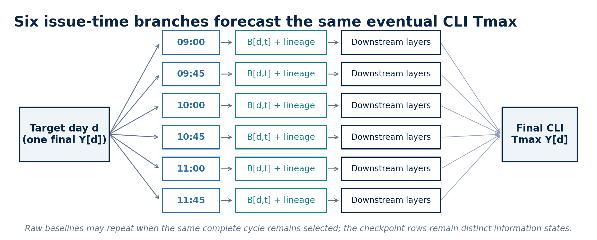
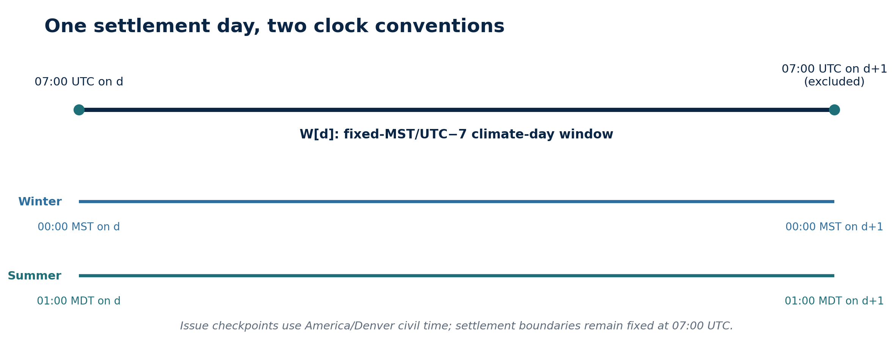
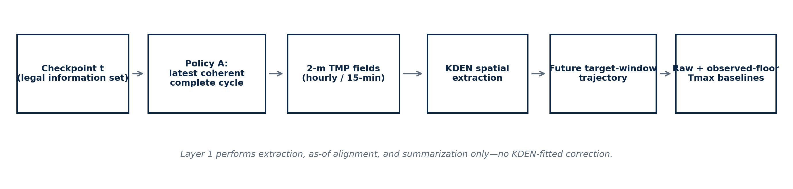
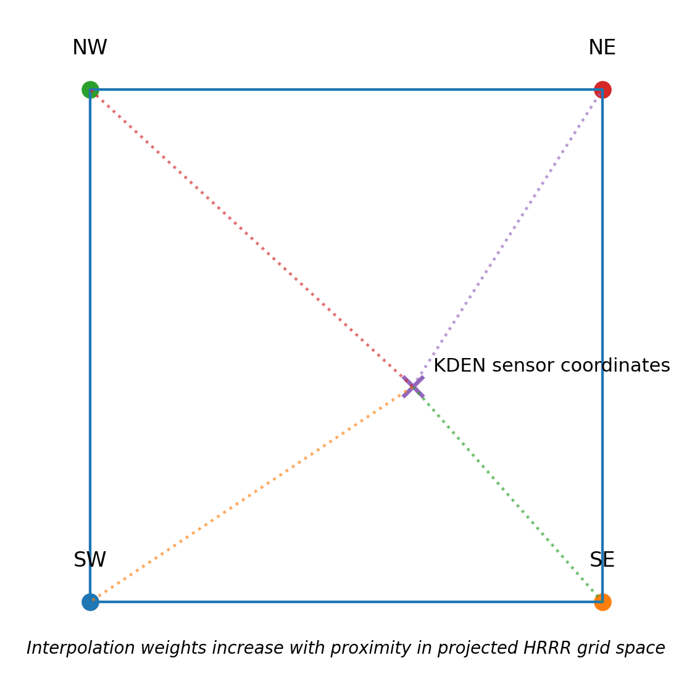
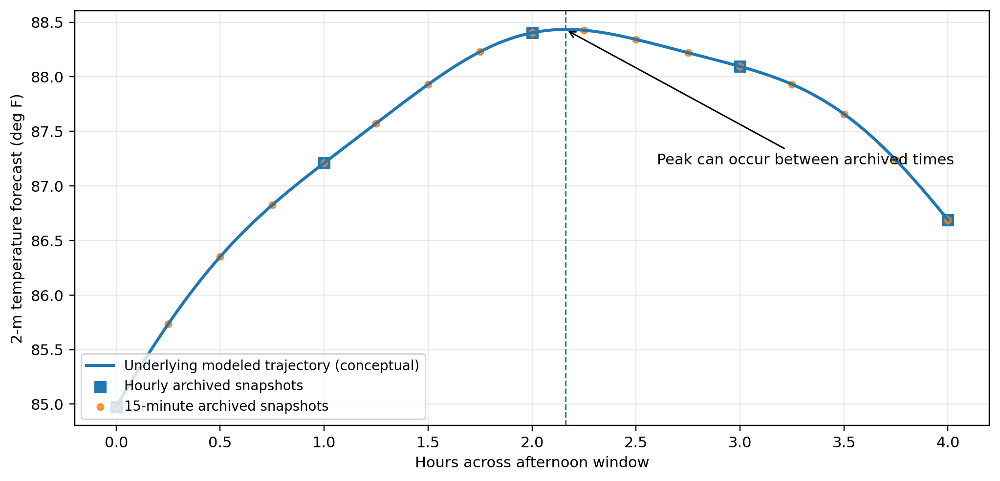

# Research reading edition

Historical document, not the current v3.75 execution contract. This GitHub reading edition preserves the source's proposals and results; they are not relabeled as completed R14 work. Agent-directed wording is retained.

Source: `KDEN_Layer_1_Baseline_Forecast_Specification_v3.0.docx`  
Source SHA-256: `873218fea795822f161499208d217efefc90148a508eea4ffbebffc988aceb84`

Word metadata is omitted by conversion. Any additional withholding is recorded in the publication manifest.

---

**KDEN PROBABILISTIC MOS**

Layer 1 Baseline Forecast Specification

Issue-time-indexed HRRRv4 trajectory reconstruction, Policy A cycle governance, spatial/temporal extraction, and live-equivalent historical backtesting

<table>
<colgroup>
<col style="width: 100%" />
</colgroup>
<thead>
<tr>
<th style="text-align: center;">
Layer 1 output family: B_v[d,t] = mechanically derived external-guidance Tmax available at checkpoint t

<em>No KDEN-fitted bias correction, nonlinear MOS, Kalman update, probability calibration, or market-price input occurs in this layer.</em>
</th>
</tr>
</thead>
<tbody>
</tbody>
</table>

| **Item** | **Version 3.0 decision** |
|----|----|
| Parent document | KDEN Probabilistic MOS Product Direction White Paper, Version 2.0 |
| Layer responsibility | Transform as-issued NWP guidance into reproducible KDEN Tmax baselines and trajectories for fixed pre-noon issue checkpoints. |
| Initial source | HRRRv4 2-m temperature from hourly and 15-minute surface products. |
| Binding issue checkpoints | 09:00, 09:45, 10:00, 10:45, 11:00, and 11:45 America/Denver civil time. |
| Binding cycle policy | Policy A: newest fully available, internally coherent cycle that covers every required future valid time. |
| Historical backtest rule | Mimic the live information set with actual first-availability timestamps when available; otherwise use a frozen conservative publication-lag emulator. |
| Primary target | Final official KDEN CLI daily maximum temperature used by the applicable Kalshi market. |
| Explicit exclusions | No D1 regression as the all-weather baseline; no cycle splicing; no learned peak uplift; no partial-cycle features in the initial implementation. |

<table>
<colgroup>
<col style="width: 100%" />
</colgroup>
<thead>
<tr>
<th>
<strong>Investment thesis for Layer 1</strong>

The project cannot prove proprietary value unless it first reconstructs the external forecast honestly at the exact moments when a trader could have used it. Layer 1 creates six auditable pre-noon baselines per target day, each constrained to the files that were legally available at that checkpoint.
</th>
</tr>
</thead>
<tbody>
</tbody>
</table>

**Version 3.0 - August 2026**

# Contents

1\. Executive decision, v3.0 timing patch, and binding scope

2\. Why Layer 1 exists and how issue-time branches work

3\. Definitions, notation, and source-of-truth hierarchy

4\. The official target-day window and the two-clock contract

5\. Fixed issue checkpoints and commercial timing hypothesis

6\. What HRRR provides: cycle, valid, horizon, and availability clocks

7\. Binding cycle-selection policy: Policy A

8\. Historical emulation of the live information set

9\. Spatial extraction at KDEN

10\. Temporal trajectory construction

11\. Baseline family and mathematical definitions

12\. Temporal-resolution loss and the missed-peak question

13\. The observed-floor comparator

14\. Error decomposition and what Layer 1 can identify

15\. Data lineage and minimum schema

16\. Validation, checkpoint skill, and the temporal requirement

17\. Engineering design and pseudocode

18\. Audit tests and acceptance gates

19\. Staged implementation roadmap

20\. Risks, open decisions, and deferred work

Appendix A. Formula reference

Appendix B. Python-oriented implementation skeleton

Appendix C. Source registry

Appendix D. Version 3.0 patch ledger

<table>
<colgroup>
<col style="width: 100%" />
</colgroup>
<thead>
<tr>
<th>
<strong>How to use this document with an LLM</strong>

Treat Sections 1-8 as binding operational governance, Sections 9-14 as baseline construction and diagnostics, Sections 15-19 as implementation contracts, and Section 20 plus the appendices as guardrails. When this specification conflicts with an older Layer 1 note, Version 3.0 governs.
</th>
</tr>
</thead>
<tbody>
</tbody>
</table>

# 1. Executive decision, v3.0 timing patch, and binding scope

Layer 1 creates a transparent reference forecast from external numerical guidance before any proprietary KDEN correction is applied. It is the surface against which every later layer must earn incremental value.

Version 3.0 is a narrow timing-governance patch, not a new forecasting model. It preserves the Version 2.0 architecture while moving the intrahour checkpoints from :30 to :45 and correcting the production-latency interpretation used to justify them. The binding contract remains six fixed civil-local checkpoints, one coherent-cycle selection rule, and a historical reconstruction that deliberately withholds files that would not yet have existed in live trading.

| **Prior issue** | **Version 3.0 resolution** |
|----|----|
| The selected cycle was described as covering all of W\[d\]. | For intraday forecasts, cycle completeness is evaluated against the remaining NWP valid-time grid R_p\[d,t\] inside W_future\[d,t\]. |
| Issue times were not frozen. | The binding checkpoint grid is 09:00, 09:45, 10:00, 10:45, 11:00, and 11:45 America/Denver: paired on-the-hour and :45 checkpoints. |
| Archive completeness and live availability were distinguished but not operationalized. | Version 3.0 requires an actual first-availability ledger or a frozen conservative lag emulator, with the method stored on every row. |
| Cycle splicing appeared as a challenger. | Policy B mosaic/splicing is not implemented. It can create a cross-cycle seam discontinuity that no HRRR run predicted. |
| Partial-cycle retention was not formally classified. | Policy C is documented as a deferred information-preservation idea only. Policy A remains the sole implementation policy. |
| The RRFS note used an earlier schedule. | As of 3 August 2026, RRFS/REFS is scheduled for 6 October 2026; HRRR is not retired with RRFSv1. \[8\]\[9\] |
| Repeated baselines were not discussed. | Repeated raw B\[d,t\] values are allowed and expected when consecutive checkpoints use the same cycle and its future peak remains after both checkpoints. |

<table>
<colgroup>
<col style="width: 100%" />
</colgroup>
<thead>
<tr>
<th>
<strong>Binding decisions</strong>

Build hourly and 15-minute raw and observed-floor baselines at all six checkpoints. Use Policy A only. Preserve complete trajectories, selected-cycle lineage, modeled peak time, spatial weights, availability method, and checkpoint identity. Keep D1 models as benchmarks only. Do not fit KDEN CLI outcomes inside Layer 1.
</th>
</tr>
</thead>
<tbody>
</tbody>
</table>

| **Question** | **Layer 1 answer** |
|----|----|
| What is B\[d,t\]? | A checkpoint-indexed family of mechanically derived HRRR Tmax summaries, each with explicit variant and lineage. |
| Is the D1 850-mb TMP regression the baseline? | No. It remains a sunny-day scientific benchmark, not the all-weather external-guidance reference. |
| Does HRRR publish native KDEN daily Tmax in the products used here? | No. Layer 1 derives Tmax from extracted 2-m temperature snapshots. |
| Does Layer 1 output probabilities? | No. It outputs point baselines, trajectories, bounds, and diagnostics consumed by later probabilistic layers. |
| Which cycle policy is implemented? | Policy A only: latest coherent complete cycle. |

# 2. Why Layer 1 exists and how issue-time branches work

The master white paper changes the unit of analysis from one row per target day to one row per target day and forecast issue time. Layer 1 must therefore create a family of baselines, not one daily number. Each branch forecasts the same final CLI outcome Y\[d\] from a different legal information state.

<figure>

<figcaption>
Figure 1. One target day contributes six issue-time branches. Every branch is evaluated against the same final CLI Tmax, but each uses only information available at its checkpoint.
</figcaption>
</figure>

<table>
<colgroup>
<col style="width: 100%" />
</colgroup>
<thead>
<tr>
<th style="text-align: center;">
P(Tmax[d] | F[d,09:00]), P(Tmax[d] | F[d,09:45]), ... , P(Tmax[d] | F[d,11:45])

<em>The later layers produce six conditional distributions. Layer 1 supplies the corresponding B[d,t] values and lineage.</em>
</th>
</tr>
</thead>
<tbody>
</tbody>
</table>

A raw baseline may repeat across adjacent checkpoints. For example, 09:45 and 10:00 may both select the 08:00 cycle. Even then, the checkpoint rows must not be collapsed: the future window has shortened, MADIS information has advanced, and downstream uncertainty and live-state estimates can change.

<table>
<colgroup>
<col style="width: 100%" />
</colgroup>
<thead>
<tr>
<th>
<strong>Interpretation rule</strong>

Same raw baseline does not imply same final forecast. Layer 1 records whether the NWP reference changed; later layers determine whether new observations and reduced time-to-peak changed the probability distribution.
</th>
</tr>
</thead>
<tbody>
</tbody>
</table>

D1 remains relevant as continuity evidence. Its annual k3 850-mb TMP model achieved development LOYO MAE 1.654 F and 2025 holdout MAE 1.871 F, establishing that fresh low-level HRRR information contains strong KDEN signal. It does not define B\[d,t\], and it does not determine how early the new all-weather system becomes useful. \[1\]\[2\]

# 3. Definitions, notation, and source-of-truth hierarchy

| **Symbol / term** | **Meaning** |
|----|----|
| d | Target climate day whose final KDEN CLI Tmax is the settlement outcome. |
| t | Forecast issue checkpoint in America/Denver civil time; internally stored in UTC. |
| c | HRRR cycle initialization time, stored in UTC. |
| p | Product family: hourly surface (wrfsfcf) or subhourly surface (wrfsubhf). |
| f | A required source file or forecast-hour component. |
| a(c,p,f) | Actual first-availability time of file/component f, not merely its cycle or valid-time label. |
| a-hat(c,p,f) | Emulated first-availability time under the frozen historical lag policy. |
| tau | Forecast valid time represented by an HRRR snapshot. |
| G_p(c) | Set of valid times published by product p for cycle c. |
| W\[d\] | Immutable official climate-day settlement window for target day d. |
| W_future\[d,t\] | Remaining part of W\[d\] strictly after issue time t. |
| R_p\[d,t,c\] | Required NWP valid-time grid: G_p(c) intersect W_future\[d,t\]. |
| V(c,p,t) | Valid times from cycle c and product p whose required files were available by t. |
| T_HRRR(c,tau,x) | HRRR 2-m temperature at cycle c, valid time tau, and location x. |
| x_KDEN | Frozen KDEN station/sensor coordinate used for extraction. |
| B_raw,v\[d,t\] | Raw future-trajectory maximum for baseline variant v. |
| R_low\[d,t\] | Lowest definitely achieved running-high bound inferred from MADIS through t. |
| B_floor,v\[d,t\] | Observed-floor baseline: max of R_low and the future HRRR maximum. |
| Y\[d\] | Final official CLI Tmax target. |

Source-of-truth hierarchy:

- **Final target:** the final NWS Daily Climate Report value named by the applicable Kalshi market rules.

- **Forecast fields:** immutable HRRR GRIB2 files and index metadata, preserved with hashes and retrieval timestamps.

- **Station registry:** a versioned KDEN metadata record with identifier, coordinates, elevation, and effective dates.

- **Issue-time legality:** actual first availability when trustworthy; otherwise the precommitted lag emulator. Eventual archive presence is never enough.

- **Time conventions:** UTC for joins and lineage, America/Denver for trader-facing checkpoints, and fixed UTC-7 for the climate-day boundary.

# 4. The official target-day window and the two-clock contract

ASOS daily maximum and minimum temperatures are calculated from 00:00 through 23:59 local standard time. For Denver, local standard time is MST (UTC-7) even when the civil clock displays MDT. \[3\]\[4\]

<table>
<colgroup>
<col style="width: 100%" />
</colgroup>
<thead>
<tr>
<th style="text-align: center;">
W[d] = [07:00 UTC on date d, 07:00 UTC on date d+1)

<em>The left boundary is included. The right boundary is excluded.</em>
</th>
</tr>
</thead>
<tbody>
</tbody>
</table>

<figure>

<figcaption>
Figure 2. The official climate-day window is fixed in UTC. Its appearance on Denver civil clocks changes with daylight saving time.
</figcaption>
</figure>

| **Example** | **Window on Denver civil clock** | **Equivalent UTC window** |
|----|----|----|
| Winter target day | 00:00 MST on d through 00:59 MST on d+1 | \[07:00Z on d, 07:00Z on d+1) |
| Summer target day | 01:00 MDT on d through 00:59 MDT on d+1 | \[07:00Z on d, 07:00Z on d+1) |

<table>
<colgroup>
<col style="width: 100%" />
</colgroup>
<thead>
<tr>
<th>
<strong>Critical time-zone distinction</strong>

Issue checkpoints are scheduled in America/Denver because traders operate on the civil clock. The settlement window is fixed at UTC-7 because ASOS climate accounting uses local standard time. In July, 09:00 local means 09:00 MDT; it does not mean 09:00 MST.
</th>
</tr>
</thead>
<tbody>
</tbody>
</table>

Required unit tests include:

- 2026-01-15 target -\> \[2026-01-15 07:00Z, 2026-01-16 07:00Z).

- 2026-07-15 target -\> \[2026-07-15 07:00Z, 2026-07-16 07:00Z).

- 2026-01-15 09:00 America/Denver -\> 16:00Z.

- 2026-07-15 09:00 America/Denver -\> 15:00Z.

# 5. Fixed issue checkpoints and commercial timing hypothesis

<table>
<colgroup>
<col style="width: 100%" />
</colgroup>
<thead>
<tr>
<th style="text-align: center;">T_issue = {09:00, 09:45, 10:00, 10:45, 11:00, 11:45} America/Denver 
Every eligible target day contributes one Layer 1 row per checkpoint and baseline variant.</th>
</tr>
</thead>
<tbody>
</tbody>
</table>

The checkpoint grid is designed to answer a commercial timing question: how early does the forecast become useful before the market usually consolidates around noon? The current noon-consolidation claim is a product observation, not yet a frozen empirical law. Market-timing validation belongs downstream, but the baseline panel must be built now so the hypothesis can be tested.

The :45 checkpoints are important because HRRR cycles are initialized hourly but ordinary runs commonly end roughly 85-90 minutes after nominal cycle time. A :45 checkpoint is therefore much more likely than a :30 checkpoint to gain one newer coherent cycle than the preceding on-the-hour checkpoint, while still leaving time before noon market consolidation.

<table>
<colgroup>
<col style="width: 100%" />
</colgroup>
<thead>
<tr>
<th>
<strong>Why Version 3.0 moves the intrahour checkpoints from :30 to :45</strong>

Version 2.0 treated the roughly 64-66 minutes between HRRR job start and job end as though it were the delay from nominal cycle time. NCEP's 30-day production tables instead show ordinary cycles beginning about 22 minutes after nominal time and ending roughly 85-90 minutes after nominal time. A :30 checkpoint therefore leaves almost no safety margin. A :45 checkpoint preserves the goal of obtaining the newest coherent state early while adding roughly 15-20 minutes beyond the average ordinary-cycle end. The overall event end is still not the same thing as the first public availability of every required hourly or subhourly GRIB file, so Policy A must continue to use trustworthy first-seen timestamps or a frozen conservative emulator. [6]
</th>
</tr>
</thead>
<tbody>
</tbody>
</table>

| **Forecast checkpoint** | **Illustrative latest complete cycle under a 105-minute conservative completion lag** |
|----|----|
| 09:00 local | 07:00 cycle |
| 09:45 local | 08:00 cycle |
| 10:00 local | 08:00 cycle |
| 10:45 local | 09:00 cycle |
| 11:00 local | 09:00 cycle |
| 11:45 local | 10:00 cycle |

<table>
<colgroup>
<col style="width: 100%" />
</colgroup>
<thead>
<tr>
<th>
<strong>Illustration, not a hard-coded mapping</strong>

The table above explains why :45 checkpoints are useful under a deliberately conservative historical design. The production algorithm must never assume this mapping. Actual first-availability timestamps, or the frozen historical lag emulator, determine the selected cycle on each day and for each product.
</th>
</tr>
</thead>
<tbody>
</tbody>
</table>

Checkpoint outputs remain separate even when the same cycle repeats. If the selected cycle predicted its maximum after both checkpoints, B_raw\[d,09:45\] and B_raw\[d,10:00\] may be identical. If the modeled peak fell between those checkpoints, the future-only maximum can change because W_future\[d,t\] shrinks.

Downstream handoff note: the offline MOS layer may later fit either one model per checkpoint or one pooled issue-time-aware model. Layer 1 does not decide between them; it must preserve checkpoint identity and provide a clean panel that supports both strategies.

# 6. What HRRR provides: cycle, valid, horizon, and availability clocks

HRRR is an hourly updated, approximately 3-km, convection-allowing deterministic forecast system. Standard two-dimensional surface files include 2-m temperature at hourly forecast-valid times. Subhourly files provide quarter-hour output through forecast hour 18. Standard cycles extend through forecast hour 18, while 00, 06, 12, and 18 UTC hourly cycles extend farther. \[5\]\[7\]\[10\]

| **Clock** | **What it means** | **Why Layer 1 cares** |
|----|----|----|
| Cycle clock c | A model run is initialized each hour from a newer analyzed atmospheric state. | Newer cycles may be more informative, but they are not instantly downloadable. |
| Valid-time clock tau | One cycle predicts future atmospheric states at hourly or 15-minute valid times. | These snapshots form one internally coherent trajectory. |
| Forecast-horizon clock | The product is designed to extend a defined number of hours after c. | A cycle must be capable of reaching every required future valid time. |
| Availability clock a | Files appear after initialization as the run is produced and disseminated. | Only files available by issue time t are legal in live or historical reconstruction. |

<table>
<colgroup>
<col style="width: 100%" />
</colgroup>
<thead>
<tr>
<th>
<strong>Horizon sufficiency is not publication completeness</strong>

An 08:00 cycle may be designed to reach 02:00 the next day and therefore cover the target horizon, yet still be unusable at 09:45 if the required public files have not become legally available. Designed reach and as-of availability are separate gates, and both must pass.
</th>
</tr>
</thead>
<tbody>
</tbody>
</table>

Recent NCEP production-status pages show ordinary HRRR runs beginning about 22 minutes after nominal cycle time and ending roughly 85-90 minutes after nominal time; the run itself lasts about 64-66 minutes after it starts. These values are 30-day running averages for the overall HRRR event. They are useful operational evidence, but they are not a guarantee for every cycle and are not a direct first-seen timestamp for each required public GRIB file. \[6\]

<figure>

<figcaption>
Figure 3. Layer 1 selects a legal coherent cycle, extracts the KDEN trajectory, and produces raw and observed-floor baselines without learning a KDEN correction.
</figcaption>
</figure>

<table>
<colgroup>
<col style="width: 100%" />
</colgroup>
<thead>
<tr>
<th>
<strong>Operational model-transition note as of 3 August 2026</strong>

NWS webinar Q/A notes state that RRFS/REFS is scheduled for 6 October 2026 and that HRRR will not be retired with RRFSv1. HRRR retirement is expected with a later follow-on RRFS implementation, with timing still being determined; a June 2026 webinar slide described 2028 as a possible earliest timeframe. The Layer 1 source-adapter interface must therefore support overlap, versioning, and eventual replacement without changing downstream schemas. [8][9]
</th>
</tr>
</thead>
<tbody>
</tbody>
</table>

# 7. Binding cycle-selection policy: Policy A

Policy A is the only cycle policy implemented in the initial Layer 1 system. It selects one model initialization for the entire required future trajectory. No valid-time mosaic and no partial-cycle splice are permitted inside the raw baseline.

| W_future\[d,t\] = { tau in W\[d\] : tau \> t } |
|:----------------------------------------------:|

<table>
<colgroup>
<col style="width: 100%" />
</colgroup>
<thead>
<tr>
<th style="text-align: center;">
R_p[d,t,c] = G_p(c) intersect W_future[d,t]

<em>R_p is the product-specific set of future valid times that must be covered.</em>
</th>
</tr>
</thead>
<tbody>
</tbody>
</table>

<table>
<colgroup>
<col style="width: 100%" />
</colgroup>
<thead>
<tr>
<th style="text-align: center;">
Complete(c,p,d,t) = 1 iff R_p[d,t,c] is a subset of V(c,p,t)

<em>Every required future snapshot must have been available by the checkpoint.</em>
</th>
</tr>
</thead>
<tbody>
</tbody>
</table>

<table>
<colgroup>
<col style="width: 100%" />
</colgroup>
<thead>
<tr>
<th style="text-align: center;">
c*(d,t,p) = max { c : Complete(c,p,d,t) = 1 }

<em>Cycle selection is performed separately for hourly and subhourly products.</em>
</th>
</tr>
</thead>
<tbody>
</tbody>
</table>

Why Policy A is binding:

- It preserves one internally coherent forecast trajectory from one model initialization.

- It prevents an archive from contributing files that arrived after the claimed issue time.

- It provides clean scientific attribution: the raw baseline means what one HRRR run predicted.

- It is straightforward to reproduce, audit, and replace with a source adapter.

- It avoids a cross-cycle seam discontinuity caused by splicing disagreeing trajectories.

<table>
<colgroup>
<col style="width: 100%" />
</colgroup>
<thead>
<tr>
<th>
<strong>Policy B is not implemented</strong>

A newest-partial-cycle plus older-tail mosaic can jump at the seam because the adjacent values come from different atmospheric initializations. That jump is a cycle-mixing artifact, not physical evidence of reheating or cooling.
</th>
</tr>
</thead>
<tbody>
</tbody>
</table>

<table>
<colgroup>
<col style="width: 100%" />
</colgroup>
<thead>
<tr>
<th>
<strong>Policy C is documented but deferred</strong>

A future research version may preserve newer partial-cycle revisions as separate features without stitching them. Version 3.0 mentions this option for completeness, but the initial build does not ingest, fit, or score partial-cycle information.
</th>
</tr>
</thead>
<tbody>
</tbody>
</table>

Worked example at 11:45 local:

| **Cycle** | **Designed horizon sufficient?** | **Published enough by 11:45?** | **Policy A status** |
|----|----|----|----|
| 11:00 | Yes once complete | No | Ineligible |
| 10:00 | Yes once complete | Yes in this example | Selected |
| 09:00 | Yes | Yes | Eligible but older |
| 08:00 | Yes | Yes | Eligible but older |

If the 10:00 cycle is not actually complete by 11:45, Policy A falls back to 09:00. The notation does not force the system one cycle behind; it forces the system to prove that the newer cycle was usable.

# 8. Historical emulation of the live information set

The historical archive contains what eventually existed. Trading requires what existed as of t. The backtest must therefore reconstruct an as-of information set rather than read the newest complete file now present in storage.

| I_t = { all source components operationally available by issue time t } |
|:-----------------------------------------------------------------------:|

Best case: historical first-availability ledger.

| a(c,p,f) = time file/component f first became operationally accessible |
|:----------------------------------------------------------------------:|

Policy A is reproduced exactly when every required component satisfies a(c,p,f) \<= t. This is the preferred source of truth if the timestamp semantics are trustworthy.

More realistic case: conservative cycle-completion lag emulator.

<table>
<colgroup>
<col style="width: 100%" />
</colgroup>
<thead>
<tr>
<th style="text-align: center;">
A-hat_complete(c,p,q) = c + L_(p,q)

<em>q may distinguish ordinary and extended cycles; L is frozen before forecast scoring.</em>
</th>
</tr>
</thead>
<tbody>
</tbody>
</table>

| Historically eligible only if A-hat_complete(c,p,q) \<= t |
|:---------------------------------------------------------:|

The emulator intentionally asks when the required coherent trajectory should be considered complete, not merely when the first file appeared. Separate lags may be needed for hourly, subhourly, ordinary-cycle, and extended-cycle products.

| **Availability mode** | **Strength** | **Risk / required guardrail** |
|----|----|----|
| Exact first-seen ledger | Closest reproduction of live Policy A. | Verify that timestamps truly represent first public availability rather than archive modification or copy time. |
| Frozen conservative lag | Reproducible even when historical first-seen metadata are absent. | Do not tune lag to forecast accuracy; justify it from production timing and prospective logs. |
| Eventual archive completeness | Easy but invalid. | Prohibited because it can select a cycle that was not yet available at t. |

<table>
<colgroup>
<col style="width: 100%" />
</colgroup>
<thead>
<tr>
<th>
<strong>Primary versus sensitivity lags</strong>

L1.1 must freeze one primary lag rule before baseline accuracy is scored. Version 3.0 is intentionally compatible with a 105-minute conservative candidate for ordinary cycles, while 90- and 95-minute scenarios may be reported as operational sensitivity analyses. The best-scoring lag cannot be selected post hoc as the historical truth, and NCEP event-end averages cannot be treated as exact file first-seen timestamps.
</th>
</tr>
</thead>
<tbody>
</tbody>
</table>

Prospective first-seen logging should begin immediately. For every requested file, store cycle, product, forecast hour, first-seen timestamp, file size, hash, and retrieval status. The live ledger will later test whether the conservative historical emulator is too strict or too optimistic.

# 9. Spatial extraction at KDEN

HRRR predicts a gridded field, not the KDEN thermometer directly. Layer 1 must freeze a spatial rule that converts cycle x valid time x grid x/y into one station trajectory. The current IEM metadata lists DEN near 39.83280 N, -104.65750 W, elevation 1656 m; this remains provisional until the authoritative station registry and any historical sensor changes are frozen. \[11\]

<figure>

<figcaption>
Figure 4. Bilinear interpolation combines the four surrounding HRRR grid nodes in projected model space.
</figcaption>
</figure>

<table>
<colgroup>
<col style="width: 100%" />
</colgroup>
<thead>
<tr>
<th style="text-align: center;">
T_KDEN = (1-u)(1-v)T_SW + u(1-v)T_SE + (1-u)vT_NW + uvT_NE

<em>Weights are nonnegative, sum to one, and are computed in the HRRR Lambert conformal grid coordinates.</em>
</th>
</tr>
</thead>
<tbody>
</tbody>
</table>

| **Variant** | **Definition** | **Purpose** |
|----|----|----|
| Nearest node | Temperature at the closest HRRR grid node. | Transparent control that avoids interpolation assumptions. |
| Bilinear | Weighted mean of the four surrounding nodes. | Primary spatial candidate for v1/v2 bakeoff. |
| Elevation-aware challenger | Predeclared deterministic adjustment using model-resolved low-level lapse information. | Deferred until raw spatial behavior is measured. |

<table>
<colgroup>
<col style="width: 100%" />
</colgroup>
<thead>
<tr>
<th>
<strong>No fixed environmental lapse-rate correction in the raw baseline</strong>

A universal 6.5 K/km adjustment can fail during inversions, shallow cold pools, downslope flow, and mixed boundary layers. Persistent elevation mismatch first belongs in diagnostics and later MOS unless a deterministic model-derived rule proves robust.
</th>
</tr>
</thead>
<tbody>
</tbody>
</table>

# 10. Temporal trajectory construction

For each selected cycle, product, and spatial rule, Layer 1 constructs the KDEN 2-m temperature sequence on the required future valid-time grid. The trajectory is a collection of forecast snapshots from one run; Layer 1 does not fit a separate trajectory model.

| Trajectory_v\[d,t,p\] = { (tau, T_HRRR(c\*,tau,x_KDEN)) : tau in R_p\[d,t,c\*\] } |
|:--:|

Construction rules:

- Use UTC internally and preserve the America/Denver checkpoint label separately.

- Convert Kelvin to Fahrenheit only after spatial extraction; retain Kelvin.

- Preserve every valid time, forecast lead, cycle, source file, availability method, and spatial weight.

- Deduplicate repeated valid times deterministically.

- Reject a trajectory with an uncovered required valid time; fail closed rather than silently interpolate missing files.

- Store the modeled time of maximum as well as its value.

- Mark whether a checkpoint reused the same selected cycle as the preceding checkpoint.

<table>
<colgroup>
<col style="width: 100%" />
</colgroup>
<thead>
<tr>
<th>
<strong>Full settlement window versus remaining NWP window</strong>

W[d] never changes. At an intraday checkpoint, HRRR is required only over W_future[d,t]. The already elapsed portion is represented separately by MADIS bounds. This avoids the Version 1.0 inconsistency of demanding that a cycle initialized after sunrise forecast hours that are already in the past.
</th>
</tr>
</thead>
<tbody>
</tbody>
</table>

# 11. Baseline family and mathematical definitions

Layer 1 emits a small predeclared family that isolates temporal resolution, spatial extraction, and the observed-floor rule. Every result is indexed by target day, checkpoint, product, spatial method, and availability-policy version.

| B_raw,hour,s\[d,t\] = max over tau in R_hour\[d,t,c\*\] of T_HRRR(c\*,tau,x_KDEN;s) |
|:--:|

| B_raw,15,s\[d,t\] = max over tau in R_15\[d,t,c\*\] of T_HRRR(c\*,tau,x_KDEN;s) |
|:--:|

Here s is nearest-node or bilinear extraction. These raw baselines are forecasts of the remaining future maximum. They are intentionally allowed to fall below an already observed lower bound so the value of the logical observed-floor rule can be measured separately.

Optional guarded local quadratic peak interpolator:

| tau_vertex = h(y_minus - y_plus) / {2(y_minus + y_plus - 2y_zero)} |
|:------------------------------------------------------------------:|

| B_quad = y_zero - (y_plus - y_minus)^2 / {8(y_minus + y_plus - 2y_zero)} |
|:------------------------------------------------------------------------:|

The interpolator is not new meteorological information. It is a local shape assumption between archived snapshots and must require concavity, a vertex inside the adjacent interval, and a capped uplift. The sampled maximum is always preserved.

| **Baseline ID** | **Temporal data** | **Spatial rule** | **Observed floor** | **Learned?** |
|----|----|----|----|----|
| H-NN | Hourly future | Nearest | No | No |
| H-BI | Hourly future | Bilinear | No | No |
| Q15-NN | 15-minute future | Nearest | No | No |
| Q15-BI | 15-minute future | Bilinear | No | No |
| Q15-BI-QUAD | 15-minute + guarded quadratic | Bilinear | No | No |
| H-BI-FLOOR | Hourly future + MADIS lower bound | Bilinear | Yes | No |
| Q15-BI-FLOOR | 15-minute future + MADIS lower bound | Bilinear | Yes | No |

# 12. Temporal-resolution loss and the missed-peak question

A maximum of the modeled temperature trajectory can occur between archived output times. Taking the maximum of hourly or quarter-hour snapshots can therefore undersample HRRR's own internal trajectory. This is a sampling problem, not proof that HRRR physics is wrong.

<figure>

<figcaption>
Figure 5. The sampled maximum can fall below a conceptual continuous-time modeled maximum when the peak occurs between archived snapshots.
</figcaption>
</figure>

Let M be the maximum of an underlying continuous model trajectory T(t) and M_delta the maximum on a regular grid with spacing delta.

| 0 \<= M - M_delta |
|:-----------------:|

If the trajectory changes no faster than L degrees per hour, every peak is at most delta/2 from a sample:

| 0 \<= M - M_delta \<= L delta / 2 |
|:---------------------------------:|

Changing from 60-minute to 15-minute output reduces this worst-case bound by a factor of four for the same L. If the trajectory is locally smooth and approximately quadratic with downward curvature magnitude kappa:

| M - M_delta \<= kappa delta^2 / 8 |
|:---------------------------------:|

Under that local approximation, reducing delta from 60 to 15 minutes reduces the bound by a factor of sixteen. These are sensitivity statements, not guarantees about real HRRR or CLI error.

<table>
<colgroup>
<col style="width: 100%" />
</colgroup>
<thead>
<tr>
<th>
<strong>Why D1 MAE does not prove missed HRRR peaks</strong>

D1 used a fixed 850-mb forecast predictor and a fitted OLS mapping to CLI Tmax. Its error combines model-form error, missing covariates, regime variation, and observation/model mismatch. It does not isolate temporal sampling of HRRR 2-m Tmax.
</th>
</tr>
</thead>
<tbody>
</tbody>
</table>

Recommended diagnostics:

- Delta_15-hour = B_15 - B_hour on identical days and checkpoints.

- Integer-change rate after Fahrenheit rounding.

- Peak-time shift between hourly and subhourly trajectories.

- Paired error difference \|Y-B_15\| - \|Y-B_hour\|.

- Regime stratification for clouds, fronts, rapid mixing, and season.

- Quadratic uplift audit for improvement versus optimistic overshoot.

A free learned temporal uplift does not belong in Layer 1. If later justified, it belongs in the offline MOS correction where it can be validated as part of g(x).

# 13. The observed-floor comparator

At an intraday checkpoint, the final maximum cannot be below a temperature that has already definitely occurred. MADIS integer-Celsius ambiguity prevents a single exact Fahrenheit running maximum, but it still supplies a valid lower bound when QC and target-window alignment pass.

| R_low\[d,t\] = max over observations o \<= t of low_candidate_F(o) |
|:------------------------------------------------------------------:|

| B_floor,v\[d,t\] = max { R_low\[d,t\], B_raw,v\[d,t\] } |
|:-------------------------------------------------------:|

Interpretation:

- R_low is a guaranteed lower bound, not an exact official running maximum.

- The HRRR component uses only future valid times after t.

- The floor may activate most often when HRRR is too cool or the day peaks early.

- It may be inactive on many hot summer mornings because HRRR still forecasts substantial afternoon warming.

- The same logical floor must later truncate or reallocate posterior probability below the bound.

<table>
<colgroup>
<col style="width: 100%" />
</colgroup>
<thead>
<tr>
<th>
<strong>Why this comparator belongs in Layer 1</strong>

The floor is a deterministic logical constraint, not a fitted correction. The raw baseline remains archived for attribution; the floor variant shows how far one can get from HRRR plus one incontrovertible live fact before invoking a GAM or state-space filter.
</th>
</tr>
</thead>
<tbody>
</tbody>
</table>

# 14. Error decomposition and what Layer 1 can identify

| e_total,v\[d,t\] = Y\[d\] - B_v\[d,t\] |
|:--------------------------------------:|

| e_total = e_dynamics + e_initialization + e_grid/terrain + e_temporal + e_target + e_availability + e_observation |
|:--:|

| **Component** | **Meaning** | **Identifiable from CLI residual alone?** |
|----|----|----|
| Dynamics / physics | Cloud, mixing, radiation, advection, boundary-layer, and land-surface forecast error. | No |
| Initialization | The starting atmospheric state was wrong or incomplete. | No |
| Grid / terrain | 3-km representation and station coordinate/elevation mismatch. | No |
| Temporal sampling | Archived times missed the modeled trajectory peak. | No; compare resolution variants. |
| Target mismatch | HRRR instantaneous 2-m snapshot versus ASOS/CLI processing. | No |
| Availability | Historical or live selection used a stale, incomplete, or future file. | Auditable from lineage. |
| Observation / CLI | Revisions, missingness, QC failure, or settlement mismatch. | Auditable from target history. |

This decomposition is scientifically useful but not statistically identifiable from one scalar residual. Layer 1 isolates components through controlled variants and audits rather than fitting unsupported error terms.

# 15. Data lineage and minimum schema

The output is an issue-time-indexed baseline panel. One summary row corresponds to target day d, checkpoint t, baseline variant v, selected cycle c, product p, and availability-policy version. Trajectory values live in a linked long table.

| **Column family** | **Representative fields** |
|----|----|
| Keys | target_day, checkpoint_id, issue_time_local, issue_time_utc, station_id, baseline_variant |
| Target definition | settlement_window_start_utc, settlement_window_end_utc, target_source, revision_policy |
| Availability policy | availability_mode, availability_policy_id, lag_minutes, cycle_class, timestamp_trust_flag |
| Cycle lineage | model, model_version, product, cycle_time_utc, selected_cycle_reason, cycle_age_minutes |
| File lineage | forecast_hour, valid_times, first_seen_time, emulated_available_time, retrieval_time, URI key, hash |
| Required grid | future_window_start_utc, future_window_end_utc, required_valid_time_count, product_grid_version |
| Station registry | lat, lon, elevation_m, metadata_source, effective_start/end |
| Spatial extraction | method, grid indices, projected coordinates, weights, grid elevations |
| Trajectory | valid_time_utc, lead_minutes, temp_k, temp_f, availability_legal, source_hash |
| Baseline summary | raw_tmax_f, floor_tmax_f, tmax_valid_time_utc, sample_count, coverage_fraction |
| Observed floor | runmax_low_f, runmax_high_f, floor_active, latest_obs_time, MADIS_QC |
| Checkpoint diagnostics | same_cycle_as_previous, same_raw_baseline_as_previous, minutes_to_window_end |
| Variant diagnostics | hourly_vs_15m_delta, quadratic_uplift, nearest_vs_bilinear_delta |
| Audit | missingness_flags, duplicate_flags, timezone_version, code_version, processing_timestamp |

Recommended artifact tree:

<table>
<colgroup>
<col style="width: 100%" />
</colgroup>
<thead>
<tr>
<th>layer1_baseline/ 
raw_registry/ 
hrrr_files_manifest.parquet 
availability_policy_registry.csv 
station_registry.csv 
target_registry.csv 
trajectories/ 
hrrr_kden_trajectory_long.parquet 
baselines/ 
baseline_issue_time_panel.parquet 
baseline_scorecard_by_checkpoint.csv 
audits/ 
availability_audit.csv 
checkpoint_cycle_selection_audit.csv 
spatial_weights_audit.csv 
trajectory_coverage_audit.csv 
temporal_resolution_audit.csv 
logs/ 
build_manifest.json 
run.log</th>
</tr>
</thead>
<tbody>
</tbody>
</table>

# 16. Validation, checkpoint skill, and the temporal requirement

Layer 1 is not trained in the usual sense, but its variants and operational policies can still be selected opportunistically. All comparisons must use identical target days, preserve day-level grouping, and report completeness before accuracy.

Each checkpoint is evaluated separately. The core question is not only which baseline is best, but how skill changes as the clock approaches noon.

| Skill(t) = performance of B\[d,t\] or downstream P(Tmax\[d\] \| F\[d,t\]) at checkpoint t |
|:--:|

<table>
<colgroup>
<col style="width: 100%" />
</colgroup>
<thead>
<tr>
<th style="text-align: center;">
t* = earliest checkpoint whose unseen performance is within a predeclared tolerance of the best pre-noon checkpoint

<em>The tolerance and metric must be frozen in the downstream validation plan.</em>
</th>
</tr>
</thead>
<tbody>
</tbody>
</table>

| **Metric family** | **Examples** | **Purpose** |
|----|----|----|
| Accuracy | MAE, RMSE, bias, median absolute error | Measures typical and systematic point error. |
| Narrow-band relevance | Exact integer, within 1 F, realized Kalshi-band hit | Tests contract-relevant discrimination. |
| Temporal-resolution value | B_15 - B_hour, fraction improved/worsened, integer-change rate | Determines whether subhourly output earns its cost. |
| Spatial extraction value | Nearest vs bilinear paired error | Tests whether interpolation improves KDEN representation. |
| Operational timing | Skill by checkpoint, cycle age, stale-source rate | Shows whether gains arrive before market consolidation. |
| Observed-floor value | Activation rate and paired error change | Measures the simple logical live constraint. |
| Stability | Rolling year, season, regime, paired bootstrap intervals | Prevents one period from defining the champion. |

<table>
<colgroup>
<col style="width: 100%" />
</colgroup>
<thead>
<tr>
<th>
<strong>Raw baselines may repeat - keep the rows</strong>

If 09:45 and 10:00 select the same cycle and its modeled peak remains after 10:00, their raw baseline may match. This is a valid operational finding: no newer coherent NWP information arrived. The rows remain necessary because later MADIS, GAM, and Kalman states differ.
</th>
</tr>
</thead>
<tbody>
</tbody>
</table>

Recommended research sequence for downstream Layer 4:

- **Checkpoint-specific GAMs first:** fit one interpretable offline MOS model per checkpoint to expose time-dependent relationships and answer the earliest-useful-forecast question directly.

- **Pooled issue-time-aware challenger later:** fit one model with checkpoint as a factor or smooth interaction to share information across times and reduce maintenance, but only after checkpoint-specific behavior is understood.

All six rows from one target day must remain in the same training or validation fold. Paired bootstrap intervals must resample by target day, not by row.

# 17. Engineering design and pseudocode

Layer 1 should use small pure functions, immutable inputs, explicit metadata outputs, and a source-adapter interface reusable across historical and live modes. UTC governs joins; America/Denver is materialized for checkpoint scheduling and reporting.

## Algorithm 1. Historical checkpoint baseline construction

<table>
<colgroup>
<col style="width: 100%" />
</colgroup>
<thead>
<tr>
<th>ISSUE_CHECKPOINTS = ["09:00", "09:45", "10:00", "10:45", "11:00", "11:45"] 
 
for target_day d: 
W = settlement_window_utc(d) 
for checkpoint in ISSUE_CHECKPOINTS: 
t = local_checkpoint_to_utc(d, checkpoint, zone="America/Denver") 
W_future = intersection(W, (t, +infinity)) 
 
for product p in {hourly_surface, subhourly_surface}: 
candidates = cycles_with_designed_horizon(product=p, future_window=W_future) 
legal = [c for c in candidates if coherent_cycle_complete(c, p, t, W_future, availability_policy)] 
c_star = max(legal) 
 
required = required_product_valid_times(c_star, p, W_future) 
files = resolve_required_files(c_star, p, required) 
assert every_file_is_legal(files, issue_time=t, availability_policy=availability_policy) 
 
trajectory = extract_kden_trajectory(files, spatial_method) 
raw_max = max_temperature(trajectory) 
floor = build_madis_lower_bound(d, t) 
floor_max = max(raw_max, floor) 
 
write_baselines_and_lineage(d, t, p, c_star, raw_max, floor_max, trajectory)</th>
</tr>
</thead>
<tbody>
</tbody>
</table>

## Core adapter interfaces:

<table>
<colgroup>
<col style="width: 100%" />
</colgroup>
<thead>
<tr>
<th>class BaselineSourceAdapter(Protocol): 
def list_cycles(self, target_day, issue_time): ... 
def designed_valid_times(self, cycle, product): ... 
def first_availability(self, cycle, product, forecast_hour): ... 
def resolve_files(self, cycle, product, valid_times): ... 
def load_temperature_field(self, source_file, valid_time): ... 
 
class AvailabilityPolicy(Protocol): 
def legal(self, source_file, issue_time): ... 
def policy_id(self) -&gt; str: ... 
 
class SpatialExtractor(Protocol): 
def extract(self, field, station_record, method): ... 
 
class BaselineBuilder(Protocol): 
def build_future_trajectory(self, source, cycle, future_window, station): ... 
def summarize_raw_and_floor(self, trajectory, observed_floor): ...</th>
</tr>
</thead>
<tbody>
</tbody>
</table>

Implementation notes:

- Use cfgrib/eccodes, wgrib2, or another audited GRIB reader and pin versions.

- Calculate bilinear weights in the model projection, not a naive latitude-longitude rectangle.

- Selection is product-specific; the latest legal hourly and 15-minute cycles may differ.

- Never overwrite a historical file when a corrected source appears; create a versioned record.

- Fail closed when lineage, availability, coverage, or station metadata are missing.

- Do not add Policy C partial-cycle features to the MVP schema beyond a deferred-work flag.

# 18. Audit tests and acceptance gates

| **Audit** | **Test** | **Pass condition** |
|----|----|----|
| Target window | Known winter and summer target days map to fixed 07Z-to-07Z bounds. | Exact expected start/end. |
| Civil checkpoint | 09:00 local converts correctly in MST and MDT seasons. | Exact UTC checkpoint values. |
| Availability legality | Every consumed file is legal under the selected policy. | 100%; no archive-only leakage. |
| Synthetic cycle selection | Known availability ledger selects the newest complete cycle. | Exact expected c\* for each product. |
| Horizon sufficiency | Selected cycle contains every required product-grid valid time in W_future. | No silent gaps. |
| Policy A coherence | All trajectory rows share one cycle per product/checkpoint/variant. | 100%; no splicing. |
| GRIB field | Each snapshot is TMP at 2 m above ground in K. | Exact metadata match. |
| Spatial weights | Four bilinear weights are finite, nonnegative, and sum to one. | Tolerance \<= 1e-10. |
| Trajectory chronology | Valid times strictly increase after deduplication. | 100% pass. |
| Temporal spacing | Hourly and 15-minute grids have expected spacing. | Deviations flagged. |
| Maximum summary | Stored max and argmax equal direct recomputation. | Exact within float tolerance. |
| Observed floor | Floor never falls below R_low and uses no observation after t. | 100% pass. |
| Repeated baseline | Same-cycle repeated B values remain separate checkpoint rows. | No deduplication across checkpoints. |
| Fold grouping | All checkpoint rows for a day share the same fold. | 100% pass. |
| Reproducibility | Same inputs and code version reproduce baseline and hashes. | Deterministic result. |
| Common-day scorecard | Variants are scored on paired common-day panels. | No unlabeled unequal-sample leaderboard. |

<table>
<colgroup>
<col style="width: 100%" />
</colgroup>
<thead>
<tr>
<th>
<strong>Layer 1 promotion gate</strong>

Do not fit the offline GAM until target-window mapping, civil checkpoint conversion, availability legality, Policy A coherence, station coordinates, trajectory coverage, and raw-baseline recomputation pass automated audits.
</th>
</tr>
</thead>
<tbody>
</tbody>
</table>

# 19. Staged implementation roadmap

| **Stage** | **Primary work** | **Required artifact** | **Exit decision** |
|----|----|----|----|
| L1.0 Contract | Freeze target window, six checkpoints, station registry, baseline variants, Policy A, and availability semantics. | Layer 1 contract and source registry. | Proceed only when every time, identifier, and policy has one definition. |
| L1.1 Source and latency audit | Verify HRRRv4 hourly/subhourly archive completeness; determine timestamp trust; collect prospective first-seen logs; freeze primary lag emulator if needed. | Availability, latency, and completeness report; policy registry. | Proceed when historical legality can be reproduced without score-driven lag choice. |
| L1.2 Spatial extractor | Implement nearest and bilinear KDEN extraction; audit grid/elevation metadata. | Spatial weights and sample-day validation report. | Proceed when reproducible across files and cycles. |
| L1.3 Trajectory engine | Build future-window hourly and 15-minute trajectories at all six checkpoints; calculate raw maxima. | Trajectory long table and raw baseline panel. | Proceed when coverage, coherence, and max tests pass. |
| L1.4 Temporal diagnostics | Quantify hourly versus subhourly sampling; test guarded quadratic interpolator. | Temporal-resolution and interpolation audit. | Retain only stable mechanical variants. |
| L1.5 Observed floor | Construct MADIS lower/upper running-high bounds and floor baselines at each checkpoint. | Floor activation and correctness audit. | Proceed when no future observation leakage exists. |
| L1.6 Baseline bakeoff | Score variants by rolling year, checkpoint, season, regime, cycle age, and availability mode. | Champion/challenger scorecard and skill-by-time curve. | Choose reproducible Layer 1 champion(s) and document earliest useful checkpoint hypothesis. |
| L1.7 Live shadow | Run Policy A on schedule; archive actual first-seen latency and every selected cycle. | Prospective baseline ledger and freshness dashboard. | Hand off when live behavior matches or explains deviations from historical assumptions. |

# 20. Risks, open decisions, and deferred work

| **Risk / open item** | **Why it matters** | **Version 3.0 disposition** |
|----|----|----|
| Historical availability gaps | Completed archives may not preserve the moment files first appeared. | Use trustworthy first-seen timestamps or a frozen conservative lag emulator; begin prospective logging now. |
| Subhourly archive gaps | A 15-minute baseline cannot be fairly backtested on incomplete lineage. | Audit first; hourly remains fallback. |
| Operational latency variability | The likely selected cycle can differ by day and product. | Policy A uses actual legality, not a hard-coded checkpoint-cycle map. |
| Climate-day convention | DST confusion can shift the target by one hour. | Fixed 07Z climate window; civil-local checkpoints. |
| Sensor coordinate history | A relocation changes extraction and residual meaning. | Version station metadata with effective dates. |
| Cross-cycle seam artifact | Mosaic trajectories mix disagreeing initializations. | Policy B not implemented. |
| Partial-cycle information | Newer incomplete runs may contain useful revisions. | Policy C mentioned only as deferred research; no MVP implementation. |
| Peak interpolation overshoot | Quadratic/spline assumptions can invent peaks. | Guarded mechanical challenger; preserve sampled maximum. |
| Elevation correction | A fixed lapse rate can fail in Denver regimes. | Defer to diagnostics/offline MOS unless deterministic rule proves robust. |
| Target-process mismatch | CLI maximum is not identical to a model snapshot. | Treat as target/residual issue, not a reason to relabel HRRR as truth. |
| HRRR/RRFS transition | Source changes alter grid, latency, and residual distribution. | Adapter interface, version registry, overlap audit, and revalidation. |
| Repeated checkpoint values | Naive deduplication could remove valid information states. | Keep every checkpoint row and explicit repeat flags. |
| Early market timing | A stronger forecast can arrive after economic opportunity closes. | Score by checkpoint and later audit market consolidation timing. |

Explicitly deferred from Layer 1:

- Policy C partial-cycle revision features and all partial-cycle modeling.

- Policy B cross-cycle mosaics or spliced trajectories.

- Learned KDEN bias correction, checkpoint GAMs, pooled issue-time GAMs, boosted trees, and conditional uncertainty.

- Kalman/state-space assimilation of sequential MADIS innovations.

- Integer and Kalshi-band probability calibration.

- Market-price features or trading decisions.

- One-minute OMO reconstruction.

- End-to-end neural forecasting.

- A learned temporal peak correction.

<table>
<colgroup>
<col style="width: 100%" />
</colgroup>
<thead>
<tr>
<th>
<strong>Layer 1 handoff condition</strong>

The layer is complete when, for any target day and checkpoint, the project can identify exactly which external forecast was legal, why Policy A selected it, what KDEN future trajectory it implied, how the spatial and temporal summaries were constructed, what the raw and observed-floor baselines were, and how those baselines performed on paired unseen days.
</th>
</tr>
</thead>
<tbody>
</tbody>
</table>

# Appendix A. Formula reference

| **Object** | **Definition** |
|----|----|
| Target window | W\[d\] = \[07:00 UTC on d, 07:00 UTC on d+1) |
| Future window | W_future\[d,t\] = {tau in W\[d\] : tau \> t} |
| Required product grid | R_p\[d,t,c\] = G_p(c) intersect W_future\[d,t\] |
| Complete cycle | Complete=1 iff every required valid time/file is available by t |
| Policy A selected cycle | c\* = max{c : Complete(c,p,d,t)=1} |
| Bilinear interpolation | T_KDEN = (1-u)(1-v)T_SW + u(1-v)T_SE + (1-u)vT_NW + uvT_NE |
| Hourly raw baseline | B_raw,hour = max over R_hour of T_HRRR(c\*,tau,x_KDEN) |
| 15-minute raw baseline | B_raw,15 = max over R_15 of T_HRRR(c\*,tau,x_KDEN) |
| Observed floor | R_low\[d,t\] = max over o\<=t of low_candidate_F(o) |
| Floor baseline | B_floor = max{R_low, B_raw} |
| Total residual | e_total\[d,t\] = Y\[d\] - B\[d,t\] |
| Lipschitz sampling bound | 0 \<= M - M_delta \<= L delta/2 |
| Quadratic sampling bound | M - M_delta \<= kappa delta^2/8 |

# Appendix B. Python-oriented implementation skeleton

<table>
<colgroup>
<col style="width: 100%" />
</colgroup>
<thead>
<tr>
<th>from dataclasses import dataclass 
from datetime import datetime 
from typing import Literal 
 
@dataclass(frozen=True) 
class AvailabilityPolicyRecord: 
policy_id: str 
mode: Literal["first_seen", "fixed_completion_lag"] 
hourly_lag_minutes: int | None 
subhourly_lag_minutes: int | None 
effective_start: datetime 
effective_end: datetime | None 
 
@dataclass(frozen=True) 
class SourceFile: 
model: str 
version: str 
product: Literal["wrfsfcf", "wrfsubhf"] 
cycle_time_utc: datetime 
valid_times_utc: tuple[datetime, ...] 
first_seen_time_utc: datetime | None 
emulated_available_time_utc: datetime | None 
uri_key: str 
sha256: str 
 
@dataclass(frozen=True) 
class BaselineResult: 
target_day: str 
checkpoint_id: str 
issue_time_utc: datetime 
variant: str 
cycle_time_utc: datetime 
raw_tmax_f: float 
floor_tmax_f: float 
tmax_valid_time_utc: datetime 
coverage_fraction: float 
availability_policy_id: str 
source_hashes: tuple[str, ...] 
 
def build_baseline(target_day, checkpoint, product, spatial_method, policy): 
issue_time = local_checkpoint_to_utc(target_day, checkpoint, "America/Denver") 
window = settlement_window_utc(target_day) 
future_window = window.intersection_after(issue_time) 
 
cycle = select_latest_coherent_complete_cycle( 
issue_time=issue_time, 
product=product, 
future_window=future_window, 
availability_policy=policy, 
) 
 
required_times = product_valid_times(cycle, product, future_window) 
files = resolve_required_files(cycle, product, required_times) 
assert all(policy.legal(f, issue_time) for f in files) 
 
trajectory = extract_future_trajectory(files, spatial_method) 
peak = max(trajectory, key=lambda row: row.temp_f) 
r_low = madis_running_lower_bound(target_day, issue_time) 
 
return BaselineResult( 
raw_tmax_f=peak.temp_f, 
floor_tmax_f=max(peak.temp_f, r_low), 
... 
)</th>
</tr>
</thead>
<tbody>
</tbody>
</table>

## Optional guarded quadratic peak interpolator

<table>
<colgroup>
<col style="width: 100%" />
</colgroup>
<thead>
<tr>
<th>def guarded_quadratic_peak(y_minus, y_zero, y_plus, h_minutes=15, max_uplift_f=2.0): 
denom = y_minus + y_plus - 2.0 * y_zero 
if denom &gt;= 0: # not concave 
return y_zero, 0.0 
tau = h_minutes * (y_minus - y_plus) / (2.0 * denom) 
if abs(tau) &gt; h_minutes: # vertex outside adjacent interval 
return y_zero, 0.0 
peak = y_zero - (y_plus - y_minus) ** 2 / (8.0 * denom) 
uplift = min(max(0.0, peak - y_zero), max_uplift_f) 
return y_zero + uplift, tau</th>
</tr>
</thead>
<tbody>
</tbody>
</table>

# Appendix C. Source registry

> **\[1\] KDEN Probabilistic MOS Product Direction White Paper, Version 2.0. Internal product document, July 2026.**
>
> **\[2\] KDEN Layer 1 Baseline Forecast Specification, Version 2.0. Internal engineering specification, August 2026.**
>
> **\[3\]** National Weather Service ASOS Information Reporting: daily maximum/minimum window 00:00-23:59 LST. [<u>https://www.weather.gov/asos/InformationReporting.html</u>](https://www.weather.gov/asos/InformationReporting.html)
>
> **\[4\]** NWS Weather Observations and Climate Products FAQ: daylight-time climate day spans 1 AM to 1 AM. [<u>https://www.weather.gov/lot/weather_observations_faq</u>](https://www.weather.gov/lot/weather_observations_faq)
>
> **\[5\]** NCEP Central Operations HRRR product inventory: hourly and subhourly surface products. [<u>https://www.nco.ncep.noaa.gov/pmb/products/hrrr/</u>](https://www.nco.ncep.noaa.gov/pmb/products/hrrr/)
>
> **\[6\] NCEP Central Operations Current Status of NCEP Model Production: 30-day average HRRR event start/end timing; event end is not assumed to equal exact public first-seen time for each required GRIB file. https://www.nco.ncep.noaa.gov/pmb/nwprod/prodstat/index.html**[<u>https://www.nco.ncep.noaa.gov/pmb/nwprod/prodstat/index.html</u>](https://www.nco.ncep.noaa.gov/pmb/nwprod/prodstat/index.html)
>
> **\[7\]** NOAA Global Systems Laboratory High-Resolution Rapid Refresh overview. [<u>https://rapidrefresh.noaa.gov/hrrr/</u>](https://rapidrefresh.noaa.gov/hrrr/)
>
> **\[8\]** NWS RRFS/REFS Webinar and Registration Form Q/A Notes, 25 June 2026: 6 October schedule and HRRR non-retirement with RRFSv1. [<u>https://www.weather.gov/media/wrn/calendar/RRFS_REF-Webinar%26RegistrationFormQANotes.pdf</u>](https://www.weather.gov/media/wrn/calendar/RRFS_REF-Webinar%26RegistrationFormQANotes.pdf)
>
> **\[9\]** NWS RRFS/REFS Webinar slides, 25 June 2026: future HRRR transition and RRFS product design. [<u>https://www.weather.gov/media/wrn/calendar/RRFS_webinar_20260625.pdf</u>](https://www.weather.gov/media/wrn/calendar/RRFS_webinar_20260625.pdf)
>
> **\[10\]** Dowell et al. (2022), The High-Resolution Rapid Refresh: An Hourly Updating Convection-Allowing Forecast Model, Weather and Forecasting.
>
> **\[11\]** Iowa Environmental Mesonet ASOS station metadata for DEN/KDEN; provisional until the project freezes an authoritative station registry.

# Appendix D. Version 3.0 patch ledger

| **Patch area** | **Binding v3.0 change** |
|----|----|
| Checkpoint grid | Replaced 09:45, 10:45, and 11:45 with 09:45, 10:45, and 11:45 while retaining the 09:00, 10:00, and 11:00 America/Denver checkpoints. |
| Latency interpretation | Corrected the distinction between roughly 64-66 minutes of start-to-end runtime and roughly 85-90 minutes from nominal cycle time to overall event end; event completion remains a proxy, not exact proof of required-file availability. |
| Target/future windows | Separated immutable W\[d\] from W_future\[d,t\] and product-specific required grid R_p. |
| Cycle governance | Made Policy A the sole implementation policy; selection is separate by product. |
| Historical legality | Retained exact first-seen and conservative completion-lag modes, added a 105-minute conservative design candidate plus 90/95-minute sensitivities, and preserved the no-score-tuning guardrail. |
| Policy B | Removed from implementation because splicing produces a cross-cycle seam artifact. |
| Policy C | Retained as a brief deferred information-preservation idea only. |
| Repeated baselines | Clarified that identical raw B values at adjacent :45/on-the-hour checkpoints are valid and must remain separate rows. |
| RRFS/HRRR note | Updated to the 6 October 2026 schedule as of 3 August 2026 and clarified that HRRR is not retired with RRFSv1. |
| Validation | Added checkpoint skill curves and earliest-useful-checkpoint concept. |
| Downstream GAM note | Documented separate-per-checkpoint and pooled issue-time strategies without deciding Layer 4. |
| Pseudocode/audits | Revised to enforce civil checkpoint conversion, future-window coverage, exact Policy A coherence, and historical as-of legality. |

<table>
<colgroup>
<col style="width: 100%" />
</colgroup>
<thead>
<tr>
<th>
<strong>Document status</strong>

This specification freezes the Layer 1 Version 3.0 research and engineering program. The next binding artifact is the L1.0 operational contract followed by L1.1 source/latency audit. No claim is made that hourly versus 15-minute, nearest versus bilinear, or raw versus observed-floor has already won.
</th>
</tr>
</thead>
<tbody>
</tbody>
</table>
