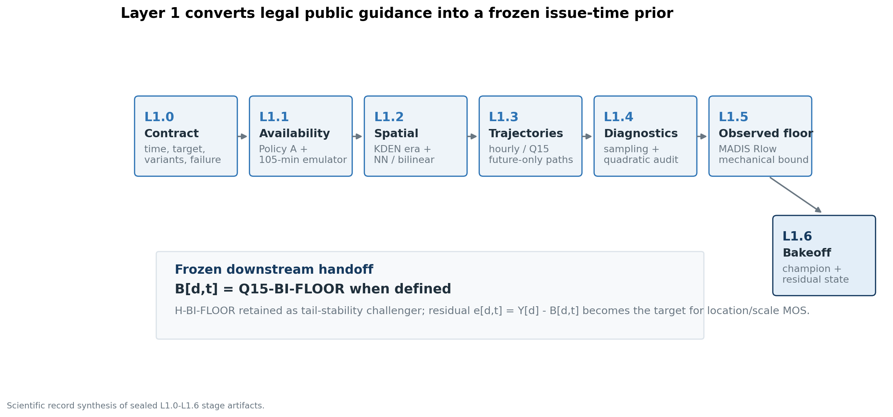
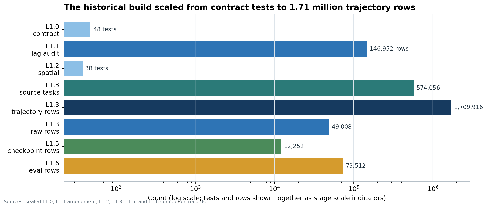
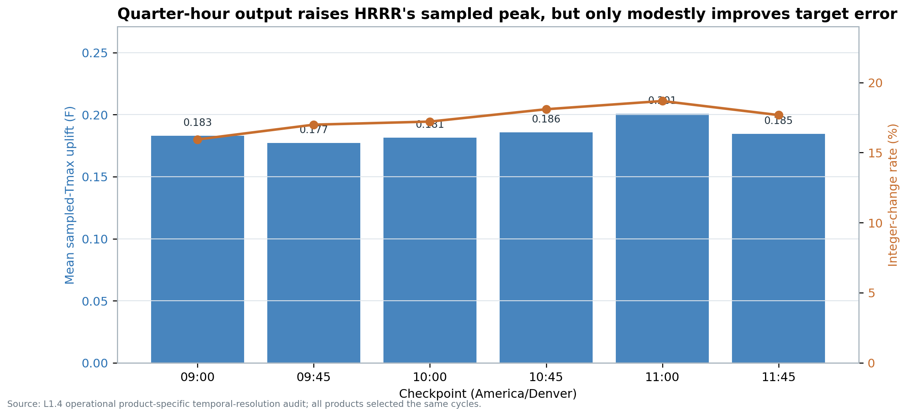
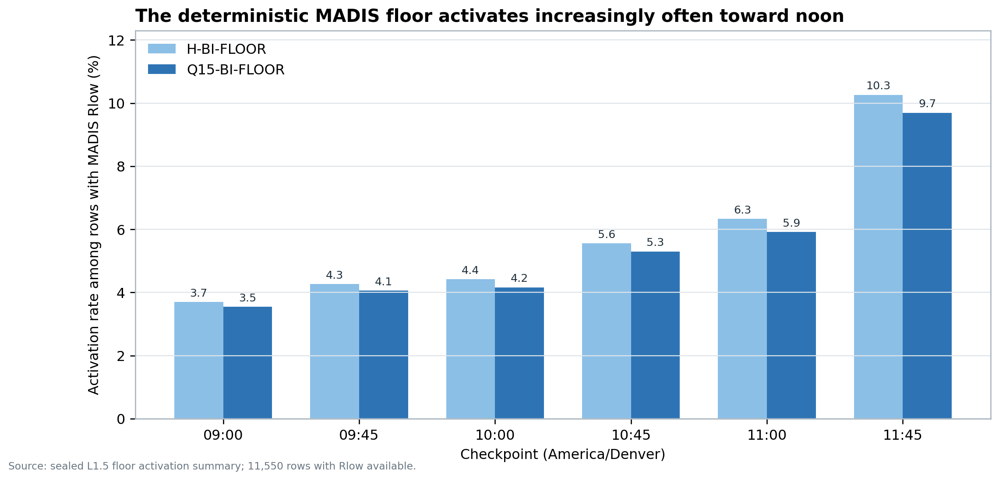
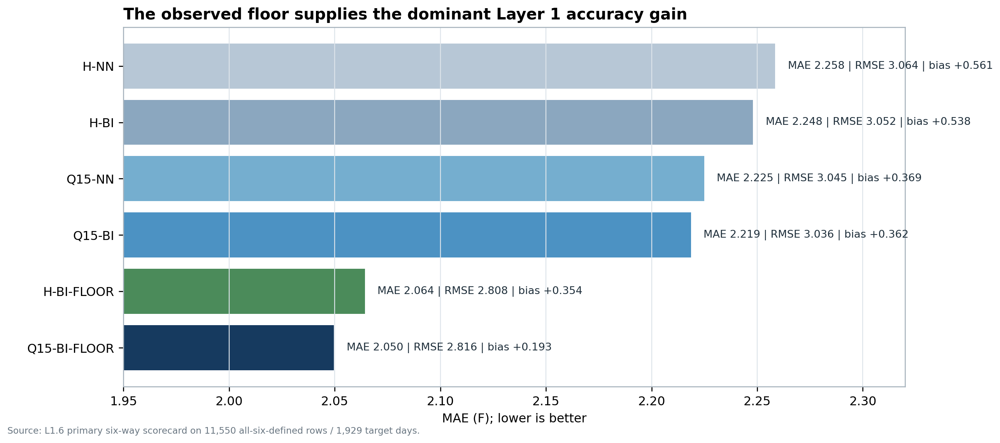
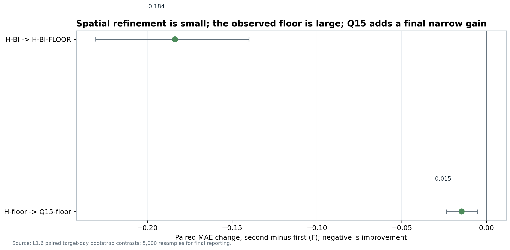
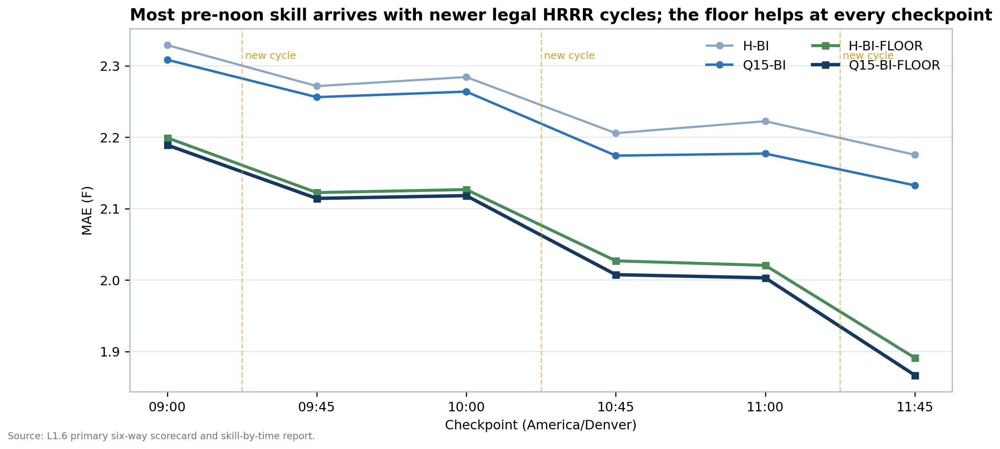
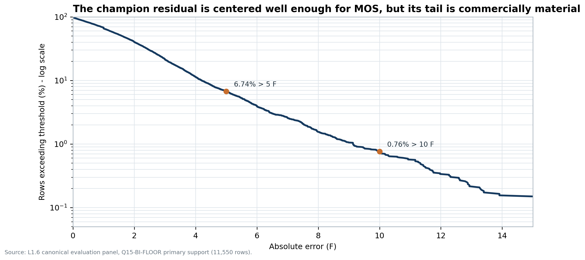
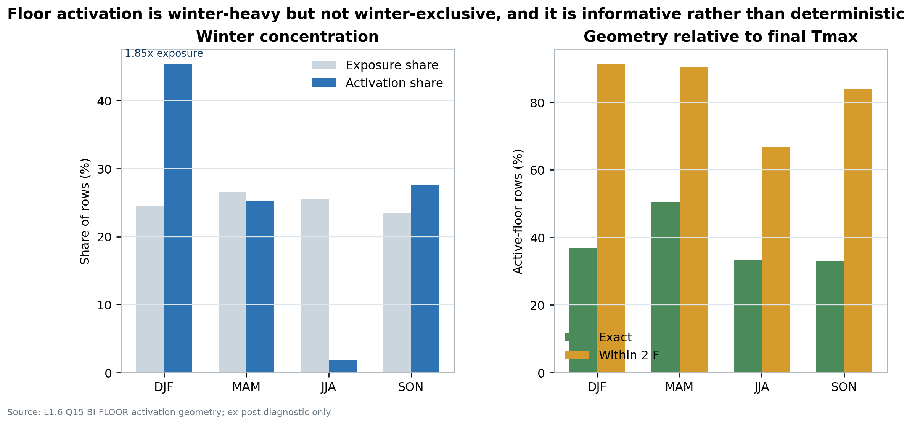
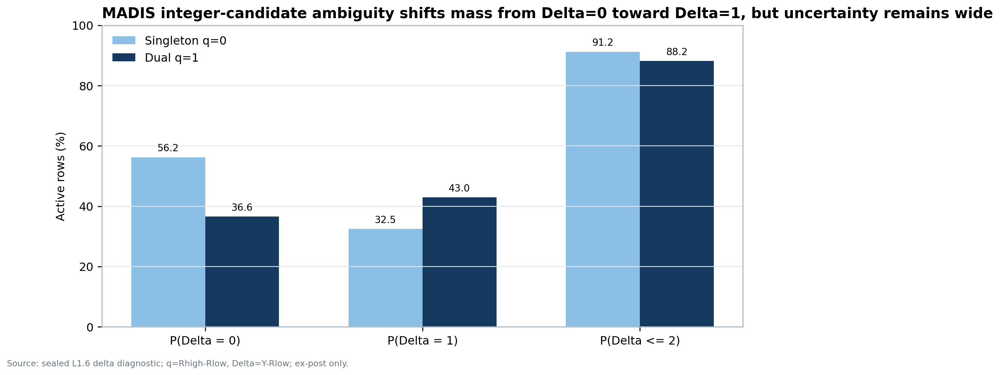

# Research reading edition

Historical document, not the current v3.75 execution contract. This GitHub reading edition preserves the source's proposals and results; they are not relabeled as completed R14 work. Agent-directed wording is retained.

Source: `KDEN_Layer_1_Scientific_Record_v1.0.docx`  
Source SHA-256: `f4be7b7c51500f7c04dad0f0e52af5a876e06bf1b47914bf396680dca3e05a2b`

Word metadata is omitted by conversion. Any additional withholding is recorded in the publication manifest.

---

**KDEN PROBABILISTIC MOS**

------------------------------------------------------------------------

KDEN Layer 1\
Scientific Record

Issue-Time HRRR Baselines, MADIS Observed Floors,\
and the Completed L1.0-L1.6 Baseline Bakeoff

Historical window: 2021-01-01 through 2026-08-04

|   **REPORT VERSION** | **1.0**                   |
|---------------------:|---------------------------|
|         **PREPARED** | **2026-08-28**            |
|   **LAYER 1 STATUS** | **Complete through L1.6** |
| **PRIMARY BASELINE** | **Q15-BI-FLOOR**          |

*Scientific archive and downstream modeling handoff*

# Contents

**Section map**

**Abstract**

**Document control and status**

**Executive findings**

**1. Scientific and commercial objective**

> 1.1 The forecast object
>
> 1.2 Why the baseline must be issue-time indexed
>
> 1.3 What Layer 1 does and does not claim

**2. Frozen Layer 1 contract**

> 2.1 Climate day and checkpoint clocks
>
> 2.2 Policy A: one coherent HRRR trajectory
>
> 2.3 Historical availability policy
>
> 2.4 Fail-closed and immutable-lineage principles

**3. Target truth and source regimes**

> 3.1 Canonical historical target
>
> 3.2 Weather.com transition
>
> 3.3 Measurement non-equivalence

**4. Stage-by-stage scientific record**

> 4.1 L1.0 - operational contract
>
> 4.2 L1.1 - source and latency audit
>
> 4.3 L1.2 - KDEN spatial extraction
>
> 4.4 L1.3 - historical trajectory engine
>
> 4.5 L1.4 - temporal resolution and peak diagnostics
>
> 4.6 L1.5 - MADIS observed lower bound
>
> 4.7 L1.6 - six-way baseline bakeoff

**5. Floor activation geometry and quantization diagnostic**

> 5.1 What activation means
>
> 5.2 Winter hypothesis
>
> 5.3 Delta diagnostic

**6. Integrated scientific interpretation**

> 6.1 Controlled attribution of Layer 1 gains
>
> 6.2 Error decomposition after Layer 1
>
> 6.3 The future-only baseline and deferred elapsed-window diagnostic

**7. Downstream location-scale GAM contract**

> 7.1 Modeling target and baseline choice
>
> 7.2 Feature families justified by Layer 1
>
> 7.3 Layer 1-specific features that should be mandatory
>
> 7.4 Distributional form
>
> 7.5 Validation and promotion

**8. State-space and live-update implications**

> 8.1 What the filter should estimate
>
> 8.2 Observation model for integer Celsius
>
> 8.3 As-of filtering discipline
>
> 8.4 Relationship to the GAM

**9. Commercial implications for KDEN Kalshi markets**

> 9.1 Baseline accuracy is necessary but not sufficient
>
> 9.2 Timing tradeoff
>
> 9.3 From whole-degree probabilities to contracts
>
> 9.4 Winter opportunity and caution

**10. Limitations, open questions, and nonclaims**

> 10.1 Historical availability truth
>
> 10.2 MADIS historical timing and gaps
>
> 10.3 Source and model transitions
>
> 10.4 Restricted feature universe
>
> 10.5 Sample size and repeated rows
>
> 10.6 Residual likelihood and tails
>
> 10.7 Deferred f00/f01 omission test
>
> 10.8 No commercial backtest in Layer 1

**11. Frozen downstream handoff**

**Appendix A. Mathematical definitions**

**Appendix B. Stage ledger and verification evidence**

**Appendix C. Data products required for reconstruction**

**Appendix D. Provenance ledger**

**Appendix E. References**

**Appendix F. Glossary**

**Closing statement**

# Abstract

This report is the durable scientific record of the completed KDEN Layer 1 program, stages L1.0 through L1.6. The program's purpose was to construct, audit, and select an issue-time external-guidance baseline for forecasting the final official daily maximum temperature at Denver International Airport (KDEN) before the event is complete. The commercial destination is a calibrated probability distribution over whole-degree Fahrenheit outcomes and Kalshi temperature-market buckets. Layer 1 intentionally stops before learned model output statistics (MOS), state-space filtering, probability calibration, market-price comparison, or trading logic.

The study covers 2,042 KDEN target days from 2021-01-01 through 2026-08-04 and six civil-time forecast checkpoints: 09:00, 09:45, 10:00, 10:45, 11:00, and 11:45 America/Denver. It reconstructs the newest legally usable coherent HRRR cycle under a frozen historical availability policy, extracts hourly and 15-minute 2-m temperature trajectories at effective-dated KDEN coordinates using nearest-node and projected bilinear methods, takes the future-only modeled maximum, optionally imposes a deterministic lower bound from MADIS high-frequency METAR observations available through the checkpoint, and scores six predeclared baseline variants against a curated settlement-equivalent KDEN Tmax truth layer.

The global Layer 1 champion is Q15-BI-FLOOR: quarter-hour HRRR 2-m temperature, projected bilinear spatial extraction, and the definitely achieved MADIS lower bound. On the primary common support of 11,550 day-checkpoint rows spanning 1,929 target days, it achieved MAE 2.050 F, RMSE 2.816 F, mean residual Y-B of +0.193 F, median absolute error 1.604 F, 34.35% within 1 F, and an 18.12% rounded-integer hit rate. H-BI-FLOOR is retained as a protected runner-up because its RMSE, error standard deviation, 95th-percentile absolute error, and maximum absolute error were all slightly lower. The paired Q15-minus-hourly floor MAE difference was -0.0147 F with a target-day clustered 95% bootstrap interval of \[-0.024, -0.005\] F. The result is real but narrow; the large improvement came from the observed floor, not from temporal or spatial refinement alone.

Layer 1 therefore hands downstream modeling a scientifically interpretable prior B\[d,t\], a matched challenger, complete as-of lineage, and a residual target e\[d,t\] = Y\[d\] - B\[d,t\]. It also identifies the next modeling problem. The champion residual retains checkpoint, seasonal, regime, and tail structure: P90/P95/P99 absolute errors are 4.199/5.605/9.137 F, 6.74% of rows exceed 5 F, and 0.76% exceed 10 F. A location-scale GAM should learn conditional residual center and uncertainty from predeclared HRRR context and as-of observation features. A later state-space model should update a latent temperature/heating-rate departure rather than average current temperature with a final-Tmax forecast. The MADIS integer-Celsius candidate interval and the logical lower-bound geometry must remain explicit in both steps.

The scientific conclusion is not that Layer 1 solved KDEN Tmax. It solved the measurement, legality, lineage, and baseline-selection problem well enough that later models can be trained against a stable object without confusing model physics, archive hindsight, observation timing, spatial extraction, temporal sampling, target corruption, or market outcomes.

# Document control and status

| **Field** | **Frozen value** |
|:---|----|
| Document title | KDEN Layer 1 Scientific Record: Issue-Time HRRR Baselines, MADIS Observed Floors, and Baseline Bakeoff |
| Version | 1.0 |
| Prepared | 2026-08-28 |
| Historical target window | 2021-01-01 through 2026-08-04, inclusive |
| Completed scope | L1.0 through L1.6 |
| Global champion | Q15-BI-FLOOR where the MADIS lower bound is defined |
| Protected runner-up | H-BI-FLOOR |
| Primary evaluation support | 11,550 all-six-defined day-checkpoint rows; 1,929 target days |
| Governing availability policy | KDEN_HIST_COMPLETE_L105_V1 |
| Report role | Archival scientific synthesis; no stage artifacts or decisions are modified |

Table 1. Frozen document control and report status.

This report is descriptive and interpretive. It reads the sealed project artifacts as evidence and restates the completed scientific contract. It does not rerun or rewrite L1.0-L1.6, retune the historical lag, alter L1.4, change the truth exception ledger, recompute MADIS bounds, fit a GAM, define a live trading threshold, or use market prices.

Administrative status note for L1.4: two historical records are intentionally preserved. The generated owner-run worksheet remains labeled OWNER_EXECUTION_COMPLETE / EMPIRICAL_EXIT_DECISION_PENDING. The subsequent engineering handoff records L1.4 as complete, PASS WITH QUALIFICATION, for progression. The project owner explicitly directed later work to treat the L1.4 decision record as immutable upstream truth and not reconcile it. This report follows that instruction: it reports the empirical output and the later handoff status without editing either source.

# Executive findings

> 1\. Layer 1 is complete through L1.6. The completed output is an issue-time baseline system, not a learned forecast model.
>
> 2\. Q15-BI-FLOOR is the primary baseline B\[d,t\] wherever the sealed MADIS R_low is defined. H-BI-FLOOR remains mandatory in downstream robustness and tail diagnostics.
>
> 3\. The MADIS lower bound was the dominant mechanical improvement. Relative to its raw parent, Q15-BI-FLOOR reduced MAE by 0.169 F; H-BI-FLOOR reduced MAE by 0.184 F. Spatial bilinear improvements were about one hundredth of a degree in overall MAE, and the final Q15-versus-hourly floor improvement was about 0.015 F.
>
> 4\. Q15 temporal resolution is nevertheless scientifically useful. Relative to hourly sampling on the same selected cycles, it raised HRRR's sampled maximum by 0.185 F on average, changed the rounded integer on 17.43% of primary rows, and produced a small but statistically resolved final MAE advantage after the floor.
>
> 5\. A guarded local quadratic interpolation was not promoted. It activated mechanically on 99.44% of eligible rows, but its average uplift was only 0.0237 F and its mean target absolute-error change was approximately +0.0003 F. It added a shape assumption without useful average score improvement.
>
> 6\. Later checkpoint skill improved primarily when a newer legal HRRR cycle became available. Same-cycle waits from 09:45 to 10:00 and 10:45 to 11:00 contributed nearly zero average change; new-cycle transitions produced materially negative MAE changes.
>
> 7\. The earliest useful tested weather checkpoint is 09:45 relative to 09:00. This is not a commercial execution threshold. Economic usefulness depends on forecast distribution quality, market prices, liquidity, fees, and how quickly the market consolidates.
>
> 8\. Floor activation is informative but not deterministic. For Q15-BI-FLOOR, 629 active rows occurred across 197 days. R_low was within 2 F of final Tmax on 88.6% of active rows and exactly equal on 39.1%.
>
> 9\. Winter is the largest activation concentration, not an overwhelming majority. DJF contributed 45.3% of activations against 24.5% of exposure, a 1.85x overrepresentation; nonwinter seasons still contributed 54.7%.
>
> 10\. MADIS whole-degree-Celsius ambiguity appears in the residual geometry only suggestively. Dual-candidate active rows had a +10.5 percentage-point excess in P(Delta=1) relative to singleton rows, but the clustered 95% interval \[-12.3, +30.3\] percentage points includes zero. Use q=R_high-R_low as a feature or observation-variance input, not a deterministic +1 F rule.
>
> 11\. The residual is suitable as a downstream modeling target but is not yet proven GAM-modelable. Its center is modestly cold, its scale and tails remain material, and the required context vector x\[d,t\] has not yet been constructed.
>
> 12\. The commercial edge must come from calibrated local residual structure, conditional uncertainty, live trajectory departures, and timing - not from using market prices inside the weather model or from retroactively selecting a convenient HRRR cycle.

Figure 1. Layer 1 converts public HRRR and MADIS information into an auditable issue-time prior and residual target.

# 1. Scientific and commercial objective

## 1.1 The forecast object

For target day d and checkpoint t, the final product is not merely one number. It is a calibrated probability mass function over the contract-authoritative whole-degree Fahrenheit maximum Y\[d\], with probabilities that can be aggregated into the exact bins offered by a KDEN Kalshi market. The upstream architecture is:

> Y\[d\] = B\[d,t\] + g_mu(x\[d,t\]) + epsilon\[d,t\]
>
> log sigma\[d,t\] = g_sigma(x\[d,t\])

B\[d,t\] is the transparent, mechanically reconstructed Layer 1 baseline. The location function g_mu learns the conditional mean residual. The scale function g_sigma learns conditional uncertainty. A later live state h(s\[d,t\]) may use filtered observation-model departures, but it must remain downstream of a validated offline prior. The final probability distribution, not point MAE alone, is what supports contract-bin probabilities and economically disciplined market decisions \[R01\].

Layer 1 was designed to answer a narrower prerequisite question: what is the best auditable external-guidance forecast that could actually have been issued at each checkpoint, before fitting a local correction? This narrowness is a feature. If Layer 1 had already embedded learned bias corrections, Kalman gains, market information, or post-event knowledge, later residual modeling could not be interpreted cleanly.

## 1.2 Why the baseline must be issue-time indexed

The same target Y\[d\] is shared by six forecast rows, but the available information changes during the morning. New HRRR cycles become usable, the remaining forecast horizon shortens, and MADIS accumulates observations. Consequently, B\[d,09:00\] and B\[d,11:45\] are different forecast states even if they sometimes have identical numeric values. Repeated rows must be preserved because downstream uncertainty, observation departures, and commercial opportunity can differ even when the raw forecast maximum repeats.

The central unit is therefore target day x checkpoint x variant. Any validation split must keep all rows from the same target day together. Treating six issue-time rows as independent days would leak day-specific information across training and validation and understate uncertainty.

## 1.3 What Layer 1 does and does not claim

Layer 1 establishes:

> • the target-day and checkpoint clocks;
>
> • the historical as-of legality rule;
>
> • a coherent HRRR cycle-selection policy;
>
> • the effective KDEN station geometry;
>
> • hourly and quarter-hour future temperature trajectories;
>
> • transparent spatial and temporal variants;
>
> • a deterministic observed lower bound;
>
> • matched scoring and bootstrap comparisons;
>
> • a frozen champion, protected challenger, and residual target.

Layer 1 does not establish:

> • that the remaining residual is learnable by any particular model class;
>
> • that a 09:45 weather forecast is commercially superior to a later forecast;
>
> • that winter floor activation guarantees the final maximum;
>
> • that R_high is a valid lower bound;
>
> • that a Gaussian residual is adequate;
>
> • that Weather.com, NWS CLI, IEM, MADIS, and HRRR measure the same physical quantity;
>
> • that the 105-minute historical availability emulator equals literal historical first-public availability;
>
> • any trading strategy, position sizing rule, or expected profit.

# 2. Frozen Layer 1 contract

## 2.1 Climate day and checkpoint clocks

The KDEN target window is fixed in standard time:

> W\[d\] = \[07:00Z on d, 07:00Z on d+1)

The interval is left-inclusive and right-exclusive. It corresponds to midnight-to-midnight Mountain Standard Time and does not move for daylight saving time. In contrast, checkpoint labels use the America/Denver civil clock and therefore resolve to UTC-7 in MST and UTC-6 in MDT. UTC governs all persisted joins; local checkpoint labels are materialized for scheduling and interpretation.

| **Checkpoint ID** | **Civil time** | **UTC in MST** | **UTC in MDT** |
|:------------------|----------------|----------------|----------------|
| CP_0900           | 09:00          | 16:00Z         | 15:00Z         |
| CP_0945           | 09:45          | 16:45Z         | 15:45Z         |
| CP_1000           | 10:00          | 17:00Z         | 16:00Z         |
| CP_1045           | 10:45          | 17:45Z         | 16:45Z         |
| CP_1100           | 11:00          | 18:00Z         | 17:00Z         |
| CP_1145           | 11:45          | 18:45Z         | 17:45Z         |

Table 2. Frozen issue checkpoints and UTC resolution.

The remaining future window is strict:

> W_future\[d,t\] = {tau in W\[d\] : tau \> t}

A model valid time equal to t is not future guidance. The elapsed portion of the day is represented separately by observed bounds. This separation is essential for interpreting floor activation: an activation means the achieved observed lower bound exceeds HRRR's forecast of the remaining future maximum. It does not automatically mean HRRR failed to represent the earlier modeled peak, and it does not justify redefining the completed baseline after seeing outcomes.

## 2.2 Policy A: one coherent HRRR trajectory

For product p, candidate cycle c, target day d, and checkpoint t, define the required valid-time set as the intersection of the product grid with W_future\[d,t\]. A cycle is complete only if every required component was legally usable by t and the cycle is horizon-sufficient. Policy A selects the newest such cycle independently for the hourly and subhourly products.

> c_star(d,t,p) = max {c : Complete(c,p,d,t) = 1}

The entire remaining trajectory comes from c_star. No cross-cycle splice, valid-time mosaic, or replacement of an older tail with a newer partial cycle is allowed. This protects scientific attribution: a baseline row represents what one internally coherent model initialization predicted, not an artificial path with a seam between disagreeing cycles.

Policy A is deliberately conservative. It may forgo some partial information from a newer run. A future research layer may preserve newer partial-cycle revisions as separate features, but it must not silently stitch them into the Layer 1 raw baseline.

## 2.3 Historical availability policy

Historical archives reveal what eventually existed, not exactly what could be downloaded at t. L1.1 found no trustworthy retrospective first-public ledger for every required HRRR object. The project therefore froze the policy-based emulator:

> A_hat_complete(c,p,q) = c + 105 minutes

The primary policy ID is KDEN_HIST_COMPLETE_L105_V1. The rule applies to both wrfsfcf and wrfsubhf and remains subject to product horizon constraints. Ninety- and ninety-five-minute policies were frozen as sensitivities before forecast scoring. They selected identical cycles at every audited checkpoint because of the checkpoint minute offsets and whole-hour cycles; this mechanical invariance is not evidence that the shorter lags were historically reliable.

The emulator states when the backtest is permitted to treat a cycle as usable. It does not claim that every required historical file was literally public, stable, and parseable at c+105 minutes. Live operation must inspect actual file existence, coverage, and usability and must not substitute the emulator where direct evidence exists.

## 2.4 Fail-closed and immutable-lineage principles

Layer 1 produces no value when critical identity or legality is missing. Missing station metadata, missing source hashes, ambiguous target binding, incomplete valid-time coverage, mixed cycles, unregistered variants, future-known availability evidence, or duplicate row identities are explicit failures. Raw source objects and stage artifacts are immutable; corrections create versioned records rather than silently overwriting lineage.

This discipline was repeatedly important in practice. Acquisition exposed authentic remote gaps, a cache rename race, a direct connection-disconnect path that bypassed ordinary retries, and severe performance degradation from recursive cache scans. Each issue was fixed narrowly without relaxing scientific guards, and every completed stage reverified upstream identity.

# 3. Target truth and source regimes

## 3.1 Canonical historical target

Each target day has one curated whole-degree Fahrenheit outcome:

> Y\[d\] = Y_settlement_recon\[d\]

The historical source is IEM's parsed NWS CLI archive, curated under a frozen CLI-primary, CF6-fallback policy aligned with the contract-authoritative KDEN climate day. The output preserves the raw IEM value and the curated value separately. It contains exactly 2,042 contiguous dates, with yearly partitions of 365, 365, 365, 366, 365, and 216 rows for 2021 through the partial 2026 period \[R04\].

Three dates have explicit ledger entries:

| **Target date** | **Raw IEM** | **Curated Y** | **Disposition** |
|:---|----|----|----|
| 2021-01-20 | 39 F | 59 F | Guarded repair; completed CLIDEN and CF6 both support 59 F |
| 2022-04-18 | 80 F | 65 F | Guarded repair; completed CLIDEN and CF6 both support 65 F |

Table 3. Curated target truth exception ledger.

The two repaired rows were later malformed or misdated atomic-table replacements, not arbitrary outlier adjustments. The code asserted the expected raw values before applying the ledger. Exactly two rows have numeric_mutation=true and exactly one uses CF6_FALLBACK. No day was dropped because it was difficult.

## 3.2 Weather.com transition

The backtest ends before Kalshi's announced 2026-08-14 transition to The Weather Company as the contractual settlement provider. Weather.com enters the architecture as a settlement and provenance layer, not as a forecast predictor. For future live markets, the project must capture the Weather.com official value at publication time and retain IEM/NWS evidence as an audit comparator. A generic Weather.com historical daily-summary product is not interchangeable with the dedicated Kalshi official-climate source or with the fixed 07:00Z KDEN climate day.

The durable target concept is contract-authoritative KDEN settlement Tmax with an explicit source-regime field. The historical backtest uses NWS_DIRECT_PRE_TWC; future records require a TWC_CLI_PRIMARY_CF6_BACKUP regime and a discrepancy flag if the frozen Weather.com value and later NWS archive differ.

## 3.3 Measurement non-equivalence

HRRR 2-m temperature is an instantaneous gridded model state. MADIS HFMETAR is a high-cadence station observation reported in whole degrees Celsius. CLI/CF6 is the official daily climate product used to define Y\[d\]. These are related but not interchangeable. MADIS cannot replace Y\[d\], and CLI cannot serve as a live five-minute state measurement. The later model must learn and propagate these differences rather than collapse them into one presumed exact temperature process.

# 4. Stage-by-stage scientific record

Figure 2. Scale of the completed Layer 1 evidence trail. Counts combine tests, audit rows, source tasks, and output rows to show the engineering progression.

## 4.1 L1.0 - operational contract

L1.0 froze the meanings that every later computation depended on: climate-day window, civil checkpoints, strict future-only filter, row identity, station and target registries, HRRR products, Policy A, baseline variants, lineage, split discipline, and fail-closed behavior. It produced no forecast data. Its value was preventing downstream code from inventing slightly different time zones, target definitions, cycle rules, or floor semantics.

The final suite passed 48 of 48 tests. The checks covered winter, summer, and daylight-saving transition dates; half-open climate-window boundaries; all checkpoint conversions; strict tau\>t behavior; newest-cycle selection and whole-cycle fallback; product separation; no-splicing; exact and conservative availability modes; rejection of archive hindsight; repeated-row preservation; and lineage failures. L1.0 passed for progression to L1.1.

Scientific implication: operational definitions are part of the statistical model. A one-hour target-window shift, use of a later archive file, or deduplication of repeated checkpoint rows would change the estimand and could create apparent skill with no meteorological basis.

## 4.2 L1.1 - source and latency audit

The initial L1.1 audit completed its source investigation but placed exact-first-seen certification on HOLD because no trustworthy retrospective public-availability ledger existed. That finding remains immutable. Change request CR-L1-001 then made a governance decision: accept the limitation, freeze the 105-minute emulator, retain 90/95 sensitivities, and progress without claiming literal historical first-public timing.

The amended gate passed. The exhaustive checkpoint-lag audit contained 146,952 rows: 2,041 target days through 2026-08-03 x six checkpoints x two products x two cycle classes x three lag scenarios. All 90/95/105 scenarios selected the same cycles at all checkpoints. The wrfsubhf extended 12Z class could not cover the last required 15-minute valid time because its subhourly horizon remained FH18; normal Policy A correctly selected a newer horizon-sufficient ordinary cycle rather than splicing or reclassifying data.

The original package passed 63 tests and verified a 74-entry manifest. The amendment passed 24 tests and verified 14 manifest entries. Live Policy A was kept distinct from historical emulation: the live selector inspects actual files and has no lag parameter.

Scientific implication: availability policy is a governance assumption, not a tuning parameter. Because the registered lag sensitivities were score-invariant here, baseline differences are not an artifact of choosing 105 minutes over 90 or 95. The deeper unresolved limitation is historical timing truth, which must remain disclosed.

## 4.3 L1.2 - KDEN spatial extraction

L1.2 converted a native HRRR grid field into a KDEN point value under frozen effective station metadata. The station registry preserved two coordinate eras relevant to the historical panel:

| **Era ID** | **Effective dates** | **Latitude** | **Longitude** | **Ground elevation** |
|:---|----|----|----|----|
| KDEN_COORD_20040105 | 2004-01-05 through 2021-11-21 | 39.83280 | -104.65750 | 1650.2 m |
| KDEN_COORD_20211122 | 2021-11-22 onward | 39.84657 | -104.65623 | 1647.2 m |

Table 4. Effective KDEN station-coordinate eras.

The coordinate displacement is 1,535.466324 m. HOMR documents a DCP/GIS metadata boundary; it does not prove a physical sensor relocation. L1.2 therefore used the effective coordinates without asserting a confirmed relocation.

Two extraction rules were implemented. Nearest node returns the closest HRRR node. Projected bilinear extraction transforms the station into the HRRR Lambert conformal grid, identifies the four surrounding nodes, and applies nonnegative weights that sum to one. The extraction retains Kelvin values and converts to Fahrenheit only downstream. A fixed lapse-rate correction was deliberately set to zero: a universal environmental lapse rate is not defensible at KDEN under inversions, cold pools, downslope flow, and mixed boundary layers.

The stage tested real bounded NOAA GRIB2 messages for wrfsfcf and wrfsubhf, verified 1,905,141 grid values per field with no missing values, reproduced full grid metadata, and retained exact byte ranges and SHA-256 source identity. Thirty-eight of 38 L1.2 tests passed; source and artifact manifests verified 14/14 and 47/47 entries. The operational hourly and subhourly grids were identical in registered geometry while product, cycle, valid-time, and source lineage remained distinct.

Scientific implication: nearest-versus-bilinear comparison isolates point-extraction sensitivity without injecting a learned station correction. Any persistent grid-elevation or local siting mismatch belongs later in residual diagnostics and MOS.

## 4.4 L1.3 - historical trajectory engine

L1.3 scaled the frozen contract, availability rule, and spatial extractor across the full 2021-01-01 through 2026-08-04 period. For each target day, checkpoint, product, spatial method, and registered availability policy, it selected the legal whole cycle, enumerated every required future valid time, retrieved the exact TMP:2 m message range, extracted KDEN values, and summarized the discrete maximum while retaining the long trajectory and source lineage.

The pilot used eight target dates, 904 parent files, 2,204 exact TMP ranges, 6,564 trajectory rows, and 192 raw baseline rows. The final sealed panel contained:

| **L1.3 quantity**      | **Count**     |
|:-----------------------|---------------|
| Target days            | 2,042         |
| Source tasks           | 574,056       |
| Long trajectory rows   | 1,709,916     |
| Raw baseline rows      | 49,008        |
| Reconciled cache files | 809,396       |
| Reconciled cache bytes | 3,583,095,277 |
| Artifact entries       | 26,553        |
| Source-lineage entries | 1,397,883     |

Table 5. Full-history L1.3 scale.

Every registered partition hash, schema, terminal task state, trajectory grid, cycle-coherence rule, temporal spacing, recomputed maximum, lag-policy equivalence row, and repeated-row audit passed. The final L1.3 gate is PASS.

Three engineering incidents are part of the scientific record because they threatened reproducibility or completeness:

> • A time-of-check/time-of-use race occurred when a cache scan saw a temporary .partial file while another worker atomically renamed it. Locking and reconciliation were added without changing accepted data.
>
> • A direct RemoteDisconnected exception bypassed the ordinary retry path. A narrow retry fix was added for that transport failure.
>
> • Recursive cache accounting on every request caused severe slowdown as the cache grew. Incremental O(1) accounting produced an approximately 406x improvement in the affected operation while preserving deterministic counts and identities.

Scientific implication: L1.3 is the provenance backbone. It makes every later score traceable to one cycle, one set of valid times, one product, one spatial rule, and immutable source bytes. It also proves that acquisition engineering can materially affect scientific completeness even when equations remain unchanged.

## 4.5 L1.4 - temporal resolution and peak diagnostics

L1.4 was a read-only analysis of the sealed L1.3 trajectories. It separated four concepts:

> • operational product-specific hourly versus Q15 maxima;
>
> • the naturally matched same-cycle subset;
>
> • pure Q15 downsampling to UTC-hour-aligned timestamps within the same Q15 trajectory;
>
> • a guarded Q15-BI local quadratic peak challenger.

The main comparison used the same selected cycle on every paired row, and the pure downsample result matched the product-specific result. This establishes that the observed difference was temporal sampling of the modeled trajectory, not newer-cycle selection.

Across the primary 105-minute policy's 24,504 product-spatial rows, Q15 minus hourly sampled Tmax had mean +0.185 F, median +0.092 F, 95th-percentile absolute difference +0.722 F, and maximum +8.118 F. The difference was never negative. The rounded Fahrenheit integer changed on 4,272 rows, or 17.43%, and 1,209 of 2,042 target days changed on at least one checkpoint/variant. The first modeled peak shifted by a median absolute 15 minutes, mean 20.71 minutes, 95th percentile 45 minutes, and maximum 285 minutes.

Figure 3. Q15 temporal resolution raises the sampled HRRR maximum and changes the rounded integer on a material minority of rows.

The target impact was smaller. For Q15-BI raw baseline, full-history MAE by checkpoint was 2.321, 2.266, 2.268, 2.175, 2.177, and 2.126 F from 09:00 through 11:45. The 09:00-to-11:45 improvement was 0.195 F, about 8.4%, with the gains concentrated where new cycles became legal. These figures use L1.4's full raw-baseline support; later L1.6 common-support figures differ slightly because the bakeoff requires all six variants to be defined.

The guarded quadratic challenger required a concave local neighborhood, a vertex inside the adjacent interval, preservation of the sampled maximum, and a 2.0 F uplift cap. Across 36,756 rows pooled over registered policies, it mechanically activated on 99.44%, but mean accepted uplift was only 0.0237 F, median 0.0064 F, maximum 1.779 F, and the mean target absolute-error change was +0.0003 F. No row hit the cap. The method added no learned information and no useful average improvement, so it was not promoted.

Scientific implication: quarter-hour output matters primarily because maxima are nonlinear sampling operators. It improves the representation of HRRR's own trajectory and modestly improves target MAE. A free learned peak uplift does not belong in Layer 1; if local peak-shape information is useful, it should be tested within downstream MOS with out-of-sample controls.

## 4.6 L1.5 - MADIS observed lower bound

L1.5 introduced one logical live fact: the final daily maximum cannot be below a temperature that has definitely already occurred. The historical acquisition was built as a self-contained KDEN HFMETAR program and stored full observation rows separately from checkpoint summaries.

### 4.6.1 Observation-time policy

The project owner explicitly chose not to make receipt-time or QC-timestamp research a blocker. Historical checkpoint eligibility uses MADIS observationTime as a pseudo-live availability proxy and requires observationTime \<= checkpoint. Receipt, insertion, modification, recovery, and QC timestamps are not used. The program never admits an observation timestamped after the checkpoint and never fabricates a five-minute grid.

This is a documented limitation rather than hidden certainty. It prevents direct timestamp leakage, but it does not prove the file was received and parsed at exactly its observation timestamp in historical operations. Any live deployment must use actual receipt state and can maintain an operational buffer if needed.

### 4.6.2 Integer-Celsius candidate geometry

MADIS KDEN HFMETAR temperature is reported in whole degrees Celsius. One C report can imply one or two whole-Fahrenheit integers. For integer c, the candidate interval is generated exactly from rational bounds:

> k_low = ceil((18c + 311) / 10)
>
> k_high = ceil((18c + 329) / 10) - 1

Examples are 20 C -\> {68}, 21 C -\> {69,70}, and 25 C -\> {77}. Values farther than 0.02 C from an integer are excluded as non-integer anomalies; the full history contained zero such retained anomalies. No arbitrary market-temperature range is imposed.

For all legal observations o from the opening of W\[d\] through checkpoint t:

> R_low\[d,t\] = max k_low(o)
>
> R_high\[d,t\] = max k_high(o)

R_low is a definitely achieved whole-F lower bound. R_high is diagnostic ambiguity, not a guaranteed lower bound. The two new variants are:

> H-BI-FLOOR = max(H-BI, R_low)
>
> Q15-BI-FLOOR = max(Q15-BI, R_low)

### 4.6.3 Acquisition and completeness

The program dynamically tried eight equivalent archive host/public/case routes and remembered a working route only as a preference. Confirmed missing HFMETAR hours became explicit source gaps; the incompatible standard point/METAR product was not substituted. Resume mode verified output hashes before skipping completed days, making interruption and restart safe and deterministic.

The full acquisition requested 23,164 source hours, downloaded 22,159, and recorded 1,005 missing hours. It produced 255,921 observation rows, including 28,621 singleton-candidate and 227,205 dual-candidate rows, plus 12,252 checkpoint rows. One hundred target days were complete with source gaps. The result had 1,942 complete days and no failed days. At the six checkpoints, R_low was defined on 11,550 rows and missing on 702.

All 12,252 MADIS checkpoint keys joined exactly to L1.3. If R_low was missing, both raw parents and their lineage remained present while floor values, deltas, and activation flags stayed null. The stage never fabricated a floor or silently substituted the raw parent into the canonical floor field. Twenty-six of 26 acceptance checks passed, an independent temporary build was byte-identical, consumed inputs remained unchanged, and the L1.4 tree remained unchanged. L1.5 passed.

Figure 4. The MADIS floor activates more frequently at later checkpoints as the observed day captures more of the eventual maximum.

Scientific implication: B_floor is a hybrid of forecast remaining maximum and observed elapsed lower bound. It is still unlearned, but its piecewise max geometry changes the residual distribution. Floor-active residuals are Y-R_low and cannot be negative when truth and observation lineage are consistent. That structural constraint is valuable downstream and must not be mistaken for a conventional additive bias correction.

## 4.7 L1.6 - six-way baseline bakeoff

L1.6 joined the curated truth layer to six frozen variants:

| **Variant**  | **Product**  | **Spatial method** | **Observed floor** |
|:-------------|--------------|--------------------|--------------------|
| H-NN         | Hourly       | Nearest node       | No                 |
| H-BI         | Hourly       | Projected bilinear | No                 |
| Q15-NN       | Quarter-hour | Nearest node       | No                 |
| Q15-BI       | Quarter-hour | Projected bilinear | No                 |
| H-BI-FLOOR   | Hourly       | Projected bilinear | R_low              |
| Q15-BI-FLOOR | Quarter-hour | Projected bilinear | R_low              |

Table 6. 4.7 L1.6 - six-way baseline bakeoff.

Q15-BI-QUAD was excluded from the bakeoff because L1.4 did not promote it. The canonical long evaluation panel contains 73,512 rows. The primary six-way comparison uses only the 11,550 rows where every variant is defined, spanning 1,929 target days. The 702 missing-floor rows remain null; a separately labeled raw-parent fallback is an operational sensitivity, not a redefinition of L1.5.

### 4.7.1 Overall scorecard

| **Variant** | **MAE** | **RMSE** | **Bias Y-B** | **Median AE** | **Error SD** | **P95 AE** | **Within 1 F** | **Rounded hit** |
|:---|----|----|----|----|----|----|----|----|
| H-NN | 2.258 | 3.064 | +0.561 | 1.809 | 3.012 | 6.031 | 29.52% | 15.09% |
| H-BI | 2.248 | 3.052 | +0.538 | 1.786 | 3.004 | 6.018 | 29.62% | 15.64% |
| Q15-NN | 2.225 | 3.045 | +0.369 | 1.742 | 3.023 | 6.029 | 30.22% | 15.90% |
| Q15-BI | 2.219 | 3.036 | +0.362 | 1.743 | 3.015 | 6.025 | 30.29% | 16.10% |
| H-BI-FLOOR | 2.064 | 2.808 | +0.354 | 1.652 | 2.785 | 5.468 | 33.85% | 17.70% |
| Q15-BI-FLOOR | 2.050 | 2.816 | +0.193 | 1.604 | 2.810 | 5.605 | 34.35% | 18.12% |

Table 7. Primary six-way common-support scorecard.

All temperatures and errors in the scorecard are Fahrenheit. Positive bias means the baseline is low/cold on average because the residual is defined as Y-B.

Figure 5. Six-way common-support leaderboard. The observed-floor variants create the dominant accuracy improvement.

Relative to H-NN, the champion reduces MAE by 0.209 F, about 9.25%, while improving within-1-F rate by 4.83 percentage points and rounded-integer hit rate by 3.03 points. The progression is not evenly distributed. Projected bilinear extraction improves MAE only slightly. Q15 temporal resolution gives a small further gain and substantially reduces cold bias. The observed floor supplies most of the reduction in MAE, RMSE, and upper quantiles.

### 4.7.2 Pairwise attribution

The final paired comparisons resampled target days 5,000 times. Negative MAE difference means the second variant improved.

| **Change** | **Overall MAE difference** | **Interpretation** |
|:---|----|----|
| H-NN -\> H-BI | -0.0106 F | Small, resolved spatial benefit |
| Q15-NN -\> Q15-BI | -0.0068 F | Small; interval includes no effect |
| H-BI -\> Q15-BI | -0.0285 F | Temporal resolution improves raw baseline and reduces cold bias |
| H-BI -\> H-BI-FLOOR | -0.1837 F | Large deterministic floor benefit |
| Q15-BI -\> Q15-BI-FLOOR | -0.1690 F | Large deterministic floor benefit |
| H-BI-FLOOR -\> Q15-BI-FLOOR | -0.0147 F | Narrow but resolved champion advantage |

Table 8. Paired Layer 1 design effects.

Figure 6. Paired MAE effects with target-day clustered bootstrap intervals.

The Q15-versus-hourly floor comparison illustrates why the runner-up is protected. Q15-BI-FLOOR has MAE lower by 0.0147 F, bias improved by 0.1615 F, median absolute error lower by 0.0479 F, within-1-F rate higher by 0.49 points, and rounded hit higher by 0.42 points. However, its RMSE is higher by 0.0086 F, error SD higher by 0.0245 F, P95 absolute error higher by 0.136 F, and maximum absolute error higher by 1.048 F. Q15 wins MAE at all six checkpoints, four of six year strata, and three of four seasons; H has small MAE advantages in 2025 and the partial 2026 period.

The exit decision is therefore GLOBAL_CHAMPION_WITH_PROTECTED_RUNNER_UP, not unconditional retirement of hourly guidance.

### 4.7.3 Skill by checkpoint

For Q15-BI-FLOOR, common-support MAE fell from 2.189 F at 09:00 to 1.867 F at 11:45. The corresponding H-BI-FLOOR values were 2.199 and 1.891 F. Adjacent checkpoint changes show the information source:

| **Transition** | **Cycle status** | **Q15 floor MAE change** | **95% CI** |
|:---|----|----|----|
| 09:00 -\> 09:45 | Newer legal cycle | -0.079 F | \[-0.113, -0.045\] |
| 09:45 -\> 10:00 | Same selected cycle | -0.002 F | \[-0.005, 0.000\] |
| 10:00 -\> 10:45 | Newer legal cycle | -0.113 F | \[-0.150, -0.076\] |
| 10:45 -\> 11:00 | Same selected cycle | -0.005 F | \[-0.010, -0.001\] |
| 11:00 -\> 11:45 | Newer legal cycle | -0.136 F | \[-0.173, -0.100\] |

Table 9. Adjacent-checkpoint skill changes for Q15-BI-FLOOR.

Figure 7. Checkpoint MAE paths. Dashed markers indicate transitions where a newer legal cycle became available.

The same-cycle waits are not exactly identical because the future-only horizon shrinks and additional MADIS observations may change the floor, but their average contribution is very small. New-cycle transitions change many individual forecasts and drive the material average gains. The earliest useful tested checkpoint hypothesis is 09:45. It is a weather-skill statement, not a claim that 09:45 maximizes trading value.

### 4.7.4 Residual and tail state

On primary support, the Q15-BI-FLOOR residual has MAE 2.050 F, RMSE 2.816 F, bias +0.193 F, and error SD 2.810 F. Its P90/P95/P99 absolute errors are 4.199/5.605/9.137 F, maximum absolute error is 23.569 F, 6.74% of rows exceed 5 F, and 0.76% exceed 10 F.

Figure 8. Empirical absolute-error exceedance curve for the Layer 1 champion.

The positive mean residual is small relative to the raw baselines but not zero. More importantly, one global scale cannot describe the full distribution. Calendar year, season, checkpoint, floor state, and meteorological regime remain plausible sources of conditional center and variance. These findings motivate the location-scale MOS layer; they do not prove a GAM will capture the structure.

Thirty-five of 35 L1.6 acceptance checks passed. Fifty-one artifacts were sealed, the core build was byte-identical on independent repetition, and consumed upstream identity remained unchanged. The L1.6 exit gate is PASS.

# 5. Floor activation geometry and quantization diagnostic

## 5.1 What activation means

The Q15 floor activates when R_low \> Q15-BI, meaning that a definitely achieved elapsed-day temperature exceeds HRRR's sampled prediction of the remaining future maximum. Across available rows, Q15-BI-FLOOR activated 629 times on 197 target days, or 5.45%. The activation rate rose from 3.54% at 09:00 to 9.69% at 11:45.

This increase is partly structural. As t advances, W_future shortens, the modeled remaining maximum may decline, and the observed running lower bound can only stay constant or rise. An activation is therefore not a pure label for HRRR cold bias. It identifies a forecast state in which elapsed reality, remaining forecast heating, and the max operator meet at a boundary.

On active rows, the mean Y-R_low gap was 1.030 F, the median was 1 F, P90 was 3 F, and the maximum was 8 F. R_low exactly equaled final Tmax on 39.1%, was within 1 F on 80.8%, and within 2 F on 88.6%. No negative gap rows occurred, supporting the internal consistency of the lower-bound construction and curated target.

## 5.2 Winter hypothesis

DJF supplied 285 of the 629 Q15 activations, 45.3%, despite only 24.5% of available-row exposure. The lift is 1.85x. MAM supplied 25.3%, SON 27.5%, and JJA 1.9%. Winter is therefore strongly overrepresented and scientifically important, but it is not an overwhelming majority: 54.7% of activations occur outside DJF.

Figure 9. Seasonal activation concentration and active-floor geometry. All final-Tmax gap calculations are ex-post diagnostics.

At 09:00, active R_low was within 2 F of final Tmax on 100% of rows and exact on 45.6%. At 11:45, within-2-F concentration fell to 81.8% and exact rate to 31.0%, even as activation became more frequent. Later activation therefore does not imply greater certainty about the final maximum. It can reflect early or plateaued heating, but it can also occur while meaningful additional warming remains.

A winter-aware specialist is scientifically plausible, but L1.6 does not authorize live routing. The first downstream test should be a preregistered interaction within the GAM - for example floor_active x season x checkpoint x remaining modeled heating - evaluated by rolling-origin target-day folds. A separate winter mixture-of-experts model would be a later challenger only if the interaction is too restrictive and sample size supports the additional degrees of freedom.

## 5.3 Delta diagnostic

For active Q15 rows, define q=R_high-R_low and Delta=Y-R_low. q=0 is a singleton integer-candidate interval and q=1 is a dual-candidate interval; it does not count observations. The diagnostic compared 80 singleton rows across 33 days with 549 dual rows across 170 days.

| **Metric**   | **q=0 singleton** | **q=1 dual** | **Dual minus singleton** |
|:-------------|-------------------|--------------|--------------------------|
| P(Delta=0)   | 56.2%             | 36.6%        | -19.6 pp                 |
| P(Delta=1)   | 32.5%             | 43.0%        | +10.5 pp                 |
| P(Delta\<=2) | 91.2%             | 88.2%        | -3.1 pp                  |
| Mean Delta   | 0.738 F           | 1.073 F      | +0.335 F                 |
| Median Delta | 0 F               | 1 F          | +1 F                     |

Table 10. Active-floor Delta distribution by candidate width.

Figure 10. Pooled active-floor Delta distribution by MADIS candidate width.

The pooled P(Delta=1) excess is +10.5 percentage points with a target-day clustered 95% interval of \[-12.3, +30.3\] points. The point estimate was positive at all six checkpoints, but zero of six checkpoint intervals excluded zero. DJF and the extended November-March split were directionally positive; MAM had a positive interval, while SON was negative and JJA had only one singleton row.

The sealed decision is SUGGESTIVE_NOT_ROBUSTLY_STRATIFIED. Candidate ambiguity may visibly enter the residual distribution, but the comparison is not a clean causal experiment. q should be preserved as an as-of feature, interaction, or observation-error input. It does not justify adding one degree to dual-candidate floors.

# 6. Integrated scientific interpretation

## 6.1 Controlled attribution of Layer 1 gains

Layer 1 intentionally constructed variants that isolate different error sources:

> • nearest versus bilinear probes spatial representation at KDEN;
>
> • hourly versus Q15 probes temporal sampling of HRRR's own trajectory;
>
> • raw versus floor probes the value of an incontrovertible elapsed-day constraint;
>
> • checkpoints probe newer-cycle information and changing observed state;
>
> • the quadratic challenger probes an interpolation shape assumption;
>
> • 90/95/105 policies probe availability-emulator sensitivity.

The empirical hierarchy is clear. Spatial interpolation is a small average improvement. Quarter-hour temporal resolution is larger and particularly helpful for reducing cold bias and preserving a more faithful modeled peak, but its final central-score advantage over the hourly floor is narrow. The observed floor is the dominant mechanical improvement. Availability-lag sensitivity is nil over the tested checkpoints because all three frozen lags select the same cycles. The quadratic interpolation adds no useful average target skill.

This hierarchy does not mean spatial and temporal details are unimportant. They establish physical coherence and prevent residual modeling from being forced to learn avoidable representation errors. But the project should allocate future complexity accordingly: spend most modeling capacity on conditional meteorological error and observation-model evolution, not on increasingly elaborate interpolation of one deterministic temperature curve.

## 6.2 Error decomposition after Layer 1

The champion residual can be conceptualized as:

> e_total = e_dynamics + e_initialization + e_grid + e_temporal + e_target + e_availability + e_observation

Layer 1 does not statistically identify these terms from one scalar residual. It reduces or audits them through controlled design:

| **Component** | **Layer 1 control** | **Residual downstream concern** |
|:---|----|----|
| Availability | Policy A, frozen emulator, source lineage | Historical emulator differs from literal publication timing |
| Grid/station | Effective coordinates; NN/BI variants | Persistent local representativeness and elevation mismatch |
| Temporal sampling | Hourly/Q15 and pure downsample | Sub-Q15 physical/model trajectory, max timing |
| Observation constraint | R_low floor; R_high diagnostic | Candidate ambiguity, receipt timing, observation-model mismatch |
| Target | Curated CLI/CF6 truth ledger | Provider regime and future publication discrepancies |
| Dynamics/initialization | Coherent HRRR cycles | Cloud, radiation, wind, PBL, moisture, snow, convection, model revision |

Table 11. Error components and Layer 1 controls.

The remaining residual should therefore be modeled with physically interpretable state and regime variables, not with a generic calendar smoother alone.

## 6.3 The future-only baseline and deferred elapsed-window diagnostic

The binding baseline uses HRRR only over tau\>t and represents the elapsed day with MADIS R_low. A separate question raised after L1.5 asks whether an all-legally-available same-cycle maximum over a broader part of W\[d\], including f00/f01 or other elapsed valid times carried by the selected cycle, would explain some late activations or improve performance.

That question remains deferred by owner direction. It does not reopen L1.4-L1.6. Any future f00/f01 omission test must be a separately sealed sensitivity with exact support and lineage. It should compare the completed strict-future baseline against a same-cycle alternative without using later cycles, outcome-selected windows, or post-checkpoint observations. Because cycles initialized after the 07:00Z window opening cannot represent every elapsed hour, the alternative must state precisely which elapsed valid times are available and must not pretend to reconstruct an internally complete full-day trajectory.

The main scientific distinction is:

> • strict future B_raw plus R_low is a forecast of max(elapsed achieved lower bound, remaining modeled maximum);
>
> • an all-available-cycle maximum is a model diagnostic that may include already elapsed modeled states but cannot replace actual observed elapsed truth.

The deferred test may help decompose activation mechanisms. It is not required to validate the completed champion.

# 7. Downstream location-scale GAM contract

## 7.1 Modeling target and baseline choice

The primary downstream residual is:

> e\[d,t\] = Y\[d\] - Q15-BI-FLOOR\[d,t\]

when the sealed floor is defined. H-BI-FLOOR must be carried through the same validation folds as a protected challenger. Missing-floor rows should remain explicit. A raw-parent fallback may be evaluated as a named operational sensitivity, but it must not be mixed into the canonical target under the same variant ID.

The first serious learned model should be a location-scale GAM:

> mu\[d,t\] = B\[d,t\] + g_mu(x\[d,t\])
>
> log sigma\[d,t\] = g_sigma(x\[d,t\])

The location GAM predicts conditional mean residual. The scale GAM predicts conditional dispersion or another positive scale parameter. Fitting only the center would leave the commercial problem largely unsolved because Kalshi value depends on probability mass near contract boundaries and on knowing when the forecast should be trusted less.

## 7.2 Feature families justified by Layer 1

The HRRR field audit reduced the 173-record wrfsfcf inventory to 40 KEEP, 40 MAYBE, and 93 DROP messages \[R05\]. The KEEP universe is organized by error mechanism:

| **Family** | **Core fields or summaries** | **Residual question** |
|:---|----|----|
| Low-level thermal | 700/850-mb temperature, dewpoint, height, wind | Is the air mass or mixing depth misrepresented? |
| Near surface | 2-m T/Td/Q, station pressure, 10-m U/V, gust, surface skin T | Is KDEN already departing from HRRR? |
| Cloud/radiation | low/total cloud, DSWRF, DLWRF, USWRF, ULWRF, cloud forcing | Will modeled solar heating be realized? |
| Energy/PBL | sensible/latent/ground flux, moisture availability, HPBL | Is energy partitioning or boundary-layer growth biased? |
| Snow/ground | SWE, snow cover, snow depth | Is winter surface state changing heating efficiency? |
| Weather transition | reflectivity, precipitation rate/amount, PWAT | Is convection or precipitation interrupting heating or increasing uncertainty? |
| Model evolution | cycle-to-cycle revisions, age, stability | Is HRRR itself changing its interpretation of the day? |

Table 12. Frozen HRRR context families and residual questions.

For each retained variable Z, the model should distinguish current forecast state, same-cycle future summaries, forecast tendency, cycle revision, observed tendency, level innovation, and trend innovation. High-value examples include:

> DZ = Z_obs(t) - Z_HRRR(t)
>
> D_Delta_Z = Delta Z_obs - Delta Z_HRRR

A positive temperature trend innovation means KDEN is heating faster than HRRR expected. Wind-vector innovation can indicate an unforecast upslope/downslope transition. Pressure tendency can mark frontal passage. Cloud disagreement and radiation integrals can describe heating suppression. These are closer to error mechanisms than a flat dump of raw fields.

## 7.3 Layer 1-specific features that should be mandatory

The GAM design should include, with careful regularization:

> • checkpoint or continuous minutes-to-window-end;
>
> • B_raw and B_floor separately;
>
> • floor_active;
>
> • floor_delta = R_low - B_raw when positive and the signed pre-max margin B_raw - R_low;
>
> • R_low, R_high, and q=R_high-R_low;
>
> • elapsed observed heating and time since the R_low-setting observation;
>
> • modeled remaining heating and predicted peak time;
>
> • Q15-minus-hourly and Q15-versus-hourly peak-time difference;
>
> • Q15/H champion-runner-up disagreement;
>
> • selected-cycle age and cycle-to-cycle revision features;
>
> • season, day-of-year, snow state, and interactions with floor activation;
>
> • source-gap and observation-completeness flags.

These features preserve the geometry discovered in L1.6. In particular, the floor creates a piecewise target. When inactive, e=Y-B_raw can be positive or negative. When active, e=Y-R_low is constrained to be nonnegative and concentrated near 0/1/2 F. A smooth model that ignores floor state may blur two different residual-generating regimes.

## 7.4 Distributional form

A Gaussian location-scale model is a reasonable first benchmark, not a guaranteed final likelihood. The residual has nontrivial tails, integer settlement, lower-bound truncation, and possible excess mass near whole-degree differences when the floor is active. The validation plan should compare at least:

> • Gaussian location-scale GAM;
>
> • heavy-tailed alternative such as Student-t with learned scale;
>
> • discretized whole-degree predictive mass derived from the continuous latent distribution;
>
> • a floor-aware or hurdle-style challenger if active-row residual mass at 0/1 cannot be captured;
>
> • nonparametric calibration applied only to out-of-fold probabilities.

Probability below R_low must be zero in the final whole-degree distribution. Any mass below the lower bound should be removed and the remainder renormalized. R_high must not be used as a hard truncation because it is the upper candidate compatible with a quantized report, not a definitely achieved temperature.

## 7.5 Validation and promotion

All comparisons must use rolling-origin, target-day-grouped folds. The six rows for one day remain together. The initial analysis should fit one model per checkpoint to expose time-varying relationships directly. A pooled issue-time-aware model can follow, using checkpoint interactions or a smooth time dimension and either day-level weighting or explicit control for six correlated rows per day.

Promotion metrics should include:

> • MAE, RMSE, bias, median and tail absolute error;
>
> • negative log likelihood and CRPS;
>
> • whole-degree Brier scores and reliability;
>
> • prediction-interval coverage and width;
>
> • calibration by checkpoint, season, floor state, and residual regime;
>
> • paired target-day bootstrap intervals;
>
> • stability across rolling years and model/source regimes;
>
> • realized Kalshi-bin probability quality, evaluated separately from weather-model training;
>
> • economic simulation after, not during, weather model selection.

No feature, smoothing penalty, checkpoint, or source-availability assumption should be promoted because it happens to maximize backtest PnL.

# 8. State-space and live-update implications

## 8.1 What the filter should estimate

The later state-space layer should estimate low-dimensional live departures such as temperature-trajectory bias and heating-rate bias. A conceptual state is:

> s_t = \[temperature bias_t, heating-rate bias_t\]

MADIS and comparable observations update this state. The filter then modifies the prior distribution over final Tmax through the remaining modeled trajectory. It must not average current observed temperature directly with a forecast of the final daily maximum; those quantities refer to different times and physical objects.

## 8.2 Observation model for integer Celsius

MADIS candidate ambiguity belongs in the measurement model. A first implementation can use the midpoint of \[k_low,k_high\] with measurement variance reflecting singleton versus dual width and other representativeness/QC uncertainty. A more exact challenger can use an interval likelihood over the latent station temperature. Particle methods or discrete mixtures are justified only if simpler interval-aware filtering fails validation.

The delta diagnostic says q carries potential information but is not strong enough for a deterministic correction. This supports variance modulation, not a fixed +1 F shift.

## 8.3 As-of filtering discipline

At checkpoint t, the live state may use only observations with actual receipt state no later than t. Historical research in this Layer 1 build used observationTime as a documented proxy; a live system can and should do better. Every update should preserve observation timestamp, receipt timestamp, source, QC, candidate interval, and whether the update arrived late.

The filter should reset or strongly regularize across target days and should not let post-event observations update an earlier forecast record. Filter hyperparameters must be estimated only within training windows or by nested time-aware validation.

## 8.4 Relationship to the GAM

The GAM learns recurring conditional structure across days: cloud/radiation biases, seasonal interactions, snow regimes, station-grid effects, and typical relationships between forecast state and residual. The state-space model learns within-day deviation from the current forecast trajectory. The two are related but not redundant.

A disciplined ordering is:

> 1\. build the HRRR-plus-floor prior B\[d,t\];
>
> 2\. fit out-of-fold location-scale GAM corrections from x\[d,t\];
>
> 3\. initialize a live state around the GAM prior;
>
> 4\. update the state with receipt-legal MADIS innovations;
>
> 5\. discretize and calibrate the final whole-degree distribution;
>
> 6\. map probabilities to market bins.

This sequence prevents the adaptive filter from absorbing stable biases that the offline model should learn and prevents the GAM from pretending it knew intraday observations that were not available at issuance.

# 9. Commercial implications for KDEN Kalshi markets

## 9.1 Baseline accuracy is necessary but not sufficient

The champion's 2.050 F MAE is a meaningful starting point, but whole-degree and bucket markets care about the shape of probability mass around settlement boundaries. A forecast can improve MAE while worsening tail calibration or a specific bucket probability. Conversely, a feature that barely moves MAE may materially improve conditional scale and thereby improve trading decisions.

The protected hourly runner-up matters commercially for this reason. Its central MAE is slightly worse, but its overall RMSE, error SD, P95, and maximum error are better. Downstream work should test whether disagreement between Q15 and hourly floors identifies tail risk. The two should not be averaged automatically; any mixture or ensemble weight must be fitted and validated out of sample.

## 9.2 Timing tradeoff

Weather skill improves from 09:00 to 11:45, especially when new cycles become legal. Market value need not follow the same curve. Earlier issuance offers more time and potentially less-consolidated prices, while later issuance offers better meteorological information but may face smaller pricing errors and less liquidity.

Layer 1 supports a timing frontier, not a universal checkpoint:

> • 09:00 is earlier but less accurate;
>
> • 09:45 is the earliest tested point with a resolved newer-cycle gain;
>
> • same-cycle :00 waits add little average baseline skill;
>
> • 10:45 and 11:45 receive additional useful cycles;
>
> • winter markets may remain uncertain later, but that empirical market observation has not been joined to this weather study.

The commercial validation must estimate probability quality, opportunity frequency, expected value after fees/slippage, fill assumptions, and risk by checkpoint. Market prices must remain outside the meteorological training target to preserve a clean weather edge.

## 9.3 From whole-degree probabilities to contracts

After calibration, the model should output p_k=P(Y=k) for plausible whole-degree outcomes. A Kalshi bucket probability is the sum of p_k over the contract's settlement integers. The distribution must follow the current market's exact settlement rules and source regime. If the market changes provider, bin edges, tie treatment, or publication rule, the mapping layer changes even if the weather model does not.

A trade candidate exists only when model probability differs from executable market price by enough to cover fees, adverse selection, model uncertainty, and risk limits. Layer 1 has no opinion on that threshold.

## 9.4 Winter opportunity and caution

Winter floor activation is a promising regime marker because it is overrepresented and winter markets are empirically described by the project owner as difficult and slower to consolidate. But the evidence does not show that active winter floors yield near-certain exact Tmax. In DJF, most active floors are close to the final value, but exact outcomes are far from universal and later checkpoints are not more concentrated at zero.

The commercially relevant research hypothesis is conditional: when floor activation, snow/ground state, cloud/radiation, wind transition, modeled remaining heating, and observation-model departures align, the posterior may become unusually concentrated or asymmetric. That is a GAM/state-space interaction problem, possibly followed by a mixture-of-experts challenger. It is not a deterministic winter override.

# 10. Limitations, open questions, and nonclaims

## 10.1 Historical availability truth

The 105-minute emulator is a frozen, conservative policy choice. It is reproducible and score-independent, but literal first-public usability is unknowable for the full archive. Live operation must use actual file state, and prospective availability logging remains useful even though it no longer blocks historical research.

## 10.2 MADIS historical timing and gaps

ObservationTime\<=t prevents timestamp leakage but is not the same as receiptTime\<=t. Historical HFMETAR archives also contain confirmed gaps. Missing floors were kept null, which protects scientific honesty but reduces primary support from 2,042 to 1,929 all-six-defined target days. Downstream training should include missingness audits and a clearly named operational fallback plan.

## 10.3 Source and model transitions

The target provider changes after the backtest. HRRR versions and eventual operational replacements may also change. Source-regime, model-version, station-era, and availability-policy fields must remain explicit. Performance across a transition should be monitored before pooling data as if the process were stationary.

## 10.4 Restricted feature universe

Layer 1 uses only HRRR 2-m temperature plus the MADIS lower bound. The field audit's wrfsfcf universe is a constrained and sensible first context source, not the complete atmospheric state. Pressure-level, native-level, neighborhood, upstream-sector, and external observation fields may add value, but each expansion increases acquisition and overfitting risk.

## 10.5 Sample size and repeated rows

The data contain about 2,000 target days, not 11,550 independent days. Floor-active and singleton candidate strata are much smaller. Any high-dimensional feature expansion, winter specialist, tree ensemble, or flexible state-space model must respect effective sample size and be evaluated on future blocks.

## 10.6 Residual likelihood and tails

The residual tail is nontrivial. A global normal assumption may understate extreme probability. Conditional scale modeling, heavy-tailed challengers, calibration curves, and tail-specific diagnostics are required before using narrow probability differences for trading.

## 10.7 Deferred f00/f01 omission test

The elapsed-window HRRR sensitivity remains held. It may clarify whether strict future-only mechanics contribute to late activation patterns, but it cannot alter the sealed L1.4/L1.6 decision unless separately authorized, preregistered, and evaluated without outcome tuning.

## 10.8 No commercial backtest in Layer 1

No market price, volume, order book, fee, fill, or PnL data entered Layer 1. The report therefore makes no claim of profitability, tradability, or optimal execution time.

# 11. Frozen downstream handoff

The following decisions are ready to carry into the next modeling program:

> 1\. Use Q15-BI-FLOOR as the primary B\[d,t\] whenever the sealed or live receipt-legal R_low is defined.
>
> 2\. Retain H-BI-FLOOR as a protected challenger, with special attention to RMSE and tail metrics.
>
> 3\. Preserve raw parents H-BI and Q15-BI, R_low, R_high, floor activation, floor delta, q, and complete lineage as model features and audit fields.
>
> 4\. Keep missing-floor rows explicit. Evaluate any raw-parent fallback under its own variant ID.
>
> 5\. Construct x\[d,t\] from the frozen HRRR KEEP universe in a staged acquisition, verifying actual .idx field stability before full download.
>
> 6\. Fit checkpoint-specific location and scale GAMs first under rolling-origin target-day grouped validation.
>
> 7\. Test a pooled issue-time-aware GAM only after checkpoint-specific behavior is understood.
>
> 8\. Treat winter/floor activation as preregistered interactions before considering a separate specialist.
>
> 9\. Model MADIS quantization in observation uncertainty; do not add one degree deterministically on dual-candidate rows.
>
> 10\. Build the state-space filter only after the offline prior is validated, and update latent trajectory/heating bias rather than mixing current temperature with final Tmax directly.
>
> 11\. Truncate final whole-degree posterior mass below R_low; do not truncate at R_high.
>
> 12\. Preserve Weather.com settlement values and IEM/NWS audit evidence under explicit future source regimes.
>
> 13\. Keep market prices outside weather-model training. Evaluate commercial value only after meteorological probability calibration.
>
> 14\. Leave the completed L1.4 decision record and all upstream stage artifacts untouched.

The minimal downstream analytical panel should contain one row per target day and checkpoint with truth, champion, runner-up, raw parents, observed-bound state, selected cycles, issue-time lineage, model context summaries, and explicit fold assignment. The entire row must be reconstructible as of t.

# Appendix A. Mathematical definitions

| **Symbol** | **Definition** |
|:---|----|
| d | KDEN target day |
| t | One of six America/Denver issue checkpoints |
| W\[d\] | \[07:00Z d, 07:00Z d+1) |
| W_future\[d,t\] | Valid times tau in W\[d\] strictly after t |
| c_star | Newest legal horizon-sufficient coherent HRRR cycle under Policy A |
| T(c,tau,x) | HRRR 2-m temperature for cycle c, valid time tau, and KDEN extraction x |
| B_raw | Maximum extracted HRRR temperature over the required future grid |
| R_low | Maximum definitely achieved whole-F candidate lower endpoint through t |
| R_high | Maximum candidate upper endpoint through t; diagnostic only |
| B_floor | max(B_raw,R_low) |
| Y\[d\] | Curated contract-equivalent final KDEN daily Tmax |
| e\[d,t\] | Y\[d\]-B\[d,t\] |
| q | R_high-R_low, 0 for singleton and 1 for dual candidate width |
| Delta | Y-R_low on active-floor diagnostic rows |

Table 13. Layer 1 mathematical notation.

Raw variants:

> H-NN\[d,t\] = max_tau T_hourly(c_star,tau,x_nearest)
>
> H-BI\[d,t\] = max_tau T_hourly(c_star,tau,x_bilinear)
>
> Q15-NN\[d,t\] = max_tau T_Q15(c_star,tau,x_nearest)
>
> Q15-BI\[d,t\] = max_tau T_Q15(c_star,tau,x_bilinear)

Floor variants:

> H-BI-FLOOR\[d,t\] = max(H-BI\[d,t\], R_low\[d,t\])
>
> Q15-BI-FLOOR\[d,t\] = max(Q15-BI\[d,t\], R_low\[d,t\])

Projected bilinear interpolation with fractional cell coordinates u and v:

> T_KDEN = (1-u)(1-v)T_SW + u(1-v)T_SE + (1-u)vT_NW + uvT_NE

The guarded quadratic peak challenger used three neighboring Q15 samples y_minus, y_zero, y_plus and accepted a vertex only under concavity, in-interval, boundary, and uplift-cap guards. It was not promoted.

# Appendix B. Stage ledger and verification evidence

| **Stage** | **Purpose** | **Completion record** | **Key verification** |
|:---|----|----|----|
| L1.0 | Freeze contract and registries | PASS | 48/48 tests |
| L1.1 | Audit sources and freeze availability emulator | PASS by CR-L1-001 amendment; original exact-first-seen HOLD preserved | 63/63 original tests; 24/24 amendment tests; 146,952-row lag audit |
| L1.2 | Freeze KDEN spatial extraction | PASS | 38/38 tests; two operational NOAA messages; 47/47 artifact entries |
| L1.3 | Build full historical trajectories and raw baselines | PASS | 574,056 tasks; 1,709,916 trajectory rows; 49,008 raw rows |
| L1.4 | Diagnose temporal resolution and quadratic peak | Complete / PASS WITH QUALIFICATION in handoff; generated worksheet status preserved | 24,504 primary rows; Q15 temporal and quadratic audits |
| L1.5 | Construct MADIS lower bounds and floor variants | PASS | 12,252 rows; 26/26 checks; byte-identical rebuild |
| L1.6 | Score six variants and freeze champion/challenger | PASS | 73,512 evaluation rows; 35/35 checks; byte-identical core rebuild |
| Delta diagnostic | Stress-test integer-C candidate signature | SUGGESTIVE_NOT_ROBUSTLY_STRATIFIED | 629 active rows; 19 checks; 10,000-resample detailed diagnostic |

Table 14. Stage completion and verification ledger.

# Appendix C. Data products required for reconstruction

If the underlying implementation were lost, the scientific reconstruction would require the following logical objects:

> 1\. A target table with target_date, raw and curated whole-F Tmax, source regime, selected product, QC status, and exception rule.
>
> 2\. A station registry with effective dates, coordinates, elevation, source, datum, and interpretation status.
>
> 3\. A checkpoint registry with civil time, IANA zone, and resolved UTC instant per target day.
>
> 4\. An availability policy registry with policy ID, lag, product/class horizon, and historical/live mode.
>
> 5\. A cycle-selection table with target day, checkpoint, product, candidate cycles, rejection reasons, selected cycle, age, and coverage.
>
> 6\. A source-message registry with URI/key, byte range, checksum, product, cycle, forecast hour, valid time, field identity, units, and retrieval status.
>
> 7\. A long KDEN trajectory table with extracted Kelvin/Fahrenheit values, station era, spatial method, nodes, weights, valid times, and leads.
>
> 8\. A raw baseline table with one row per day/checkpoint/variant and maximum value/time.
>
> 9\. A MADIS observation table with exact KDEN identity, observationTime, raw Kelvin/Celsius, candidate interval, inclusion status, and source hash.
>
> 10\. A MADIS checkpoint-bound table with R_low, R_high, argmax observations, counts, missingness, and day status.
>
> 11\. A floor panel preserving raw parents, bounds, floor values, activation, delta, and null state.
>
> 12\. A truth-joined evaluation panel with residuals, absolute/squared errors, rounded outcomes, cycle lineage, and strata.
>
> 13\. Scorecards and target-day clustered bootstrap contrasts.

These objects are sufficient to reproduce the logic described in this report without relying on filenames or a particular programming language.

# Appendix D. Provenance ledger

The following SHA-256 identities were computed for the governing and completion records used in this synthesis. Paths are project-relative descriptions; the hash is the durable identity.

| **Reference** | **Record** | **SHA-256** |
|:---|----|----|
| R01 | Probabilistic MOS Product Direction White Paper v2.0 | 56f83d0b​c3f8ba82​89c2bb30​375df1a6​2581d065​7929c02c​6a08a7da​4c0adaff |
| R02 | Layer 1 Baseline Forecast Specification v3.0 | 873218fe​a795822f​16149920​8d217efe​fc90148a​508eea4f​fbebffc9​88aceb84 |
| R03 | Layer 1 Engineering Handoff L1.4 to L1.5 v1.0 | 6f2626ea​2d1d4358​5f48c45a​7493cca5​9cc622f5​db73c218​e026601d​ee6bbdcf |
| R04 | KDEN Tmax Truth Layer Weather.com/IEM handoff v1.0 | e3753a6e​29a51bab​5dd01860​bf95a4a3​1289e6c3​66f0128f​cdd7d279​0d3667ab |
| R05 | Scientific Audit of HRRR wrfsfcf Field Universe | 43221746​ed7b7a05​d40ea776​ad5d3c12​f44d0a16​50d11b97​ada0d8fa​e0862937 |
| A10 | L1.0 artifact manifest file | 8de4271b​03b2cb09​4aa1fe9d​c39ad228​02639aaa​2a85c469​8b8aeaa3​69ea53df |
| A11 | L1.1 amendment artifact manifest file | 01fd21b6​bb9f3a3b​f11f30e8​95995807​05cff768​3d60a404​14e59608​969f48e7 |
| A12 | L1.2 artifact manifest file | d9013183​4ac896a7​c64a6a34​f8c595c1​1717e008​cb26a691​180109d2​a8182684 |
| A13 | L1.3 artifact manifest file | 20fa26d2​c2c8359b​3906e167​6eefd8cf​d8868e4c​5e4f205f​a0dc8b32​fb14f968 |
| A15 | L1.5 full-history artifact manifest file | 51872cfa​a4dbb68e​39f89fd9​4860cd67​efdb9587​b3d3887f​d536d321​c04d7b9f |
| A16 | L1.6 full-history artifact manifest file | a6ad4798​14d58984​637e8930​eb4ff4b5​b13f6fcd​fc21bc25​f60538af​39ba42fc |
| AD1 | Delta diagnostic artifact manifest file | f4420aaf​9812185c​5f25858c​d59e614b​fde0013a​869eae47​5221ed70​476b6bac |
| T01 | Curated truth run manifest file | 8db65b25​2a07588c​f0cfa7f6​d99f6843​b767cfae​1fc22466​b7f40e2b​07b73ad9 |
| M01 | MADIS full-history last-run summary file | 921dee8f​b2431b32​12e254af​a42e55b9​12fa0c04​40250973​b749df9a​9428912d |

Table 15. SHA-256 identities of governing and sealed records.

# Appendix E. References

\[R01\] KDEN Probabilistic MOS Product Direction White Paper, version 2.0. Defines the calibrated-distribution objective; baseline plus nonlinear MOS plus live state; location-scale GAM; state-space challenger; validation, calibration, and market separation.

\[R02\] KDEN Layer 1 Baseline Forecast Specification, version 3.0. Defines target and checkpoint clocks, Policy A, historical availability modes, spatial and temporal variants, observed floor, schema, validation, and stage roadmap.

\[R03\] KDEN Layer 1 Engineering Handoff, L1.4 to L1.5, version 1.0. Consolidates L1.0-L1.4 decisions, counts, incidents, run identities, temporal diagnostics, and immediate next-stage guidance.

\[R04\] KDEN Tmax Truth Layer: Weather.com transition, IEM settlement reconstruction, and implementation contract, version 1.0. Defines the curated historical oracle, two guarded repairs, one CF6 fallback, future settlement-regime handling, and acceptance tests.

\[R05\] Scientific Audit of the HRRR wrfsfcf Field Universe for KDEN Tmax MOS. Classifies 173 official inventory records into 40 KEEP, 40 MAYBE, and 93 DROP; defines time semantics, MADIS analogues, physical feature families, and residual-oriented feature engineering.

Additional authoritative evidence is embedded in the stage packages, including NOAA/NCEP HRRR product inventories and operational files, NCEI HOMR station metadata, NWS CLI/CF6 products and instructions, IEM parsed archives, NOAA MADIS HFMETAR archives, and Kalshi settlement-source documentation. The stage manifests retain the exact snapshots, source hashes, ranges, and URLs used at build time.

# Appendix F. Glossary

| **Term** | **Meaning** |
|:---|----|
| As-of | Information actually or emulated as legally available no later than the checkpoint |
| B\[d,t\] | Layer 1 external-guidance baseline for target day d and checkpoint t |
| BI | Projected bilinear spatial interpolation |
| CLI | NWS Daily Climate Report product used to define official daily climate values |
| CF6 | NWS climate form used as a truth fallback under the frozen policy |
| Coherent cycle | One HRRR initialization supplying the entire required remaining trajectory |
| Floor activation | R_low exceeds the raw forecast remaining maximum |
| HFMETAR | High-frequency METAR stream in NOAA MADIS |
| HRRR | High-Resolution Rapid Refresh deterministic numerical weather model |
| L105 | Frozen 105-minute historical cycle-completion emulator |
| MADIS | Meteorological Assimilation Data Ingest System |
| MOS | Model output statistics; learned local correction and uncertainty model |
| NN | Nearest HRRR grid node |
| Policy A | Newest legal horizon-sufficient whole-cycle rule with no splicing |
| Q15 | HRRR quarter-hour subhourly surface product |
| R_low | Definitely achieved whole-F lower bound derived from MADIS |
| R_high | Candidate upper endpoint retained for ambiguity diagnostics |
| Settlement-equivalent truth | Curated whole-F KDEN Tmax aligned with the governing CLI/CF6 hierarchy |
| Target-day grouped validation | All checkpoints from one date remain in the same training or validation block |
| wrfsfcf | HRRR hourly surface forecast product |
| wrfsubhf | HRRR subhourly surface forecast product |

Table 16. Glossary of Layer 1 terms.

# Closing statement

Layer 1 is complete because it has reached a stable scientific boundary. The project can now state exactly what the baseline means, which information it was allowed to use, how it was constructed, how six variants compared, where the gains came from, what uncertainty remains, and what object the next model must learn. Q15-BI-FLOOR is the primary prior; H-BI-FLOOR is the protected tail challenger; e\[d,t\]=Y\[d\]-B\[d,t\] is the downstream residual target. The next edge must come from conditional meteorology, calibrated uncertainty, and disciplined live-state updates - not from rewriting the baseline after observing outcomes.
