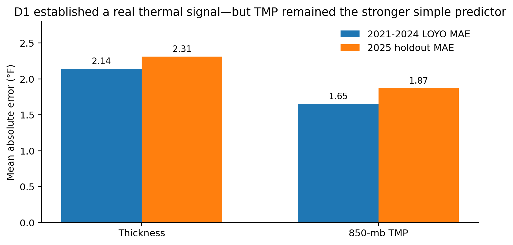

# Research reading edition

Historical document, not the current v3.75 execution contract. This GitHub reading edition preserves the source's proposals and results; they are not relabeled as completed R14 work. Agent-directed wording is retained.

Source: `7-25-26KDEN_Probabilistic_MOS_Product_Direction_White_Paper_v2.0.docx`  
Source SHA-256: `56f83d0bc3f8ba8289c2bb30375df1a62581d0657929c02c6a08a7da4c0adaff`

Word metadata is omitted by conversion. Any additional withholding is recorded in the publication manifest.

---

**KDEN PROBABILISTIC MOS**

**Product Direction White Paper**

> From sunny-day in-house regressions to an all-weather, observation-augmented, probabilistic postprocessing system with live state estimation for Denver temperature markets

<table>
<colgroup>
<col style="width: 100%" />
</colgroup>
<thead>
<tr>
<th style="text-align: center;">
<em>p(Tmax[d] | NWP forecast state, offline MOS prior, filtered live state, KDEN context, issue time)</em>

The product is a calibrated probability distribution over the final official KDEN daily maximum temperature—not merely a single point forecast.
</th>
</tr>
</thead>
<tbody>
</tbody>
</table>

| **Audience** | Investor / project stakeholder seeking a complete explanation of the strategic pivot |
|:---|----|
| **Decision** | Adopt a hybrid local probabilistic MOS architecture with an offline nonlinear correction and a live state-space/Kalman challenger layer |
| **Initial build** | HRRRv4 + MADIS five-minute HF-METAR + official CLI Tmax + all valid days; offline MOS first, live state update second |
| **Version** | 2.0 — July 2026 |

<table style="width:97%;">
<colgroup>
<col style="width: 97%" />
</colgroup>
<thead>
<tr>
<th style="text-align: left;">
<strong>Investment thesis in one sentence</strong>

The fastest credible route to weather-market edge is not to rebuild national weather prediction in-house; it is to take the best available numerical guidance, learn its systematic KDEN errors offline, adapt a low-dimensional live bias state as local observations arrive, and translate the resulting posterior into calibrated probabilities for the exact contracts being traded.
</th>
</tr>
</thead>
<tbody>
</tbody>
</table>

*This document is a product-direction and research-governance plan. It does not claim that profitable trading has already been demonstrated.*

# Contents

1\. Executive decision

2\. The commercial objective

3\. What D1 proved—and what it did not

4\. Why the product direction is changing

5\. The new product thesis: hyperlocal probabilistic MOS

6\. The live adaptation thesis: Kalman/state-space correction

7\. Product architecture

8\. Data strategy and operating dataset

9\. Modeling strategy

10\. Validation and economic proof

11\. Product roadmap and decision gates

12\. Team plan and operating model

13\. Risk register and mitigations

14\. Investor interpretation: why the pivot increases discipline

15\. Appendices: definitions, example outputs, source registry, references

<table style="width:97%;">
<colgroup>
<col style="width: 97%" />
</colgroup>
<thead>
<tr>
<th style="text-align: left;">
<strong>How to read this paper</strong>

Sections 1–4 explain the strategic logic in nontechnical language. Sections 5–6 explain the two-speed forecasting thesis: broad learning offline and narrow adaptation online. Sections 7–10 describe exactly what the engineering and research team will build. Sections 11–13 explain resources, risks, and the investor-level case for continuing the project.
</th>
</tr>
</thead>
<tbody>
</tbody>
</table>

15\. Appendices: definitions, example outputs, source registry, references

# Executive decision

The project is entering a new era. The prior D1/D2 program was designed to determine whether a small, interpretable KDEN-specific model could be built from selected HRRR thermal features on sunny days. That research succeeded at its intended job: it proved that a strong, physically coherent thermal signal exists. It also exposed the limitation of the approach. A one-predictor relationship cannot consistently represent clouds, mixing, wind shifts, thermal advection, fronts, ground state, and other mechanisms that control whether atmospheric heat becomes the observed surface maximum.

The new direction changes the center of gravity. Instead of treating HRRR fields as isolated ingredients from which the team tries to construct a full forecast, the project will treat established numerical guidance as the forecast engine and specialize in local correction, uncertainty estimation, and intraday updating. In operational terms, the team will build a KDEN-specific statistical layer on top of large-scale weather systems. The resulting architecture has two learning speeds: a nonlinear MOS layer learns broad KDEN error structure from years of history, while a deliberately low-dimensional state-space layer updates the current day as MADIS observations arrive.

| **Dimension** | **D1 / proposed D2 direction** | **New KDEN probabilistic MOS direction** |
|:---|----|----|
| Primary question | Can a simple thermal relationship explain Tmax on selected sunny/stable days? | Given the best forecast state and observations available now, what is the probability of every final integer Tmax? |
| Role of HRRR / NWP | Feature provider inside an in-house regression | Primary forecast baseline and physical state representation |
| Coverage | Sunny subset, with a possible stable-regime subset | All valid days; weather regime becomes a predictor and uncertainty driver |
| Unit of analysis | One row per target day | One row per target day × forecast issue time |
| Live observations | Excluded from the first-pass model; later diagnostic | Assimilated every five minutes into trajectory features and, if validated, a live state estimate |
| Output | Point forecast and residual | Posterior probability distribution over integer Tmax and Kalshi bands |
| Model family | One-predictor OLS; possible filters | Baseline calibration → offline GAM/boosting → live Kalman/state-space challenger → probabilistic calibration |
| OMO status | Potential data dependency under investigation | Deferred value-of-information experiment; not a blocker for v1 |

<table style="width:97%;">
<colgroup>
<col style="width: 97%" />
</colgroup>
<thead>
<tr>
<th style="text-align: left;">
<strong>Decision</strong>

Proceed with an all-weather, issue-time-indexed, observation-augmented probabilistic MOS build. Preserve D1 as the scientific benchmark, repurpose D2 as failure-mode and regime analysis, and test a live Kalman/state-space correction only after the offline MOS prior is credible.
</th>
</tr>
</thead>
<tbody>
</tbody>
</table>

# **1. The commercial objective**

*What the product must deliver for a weather-market investor*

Kalshi daily temperature markets settle on the final National Weather Service climate report named in the market rules. The commercial opportunity exists when the project’s calibrated probability for a temperature band differs materially from the probability implied by the market price before that market has consolidated. Current Kalshi guidance describes daily temperature contracts as ranges that settle from the final NWS climate report, with the exact source defined by each market’s rules.\[9\]

The product therefore cannot be judged only by whether its average point forecast is close. The investable object is a probability distribution. A forecast of 88°F is not enough when the market is divided into narrow intervals such as 86–87°F, 88–89°F, and 90–91°F. The system must say how much probability belongs to each interval and whether those probabilities are calibrated.

<table>
<colgroup>
<col style="width: 100%" />
</colgroup>
<thead>
<tr>
<th style="text-align: center;">
<em>Model edge = Pmodel(Yes) − Pmarket(Yes)</em>

An apparent edge becomes economically relevant only after fees, bid–ask spread, execution, liquidity, and model uncertainty are considered.
</th>
</tr>
</thead>
<tbody>
</tbody>
</table>

Illustrative example: if a contract paying \$1.00 is offered at \$0.28 and the model assigns a calibrated 42% probability, the gross probability gap is 14 percentage points. That is not automatically a trade. The system must first account for trading costs, uncertainty in its own estimate, and whether the market can be entered at the displayed price.

- Primary product promise: before a defined intraday cutoff, estimate the probability of each plausible official KDEN integer Tmax.

- Secondary product promise: map those integer probabilities into the exact live Kalshi bands without changing the meteorological model.

- Commercial proof standard: demonstrate prospective, calibrated forecast advantage before considering automated execution.

- Scope discipline: the first product is one station, one target, and a fixed family of issue times—not a national weather platform.

# **2. What D1 proved—and what it did not**

*The prior phase was a successful scientific signal audit, not a failed production model*

D1 was intentionally simple and auditable. It used one-predictor ordinary least squares on a predeclared sunny-day dataset, kept thickness and pressure-level temperature branches separate, selected models using leave-one-year-out validation over 2021–2024, and reserved 2025 as the untouched holdout. The primary sunny definition was k3 = cloud_ss ≤ 3; k2 and k4 were sensitivity definitions.\[1\]\[2\]

The primary k3 dataset contained 546 days from 2021–2025, including 94 holdout days in 2025. The strongest annual thickness model used 850–700-mb thickness, while the strongest practical control used 850-mb temperature. The signal was real and transferred out of sample, but the direct 850-mb TMP predictor was stronger than thickness in both development and holdout.\[1\]\[2\]

*Figure 1. Primary k3 annual D1 performance. Lower MAE is better. D1 proved a strong same-day thermal signal but did not support thickness as the strongest practical one-predictor model.*

| **Finding from D1** | **Product implication for the new era** |
|:---|----|
| Fresh low-level HRRR predictors were consistently useful. | Retain low-level thermal state as a core feature and baseline diagnostic. |
| TMP beat thickness as a simple practical predictor. | Do not anchor future product design to one paper-faithful variable. |
| Seasonal models helped selectively, not universally. | Use flexible context effects and validation rather than four disconnected seasonal products. |
| Sunny was helpful but not sufficient. | Move cloud and regime information from exclusion rules into predictors and uncertainty. |
| Large residuals suggested wind, advection, ground state, inversions, and initialization failures. | Build a multivariate state representation and use residual analysis to prioritize mechanisms. |
| D1 was not an observation-augmented live system. | Rebuild the dataset around issue time and live information availability. |

<table style="width:97%;">
<colgroup>
<col style="width: 97%" />
</colgroup>
<thead>
<tr>
<th><strong>What D1 should be remembered as</strong> 
A disciplined proof that HRRR contains a strong KDEN-relevant thermal signal, and a disciplined demonstration that a simple in-house regression is not the final operational architecture.</th>
</tr>
</thead>
<tbody>
</tbody>
</table>

# **3. Why the product direction is changing**

*The pivot follows from evidence, not from impatience*

The original D2 concept was to study large-error D1 days, identify ex ante regime variables, and construct a sunny-plus-stable subset. That remains scientifically useful. It is not the best primary commercial architecture because it would continue to solve only the days admitted by a gate and would still ask a relatively small in-house model to reconstruct much of the atmosphere.

The strategic change is to exploit division of labor. NOAA and other forecast centers already operate data-assimilation and numerical systems designed by large teams to represent atmospheric dynamics, clouds, convection, radiation, moisture, wind, and boundary-layer processes. HRRR is a 3-km, hourly updated, cloud-resolving and convection-allowing model.\[4\] NBM blends and postprocesses multiple forecast systems, and its current operational product is versioned.\[5\] LAMP is itself an hourly station-guidance MOS system that combines model guidance and recent observations.\[6\]

The project’s defensible specialization is narrower: learn how these systems are wrong at KDEN, how that error changes with the local state, and how uncertainty should be distributed across the exact settlement bands. This produces more leverage per unit of engineering effort than building an independent weather model from raw state variables.

| **Reason for the pivot** | **Investor-level interpretation** |
|:---|----|
| Leverage external R&D | The project uses national-scale physics and data assimilation without financing their recreation. |
| Focus on the local residual | The target problem becomes smaller: KDEN bias, timing, terrain, observation trajectory, and calibration. |
| Expand market coverage | All valid days become candidates; cloudy and transitional days are no longer automatically discarded. |
| Produce tradeable probabilities | The output aligns with contract pricing rather than stopping at a point estimate. |
| Reduce model risk | The baseline and the local correction can be audited, replaced, and compared independently. |
| Preserve optionality | NBM, LAMP, ensemble guidance, and one-minute observations can be added only after they prove incremental value. |

<table style="width:97%;">
<colgroup>
<col style="width: 97%" />
</colgroup>
<thead>
<tr>
<th><strong>This is not a repudiation of in-house modeling</strong> 
The project is still building a proprietary model. The proprietary value moves from recreating broad atmospheric physics to learning local corrections, conditional uncertainty, and market-relevant timing better than a generic national product.</th>
</tr>
</thead>
<tbody>
</tbody>
</table>

# **4. The new product thesis: hyperlocal probabilistic MOS**

*The working product is a local correction and uncertainty engine*

<table>
<colgroup>
<col style="width: 100%" />
</colgroup>
<thead>
<tr>
<th style="text-align: center;">
<em>Tmax[d] = B[d,t] + g(x[d,t]) + h(s[d,t]) + ε[d,t]</em>

d = target day; t = issue time. g(·) is the offline nonlinear correction; s[d,t] is the live filtered state; h(·) turns that state into an additional intraday correction.
</th>
</tr>
</thead>
<tbody>
</tbody>
</table>

| **Term** | **Meaning** | **Business role** |
|:---|----|----|
| Tmax\[d\] | The final official KDEN daily maximum temperature used for settlement. | The outcome whose integer and band probabilities are priced. |
| B\[d,t\] | A strong baseline forecast available by issue time t—initially HRRR-derived, later challenged by NBM and LAMP. | Imports large-scale atmospheric skill. |
| x\[d,t\] | KDEN-specific information available by t: observed trajectory, forecast deviations, cloud/radiation, wind, moisture, season, ground state, and model metadata. | Explains when and why the baseline is locally wrong. |
| g(·) | A learned nonlinear correction estimated offline from historical KDEN forecast errors. | Creates the proprietary hyperlocal prior forecast. |
| s\[d,t\] | A low-dimensional live state, initially framed as temperature-trajectory bias and heating-rate bias. | Summarizes what today’s observations imply beyond the historical prior. |
| h(·) | The state-space/Kalman adjustment generated from the filtered live state. | Lets the forecast adapt during the day without retraining the historical model. |
| ε\[d,t\] | The remaining conditional error distribution, whose width and shape may change by weather state. | Turns a corrected point estimate into honest probabilities and prevents false confidence. |

Live updating does not mean retraining the historical model every five minutes. The offline MOS model remains fixed during the day. New MADIS observations and forecast cycles change x\[d,t\] and sometimes B\[d,t\]. A separate state-space layer may then update s\[d,t\] recursively, producing a new posterior forecast without rewriting the offline model. Offline parameters and online filter parameters are both versioned and retrained only under controlled procedures.

The investor should think of the product as a specialized risk engine with two correction layers. The baseline says what the broad forecast ecosystem expects. The offline local model says how KDEN tends to depart from that expectation under similar historical states. The live filter asks whether today is already departing from that prior in a persistent way. The distribution layer says how much confidence to place in the resulting posterior estimate.

# 5. The live adaptation thesis: Kalman/state-space correction

*The model learns broadly offline and adapts narrowly online*

The proposed Kalman layer is an accommodation to the MOS thesis, not a replacement for it. The offline model uses years of data to learn nonlinear KDEN bias, weather-state interactions, and conditional uncertainty. The online layer tracks only a small set of quantities that can plausibly change during the current day. This separation preserves interpretability and prevents a few recent observations from overwriting the broader historical relationship.

<table>
<colgroup>
<col style="width: 100%" />
</colgroup>
<thead>
<tr>
<th style="text-align: center;">
<em>NWP → offline nonlinear MOS prior → live Kalman/state-space update → integer Tmax posterior</em>

The offline layer explains recurring KDEN error structure. The online layer updates a narrow live state as observations arrive. The probability layer prices the remaining uncertainty.
</th>
</tr>
</thead>
<tbody>
</tbody>
</table>

This hybrid has precedent in operational temperature guidance. The Japan Meteorological Agency has long used a Kalman-filter-based surface-temperature correction, and recent research found that a broad nonlinear correction combined with a Kalman filter outperformed either component alone because the broad model corrected structural errors while the filter corrected smaller local and temporal deviations.\[10\] The project will treat that result as motivation—not as proof that the same architecture must win at KDEN.

| **Component** | **Technical role** | **Investor meaning** |
|:---|----|----|
| NWP baseline | Provides the physically generated forecast path and initial Tmax expectation. | Leverages national-scale atmospheric modeling rather than recreating it. |
| Offline nonlinear MOS | Learns historical KDEN residual structure and state-dependent uncertainty. | Creates the main proprietary local forecast prior. |
| MADIS live observations | Provide quantized, quality-controlled evidence about the actual morning trajectory. | Shows whether the current day is following or departing from the prior. |
| Kalman/state-space layer | Recursively estimates a low-dimensional live state from forecast-observation innovations. | Adapts the forecast without retraining the historical model every five minutes. |
| Posterior probability layer | Combines the offline prior, filtered live state, and remaining uncertainty. | Produces the integer and contract-band probabilities that can be compared with price. |
| Promotion discipline | Compares offline-only and hybrid systems under identical rolling validation. | The filter is funded only if it earns measurable incremental value. |

## 5.1 What the filter is actually estimating

The filter should not directly average an NWP forecast of the final daily maximum with a MADIS measurement of the current temperature; those are different quantities. Instead, the first practical state should describe how the observed temperature path is departing from the forecast path. The recommended initial state contains two elements:

<table>
<colgroup>
<col style="width: 100%" />
</colgroup>
<thead>
<tr>
<th style="text-align: center;">
<em>s[d,t] = [ temperature-trajectory bias ; heating-rate bias ]</em>

Trajectory bias asks whether KDEN is persistently warmer or cooler than the predicted path. Heating-rate bias asks whether that departure is widening or closing.
</th>
</tr>
</thead>
<tbody>
</tbody>
</table>

At each update, the system predicts how that state should evolve, compares the newest observation with the temperature the prior system expected, and then moves the state by an amount determined by relative uncertainty. In plain language:

<table>
<colgroup>
<col style="width: 100%" />
</colgroup>
<thead>
<tr>
<th style="text-align: center;">
<em>posterior state = prior state + Kalman gain × (new observation − expected observation)</em>

The Kalman gain is large when the observation is informative relative to the prior, and small when the observation is noisy, stale, or inconsistent with the assumed state dynamics.
</th>
</tr>
</thead>
<tbody>
</tbody>
</table>

## 5.2 How MADIS ambiguity enters the measurement model

MADIS five-minute HF-METAR does contain distributional uncertainty for the Fahrenheit state even when its integer-Celsius report is exact. A dual-candidate observation such as {69°F, 70°F} is a discrete quantization likelihood, not evidence that uncertainty is absent. The project’s historical near-50/50 test is therefore useful: it suggests that an unconditional first-pass likelihood may assign similar weight to the low and high candidate. It does not establish that the conditional probability remains 50/50 after accounting for prior temperature, heating direction, time of day, dewpoint, or the forecast trajectory.

The initial engineering implementation should be intentionally simple: approximate each dual-candidate set by its midpoint and a measurement variance calibrated from historical data. A second implementation can use the exact candidate-set likelihood or an interval-aware filter. A particle filter or other non-Gaussian method should be considered only if the simpler approximation shows a measurable limitation on exact-integer or band probabilities.

## 5.3 Why Kalman remains a challenger layer

Kalman filtering is attractive because it adapts quickly and uses uncertainty explicitly, but it can carry yesterday’s or the previous hour’s error pattern into a new regime. Adaptive MOS bias correction has longstanding operational precedent.\[11\] Separate work comparing MOS and Kalman corrections found that performance can weaken during abrupt pattern changes when recent bias is no longer representative.\[12\] Clouds, fronts, wind shifts, and convective development are precisely the conditions under which KDEN’s error dynamics may change suddenly.

For that reason, the commercial thesis is not “Kalman filtering will work.” The thesis is that a low-dimensional state-space update is a credible, testable extension of the offline MOS prior. The offline-only model remains the champion until the hybrid improves unseen probabilistic performance, remains stable through regime changes, and produces interpretable innovation and covariance diagnostics.

<table style="width:97%;">
<colgroup>
<col style="width: 97%" />
</colgroup>
<thead>
<tr>
<th style="text-align: left;">
<strong>Investor guardrail</strong>

The Kalman layer is not permitted to hide a weak offline model or manufacture apparent responsiveness. It must beat the offline champion at the same issue times, on the same unseen days, with the same market-relevant scoring rules. If it does not, it remains a research result rather than a production dependency.
</th>
</tr>
</thead>
<tbody>
</tbody>
</table>

# 6. Product architecture

*A modular system in which each layer has a distinct responsibility*

| **Layer** | **Inputs** | **Output** | **Why it exists** |
|:---|----|----|----|
| 1\. Baseline forecast layer | HRRRv4 initially; later version-aware NBM/LAMP challengers | As-issued Tmax baseline and forecast trajectory | Captures large-scale physics and broad forecast skill. |
| 2\. Local observation layer | MADIS five-minute temperature, dewpoint, wind, gust, pressure, QC | KDEN trajectory and forecast-departure measurements | Shows what the station is actually doing through the morning. |
| 3\. Context feature layer | Cloud/radiation, boundary layer, moisture, advection, snow/ground state, model revision | Issue-time feature vector x\[d,t\] | Describes the physical state controlling baseline error. |
| 4\. Offline nonlinear MOS layer | Baseline + issue-time feature vector | Prior corrected center, scale, or quantiles | Learns recurring KDEN bias, nonlinear effects, and conditional uncertainty. |
| 5\. Live state-estimation layer | Offline prior + sequential MADIS innovations + filter parameters | Posterior trajectory-bias and heating-rate-bias state | Adapts the current forecast without retraining the offline model. |
| 6\. Probability / calibration layer | Posterior center, scale, residual history, model disagreement | Calibrated distribution over integer Tmax | Prevents one-point overconfidence and supports narrow bands. |
| 7\. Market mapping layer | Integer probabilities + live contract definitions | Probability for each Kalshi contract | Translates weather probabilities without contaminating the weather model. |
| 8\. Decision-support layer | Model probability, price, fees, spread, liquidity, limits | Paper-trade or trade recommendation | Separates forecast quality from execution and capital risk. |

<table style="width:97%;">
<colgroup>
<col style="width: 97%" />
</colgroup>
<thead>
<tr>
<th style="text-align: left;">
<strong>Separation of concerns</strong>

The meteorological system—including the offline MOS prior and live state-space update—should be trained without market prices. Market comparison and execution belong downstream. This preserves honest calibration and lets the same weather distribution be evaluated against different contract structures.
</th>
</tr>
</thead>
<tbody>
</tbody>
</table>

## 6.1 What the live system does at each update

1\. Ingest the latest eligible HRRR baseline and forecast fields, preserving cycle, valid time, issue time, and model version.

2\. Ingest the newest MADIS KDEN observations and update candidate temperature bounds, running-high bounds, quality flags, and forecast-observation innovations.

3\. Create an as-of feature vector containing only information that could genuinely have been known at that moment.

4\. Apply the offline champion MOS model to produce the prior corrected distribution and expected temperature trajectory.

5\. Update the live trajectory-bias and heating-rate-bias state with the Kalman/state-space challenger, then produce the posterior distribution over final integer Tmax.

6\. Map the posterior into the current Kalshi bands, compare with executable prices after costs, and archive the entire prior, innovation, filtered state, posterior, and market snapshot for reproduction after settlement.

## 6.2 Example product output (illustrative only)

| **Issue time** | **Baseline Tmax** | **Offline prior → live posterior** | **Example band probabilities** | **System interpretation** |
|:---|----|----|----|----|
| 11:00 Denver local | 88.0°F | 87.8°F → 86.9°F | 84–85: 13% \| 86–87: 44% \| 88–89: 31% \| 90+: 12% | Offline MOS corrects stable KDEN bias; live observations indicate additional negative trajectory bias. |
| 12:00 Denver local | 88.0°F | 87.6°F → 87.3°F | 84–85: 6% \| 86–87: 43% \| 88–89: 41% \| 90+: 10% | The live bias has partially stabilized; more information narrows the posterior without eliminating adjacent-band risk. |

# 7. Data strategy and operating dataset

*The central engineering product is an issue-time-correct, version-aware historical panel*

The new dataset is not D1 with more columns. Its unit of analysis changes from one target day to one target day at one forecast issue time. A single calendar day may therefore contribute rows at 08:00, 09:00, 10:00, 11:00, and 12:00 Denver local time, all sharing the same final CLI target but carrying progressively richer information.

<table>
<colgroup>
<col style="width: 100%" />
</colgroup>
<thead>
<tr>
<th style="text-align: center;">
<em>One row = target day d × forecast issue time t</em>

All rows from the same target day must remain together in the same training or validation fold.
</th>
</tr>
</thead>
<tbody>
</tbody>
</table>

| **Source** | **Role in v1** | **Minimum metadata that must be stored** |
|:---|----|----|
| HRRRv4 | Initial coherent NWP baseline and physical feature source, using the project’s 2021-onward common window. | Model/product, cycle, forecast hour, valid time, issue/availability time, grid point, units, retrieval source, file hash. |
| MADIS five-minute HF-METAR | Live local trajectory: temperature, dewpoint, wind, gust, pressure, QC, receipt time. | Station identifier, observation time, receipt time, raw value, units, QC, source file, Fahrenheit candidate bounds. |
| NWS/IEM CLI Tmax | Final target truth used to train and score the system. | Target date, station, source product, value, issue/revision timestamp, correction status. |
| Calendar/static context | Day-of-year, solar geometry, local standard/daylight handling, station metadata. | Derivation version and timezone rules. |
| NBM / LAMP (later) | Baseline challengers and ensemble disagreement features. | Product version, cycle, issue time, station/grid definition, archive provenance. |
| Kalshi market data (separate) | Economic evaluation and execution simulation only. | Contract definition, timestamped bid/ask, volume/liquidity, fees, settlement rule version. |

## 7.1 All valid days, not sunny-only

The operating model should forecast every day for which the settlement target and required issue-time sources are valid. Cloudy and transition days are not discarded merely because they are difficult. Cloud, radiation, precipitation, and regime information become predictors and drivers of uncertainty. The D1 k2/k3/k4 labels remain valuable evaluation strata and scientific benchmarks.

<table style="width:97%;">
<colgroup>
<col style="width: 97%" />
</colgroup>
<thead>
<tr>
<th><strong>Critical interpretation</strong> 
Moving to all days does not assume that the baseline “solves clouds.” It means cloud-related error is measured and modeled rather than removed from the sample. A forecast model that is uncertain on cloudy days should say so through a wider distribution.</th>
</tr>
</thead>
<tbody>
</tbody>
</table>

## 7.2 No-leakage and reproducibility rules

- Use only values whose operational availability time is at or before the issue time—not merely values whose valid time is earlier.

- Never use final daily CloudSS, final daily Tmax, or later forecast cycles as predictors for an earlier forecast.

- Keep all issue-time rows from one target day in the same fold.

- Store raw source files and immutable transformations; never overwrite source history with corrected downloads.

- Record NWP version and product definitions because a baseline upgrade changes the residual distribution that g(·) must learn.

- Reconstruct the live filter sequentially. Never initialize or update an earlier issue time using observations, innovations, or posterior states from later in the day.

- Freeze feature definitions and go/no-go thresholds before evaluating a final prospective period.

- Represent missing sources explicitly; do not silently fill future information backward in time.

## 7.3 MADIS five-minute decision and OMO deferral

The OMO investigation established that the anonymous MADIS HTTP product available to the project behaves as five-minute HF-METAR: benchmark airports showed approximately 12 observations per hour and 300-second spacing. The project also documented repeated difficulty obtaining full one-minute access.\[7\]\[8\] That is a data-quality limitation, but it should not block v1.

The five-minute stream can still encode current temperature bounds, running-high bounds, 15–120-minute heating, dewpoint evolution, wind shifts, pressure tendency, gust changes, and observed-versus-forecast departures. The one-minute bridge will be reconsidered only after a controlled ablation demonstrates that one-minute information materially improves narrow-band probabilities beyond the five-minute system. For the Kalman challenger, the dual-candidate Fahrenheit set is treated as a measurement likelihood or calibrated measurement variance rather than being silently collapsed to one integer.

# 8. Modeling strategy

*A small, predeclared ladder of increasingly flexible challengers*

The team should not run an indiscriminate algorithm tournament. The model ladder is designed so that every increase in complexity answers a specific question and must earn its place out of sample.

| **Model stage** | **Question answered** | **Core output** | **Promotion criterion** |
|:---|----|----|----|
| 0\. Raw baseline | How good is the external forecast without local modeling? | Baseline point and, when available, native uncertainty | Reference standard; cannot be skipped. |
| 1\. Simple local calibration | Is KDEN mainly a stable bias/scale problem? | Intercept/slope or residual correction by issue time | Must improve multiple rolling years without unstable coefficients. |
| 2\. Offline GAM / location-scale GAM | Do smooth nonlinear effects and context-dependent uncertainty explain the residual? | Prior corrected mean/median plus conditional scale | Must improve deterministic and probabilistic scores while remaining interpretable. |
| 3\. Boosted-tree offline challenger | Do thresholds and interactions add material predictive skill? | Nonlinear prior residual / quantile predictions | Must beat GAM robustly, not merely on one year or one season. |
| 4\. Live Kalman/state-space challenger | Does sequential observation assimilation add value beyond the offline prior? | Posterior live bias state and updated Tmax distribution | Must beat the offline champion at the same issue times and remain stable through regime changes. |
| 5\. Probability calibration | Are integer and band probabilities honest? | Calibrated mass over each integer and contract band | Reliability and proper scoring rules improve on unseen periods. |
| 6\. Mixture of experts (later) | Are there persistent physical regimes requiring distinct local mappings or filters? | Regime-weighted distributions | Only after residual evidence and data volume justify the added complexity. |

## 8.1 Why a GAM is the preferred first serious model

An offline generalized additive model is a natural bridge from D1. It retains interpretability but allows curved relationships rather than forcing every effect to be linear. It can show, for example, whether correction changes smoothly with heating rate, day of year, dewpoint, forecast cloud, or wind direction. A location-scale formulation can model both the expected correction and the width of the error distribution. In the hybrid architecture, this GAM produces the prior distribution that the live state-space layer may subsequently update.

<table>
<colgroup>
<col style="width: 100%" />
</colgroup>
<thead>
<tr>
<th style="text-align: center;">
<em>μprior[d,t] = B[d,t] + gμ(x[d,t]) and log σprior[d,t] = gσ(x[d,t])</em>

The offline model produces the prior center and width. A live filter is tested afterward as a separate posterior update.
</th>
</tr>
</thead>
<tbody>
</tbody>
</table>

## 8.2 Why boosted trees are challengers, not automatic replacements

Boosted trees are well suited to tabular meteorological data because they can detect thresholds and interactions: a 2°F warm departure may matter differently under downslope wind than under upslope flow; cloud forecast error may matter differently near peak heating than early in the morning. Their flexibility also creates overfitting risk. They should be promoted only after grouped rolling validation shows robust gains over the GAM.

## 8.3 What role remains for mixed models

Mixed effects are useful for dependence and partial pooling—for example, repeated issue times within a day, multiple stations in a future regional build, or version-specific baseline behavior. They are not the primary answer to D1’s missing-physics problem. Nonlinear covariates and interactions should be addressed first through GAMs, trees, and distributional models; hierarchical effects can be added where the grouping structure genuinely supports them.

## 8.4 How the live state-space layer is evaluated

The first filter should be a deliberately low-dimensional linear-Gaussian approximation so that its behavior can be audited. Process noise controls how rapidly trajectory bias and heating-rate bias may move; measurement noise controls how strongly the filter trusts quantized MADIS observations. Both must be estimated only from training periods. The project will compare three matched systems: offline MOS only, adaptive daily bias correction, and offline MOS plus intraday state-space updating. More flexible interval-aware or particle methods are promoted only after the classical approximation exposes a repeatable limitation.

## 8.5 Candidate v1 feature families

| **Feature family** | **Examples** | **Reason for inclusion** |
|:---|----|----|
| Baseline state | Baseline Tmax, hourly temperature path, prior-cycle revision, native spread | Defines what the external system already expects. |
| Observed thermal trajectory | Current candidate bounds, runmax bounds, 15/30/60/120-minute change, robust slope, acceleration | Captures whether KDEN is heating faster or slower than expected. |
| Forecast-observation departures | Observed minus forecast temperature, dewpoint, wind | Directly measures baseline miss as it develops. |
| Cloud/radiation | Total/layer cloud, shortwave radiation, precipitation/convection indicators | Explains suppressed or interrupted heating. |
| Boundary layer and wind | PBL height, lapse rate, wind direction/speed, gusts, advection proxies | Represents mixing, downslope/upslope, and air-mass change. |
| Moisture | Dewpoint, RH, dewpoint depression, trends | Explains evaporative/convective context and thermal-state translation. |
| Surface/seasonal context | Day of year, solar elevation, snow/ground proxy, pressure tendency | Accounts for seasonal energy and surface-state effects. |
| Filter state and diagnostics | Prior/posterior bias, heating-rate bias, innovation, gain, covariance, reset flags | Makes the online update auditable and detects divergence or regime mismatch. |
| Model metadata | Source version, cycle age, missingness, disagreement among baselines | Controls version shifts and expresses forecast uncertainty. |

# 9. Validation and economic proof

*The project is only investable if the probabilities survive unseen weather and live timing*

The validation design must resemble deployment. Random row splits are prohibited because they would place different issue times from the same weather day in both training and validation. The default design is rolling-origin evaluation grouped by target day.

| **Example fold** | **Training window** | **Evaluation window** | **Purpose** |
|:---|----|----|----|
| Fold 1 | 2021–2022 | 2023 | Early temporal transfer |
| Fold 2 | 2021–2023 | 2024 | Growing-history transfer |
| Fold 3 | 2021–2024 | 2025 | Comparison with prior D1 holdout era; no longer treated as pristine for the redesigned project |
| Fold 4 | 2021–2025 | 2026 prospective / shadow period | Strongest evidence for current product direction |

## 9.1 Metrics

| **Category** | **Metrics** | **What they protect against** |
|:---|----|----|
| Point accuracy | MAE, RMSE, bias, within-1°F rate | Large average errors and systematic warm/cool bias |
| Integer/band accuracy | Exact integer hit rate, realized Kalshi-band hit rate | A model that is close on average but repeatedly lands in the adjacent contract |
| Probabilistic quality | CRPS, log score, Brier score | Assigning high probability to the wrong outcome |
| Calibration | Reliability curves, calibration intercept/slope, coverage of intervals | False confidence or probabilities that do not mean what they claim |
| Filter diagnostics | Innovation bias/variance, posterior coverage, covariance stability, reset frequency | A responsive-looking filter that is mis-specified, overconfident, or diverging |
| Operational timing | Skill by issue time, latency, stale-source rate | Forecasts that improve only after the market opportunity has passed |
| Economic simulation | Net edge after spread/fees, fill assumptions, drawdown, turnover | Confusing forecast skill with realizable trading performance |

## 9.2 Promotion rules

- A correction model must beat the strongest eligible baseline across multiple rolling years and multiple issue times—not only on one aggregate leaderboard.

- A more complex model must beat the simpler champion on proper probabilistic scores as well as point accuracy.

- All selection thresholds and model-promotion rules must be frozen before the final prospective evaluation.

- No live capital deployment occurs before a sufficiently long shadow/paper-trading period demonstrates stable calibration and executable edge after costs.

- A live Kalman/state-space layer must beat the offline champion at identical issue times, maintain calibrated posterior uncertainty, and avoid systematic degradation during fronts, cloud transitions, and other regime changes.

- If local correction does not materially improve the baseline, the project should retain the baseline and stop adding complexity rather than manufacture a result.

<table style="width:97%;">
<colgroup>
<col style="width: 97%" />
</colgroup>
<thead>
<tr>
<th><strong>Investor protection principle</strong> 
The project is designed with kill criteria. A disciplined “baseline wins” result is more valuable than a complex model whose apparent edge disappears out of sample.</th>
</tr>
</thead>
<tbody>
</tbody>
</table>

# 10. Product roadmap and decision gates

*Each phase produces an auditable artifact and a go / revise / stop decision*

| **Phase** | **Primary work** | **Required deliverables** | **Exit decision** |
|:---|----|----|----|
| 0\. Product contract | Freeze target, issue times, settlement source, validity rules, and no-leakage policy. | Product specification; source registry; target/issue-time schema. | Proceed only when every field has an operational availability definition. |
| 1\. Data foundation | Build HRRRv4 + MADIS five-minute + CLI all-day panel. | Raw archive; versioned feature table; completeness and latency audits. | Proceed if historical reconstruction and live ingestion are reproducible. |
| 2\. Baseline bakeoff | Reconstruct HRRR baseline; add NBM/LAMP only if archives pass version/as-issued audit. | Baseline scorecard by issue time, season, and regime. | Choose strongest reproducible baseline; do not assume HRRR is the final winner. |
| 3\. Offline GAM prototype | Fit prior mean and uncertainty corrections. | Response plots; rolling-year scores; residual diagnostics. | Promote if gains are robust and interpretable. |
| 4\. Tree challenger | Test nonlinear thresholds/interactions in the offline prior. | Champion-challenger report; feature stability; calibration comparison. | Promote only if gains survive all required folds. |
| 5\. Live state-space prototype | Estimate trajectory-bias and heating-rate-bias states; calibrate process and measurement uncertainty. | Filter specification; innovation diagnostics; offline-versus-hybrid scorecard; regime-change audit. | Promote only if posterior gains are robust and filter behavior remains stable. |
| 6\. Integer/band calibration | Convert posterior distribution into integer and contract probabilities. | Calibration curves; CRPS/log/Brier score; band mapping tests. | Proceed only if probabilities are honest on unseen data. |
| 7\. Live shadow deployment | Run prior and posterior forecasts on schedule without trading. | Forecast ledger; source freshness dashboard; filter-state dashboard; prospective performance report. | Proceed only if live performance matches backtest assumptions. |
| 8\. Trading integration | Add market comparison, limits, and execution simulation. | Paper-trade P&L attribution; fee/spread sensitivity; risk controls. | Capital decision made separately from model-promotion decision. |
| 9\. Optional expansion | OMO ablation/bridge, NBM/LAMP adapters, nearby stations, interval-aware/particle filters, mixture of experts. | Incremental value studies. | Add only components that earn measurable value. |

## 10.1 Recommended first build

<table>
<colgroup>
<col style="width: 100%" />
</colgroup>
<thead>
<tr>
<th style="text-align: center;">
<em>HRRRv4 + MADIS five-minute HF-METAR + CLI Tmax + all valid days</em>

Model sequence: offline probabilistic MOS prior → live state-space challenger → calibrated integer probabilities. NBM and LAMP remain baseline challengers after their lineage is proven usable.
</th>
</tr>
</thead>
<tbody>
</tbody>
</table>

HRRRv4 is recommended as the first build because the project already has a coherent 2021-onward archive and experience extracting pressure-level fields. This is a data-engineering decision, not a presumption that HRRR will outperform NBM or LAMP. Baseline choice will ultimately be empirical.

# 11. Team plan and operating model

*What the engineering and research group will actually do*

| **Workstream / role** | **Mission** | **Concrete responsibilities** | **When the role becomes critical** |
|:---|----|----|----|
| Data engineering | Create a trustworthy historical and live feature system. | Ingestion, raw-file preservation, as-of joins, source latency, QC, version registry, reproducible builds, sequential state reconstruction. | Immediately; this is the first bottleneck. |
| Applied statistics / ML | Build and validate offline and online correction models. | GAMs, boosting, distributional calibration, state-space/Kalman estimation, covariance tuning, grouped rolling validation, champion/challenger governance. | As soon as the baseline panel passes audit. |
| Meteorological feature science | Ensure predictors and state dynamics correspond to plausible mechanisms. | Cloud/radiation, boundary layer, wind/advection, moisture, ground state, residual case studies, regime-change interpretation. | During feature and filter specification and residual analysis. |
| MLOps / product engineering | Operate the prior and posterior model on schedule and preserve every decision. | Feature service, model/filter registry, monitoring, innovation alerts, forecast ledger, reproducibility. | Before live shadow deployment. |
| Market analytics / execution | Translate calibrated posterior weather probability into economic decisions. | Contract mapping, market data, fees/spread, paper trading, limits, attribution. | Only after probability calibration is credible. |
| Product / research governance | Prevent scope creep and post-hoc claims. | Precommitments, milestone gates, documentation, decision records, investor reporting. | Continuous. |

The first two phases do not require a large team or expensive high-performance computing. One or two strong hybrid data/ML researchers can build the initial panel and baseline stack. Specialized hiring should follow evidence: meteorological depth when residual patterns justify it, MLOps before shadow deployment, and execution engineering only after calibrated probability advantage is demonstrated.

<table style="width:97%;">
<colgroup>
<col style="width: 97%" />
</colgroup>
<thead>
<tr>
<th><strong>Capital discipline</strong> 
The project should not fund a giant end-to-end neural weather model, nationwide expansion, or automated trading infrastructure before a one-station postprocessing system proves incremental skill and live reliability.</th>
</tr>
</thead>
<tbody>
</tbody>
</table>

# 12. Risk register and mitigations

*The primary threats are data lineage, leakage, calibration failure, and overbuilding*

| **Risk** | **How it could damage the product** | **Mitigation** |
|:---|----|----|
| NWP version shifts | The baseline residual distribution changes, making historical correction stale. | Store version metadata; run version-specific audits; use champion/challenger adapters; recalibrate after upgrades. |
| Historical “as-issued” gaps | Backtests accidentally use data not actually available at issue time. | Use availability timestamps; archive raw products; reject sources whose lineage cannot be established. |
| MADIS temperature ambiguity | Current runmax may map to two Fahrenheit candidates. | Carry lower/upper candidates and ambiguity flags; encode them in the measurement model; never choose a candidate silently. |
| Five-minute sampling | An off-grid peak or rapid trajectory change may be missed. | Quantify with later ablation; widen uncertainty; build one-minute bridge only if incremental value is material. |
| Filter misspecification or divergence | Incorrect process/measurement covariance makes the posterior sluggish, unstable, or falsely confident. | Estimate parameters only inside training folds; monitor innovations and covariance; cap gains; define reset/fallback rules. |
| Regime-change carryover | A bias state learned before a front, cloud transition, or wind shift becomes actively misleading afterward. | Use context-aware process noise, regime/reset flags, offline-only fallback, and explicit regime-change validation. |
| CLI revisions / settlement mismatch | Training target differs from final market settlement. | Preserve issue and revision history; train on final official target; flag corrected days. |
| Leakage across issue times | Backtest appears excellent because the same weather day is in train and test. | Group all rows by target day; reconstruct filters sequentially; audit folds. |
| Overfitting small samples | Flexible model learns rare years/regimes rather than repeatable structure. | Regularization, feature discipline, rolling validation, simpler champion, prospective shadow period. |
| Market adaptation | Forecast edge may be incorporated into price before execution. | Measure edge by timestamp; focus on early issue times; include slippage and liquidity in simulations. |
| Scope expansion | Team spends time on OMO, nationwide models, advanced filters, or execution before proving core value. | Milestone gates and explicit deferred backlog. |
| False profitability inference | Good MAE is mistaken for positive EV. | Separate probabilistic scoring from execution simulation and capital approval. |

# 13. Investor interpretation: why the pivot increases discipline

*The change is a de-risking move, not abandonment of the original research*

The investor should not interpret the move away from a sunny-day in-house regression as evidence that the original work failed. The original phase did what a sound research program should do: it isolated a simple hypothesis, evaluated it out of sample, discovered a real signal, and identified where that signal was insufficient. The pivot is the conversion of that evidence into a product architecture that better matches the economic objective.

| **Investor concern** | **Answer** |
|:---|----|
| “Are we starting over?” | No. D1 supplies validated predictors, timing knowledge, residual hypotheses, pipeline discipline, and benchmark performance. |
| “Why trust outside forecasts?” | The product does not trust them blindly; it measures and corrects their local errors while leveraging their atmospheric modeling. |
| “Why add a Kalman filter?” | The offline model learns recurring error from years of data; the filter tests whether today is persistently departing from that prior. It is a narrow adaptation layer, not a second weather model. |
| “Is the model retrained every five minutes?” | No. The historical MOS model remains fixed. Only a small posterior state is updated recursively from new observations. |
| “Why forecast all days if cloudy days are harder?” | Hard days carry uncertainty and market opportunity. The model should widen or shift probabilities rather than refuse to forecast them. |
| “Why not build the most complex model immediately?” | The project promotes complexity only when it improves unseen probabilistic performance. This protects capital and interpretability. |
| “What is proprietary?” | The KDEN issue-time dataset, local error model, state dynamics, observation likelihood, calibration, model governance, and market-timing integration. |
| “What proves the business?” | Prospective calibrated posterior probabilities that outperform strong baselines and the offline-only champion, then produce executable paper-trading edge after costs. |

<table style="width:97%;">
<colgroup>
<col style="width: 97%" />
</colgroup>
<thead>
<tr>
<th style="text-align: left;">
<strong>Why stay on board</strong>

The project has moved from proving that a local thermal relationship exists to building a two-speed forecasting system: broad nonlinear learning from history and narrow live adaptation from current observations. The roadmap remains modular, measurable, and designed to stop when a component does not earn its complexity.
</th>
</tr>
</thead>
<tbody>
</tbody>
</table>

# Appendix A — Product definitions and glossary

| **Term** | **Plain-language definition** |
|:---|----|
| NWP | Numerical weather prediction: a computer model that simulates the atmosphere using physical equations and assimilated observations. |
| MOS / postprocessing | A statistical layer that learns how a forecast system is systematically biased or uncertain at a location. |
| HRRR | NOAA’s hourly, 3-km, convection-allowing regional forecast model used as the first coherent baseline/feature source. |
| NBM | The National Blend of Models, which combines and calibrates many forecast sources and is versioned over time. |
| LAMP | Localized Aviation MOS Program: station guidance updated hourly using model guidance and recent observations. |
| MADIS HF-METAR | The publicly accessible high-frequency observation product available to the project at approximately five-minute cadence. |
| CLI Tmax | The final official daily climate-report maximum temperature used as the model target and typically used by Kalshi daily temperature markets. |
| GAM | Generalized additive model: an interpretable regression whose effects can bend smoothly rather than being forced into straight lines. |
| Kalman filter | A recursive state-estimation method that combines a prior state with a new measurement according to their relative uncertainty. |
| State-space model | A model that separates an evolving hidden state from the noisy or quantized observations used to infer it. |
| Latent state | A quantity not observed directly; here, initially the current trajectory bias and heating-rate bias. |
| Innovation | The difference between the newest observation and the value the prior system expected to observe. |
| Kalman gain | The weight controlling how strongly the innovation moves the prior state toward the observation. |
| Process noise / measurement noise | Uncertainty in how the hidden state evolves versus uncertainty in what the observation reveals about that state. |
| Boosted trees | An ensemble of sequential decision trees that can learn thresholds and interactions in tabular data. |
| Calibration | The property that events assigned 40% probability occur about 40% of the time over comparable cases. |
| CRPS | A proper score for an entire continuous forecast distribution; lower is better. |
| Brier score | Squared error for a probability forecast of a binary event such as one market band resolving Yes; lower is better. |
| Issue time | The exact moment the system claims a forecast, defining which inputs were legally available. |
| As-of join | A data join that uses only source values available by the forecast issue time. |
| Positive EV | Positive expected value: the model’s estimated probability advantage remains favorable after price, fees, spread, and execution risk. |

# Appendix B — Minimum issue-time dataset schema

| **Column family** | **Representative fields** |
|:---|----|
| Keys | target_day, issue_time_utc, issue_time_local, station_id |
| Target | cli_tmax_final_f, cli_product_issue_time, cli_revision_flag |
| Baseline lineage | baseline_source, baseline_version, cycle_time, valid_time, availability_time, baseline_tmax_f |
| Baseline trajectory | forecast_temp_current, forecast_temp_future_hours, prior_cycle_tmax, baseline_revision |
| MADIS observation | obs_time, receipt_time, temp_c_raw, temp_f_low, temp_f_high, qc, dewpoint, wind, gust, pressure |
| Trajectory features | runmax_low/high, heat_15m, heat_30m, heat_60m, robust_slope, acceleration, time_since_new_high |
| Forecast departures | obs_minus_forecast_temp, dewpoint_departure, wind_departure |
| Physical context | cloud layers, shortwave radiation, PBL height, lapse rate, RH, wind profile, precipitation, snow/ground proxy |
| Offline MOS prior | prior_mean, prior_scale, prior_quantiles, offline_model_id, offline_model_version |
| Filtered live state | state_bias_prior/posterior, heat_rate_bias_prior/posterior, innovation, kalman_gain, state_covariance, reset_flag, filter_id/version |
| Posterior forecast | posterior_mean, posterior_scale/quantiles, integer_probabilities, band_probabilities |
| Metadata | feature_version, source_hashes, missingness flags, model_disagreement, processing_timestamp |

# Appendix C — Explicitly deferred work

- Full one-minute OMO probabilistic bridge, pending a controlled value-of-information study.

- Advanced non-Gaussian filtering—such as exact candidate-set likelihoods or particle filters—unless the classical low-dimensional state-space approximation shows a repeatable market-relevant limitation.

- End-to-end neural weather modeling from raw gridded state.

- Nationwide or multi-city deployment before KDEN v1 is validated.

- Automated trading before live shadow forecasts and execution simulation pass review.

- Unrestricted feature explosion or indiscriminate model search.

- Market-price features inside the meteorological model.

- Permanent sunny/stable exclusion gates as the main product architecture.

# Appendix D — Evidence and source registry

Internal project sources

\[1\] Historical Synthesis of the KDEN Dataset 1 Regression Study (internal project report, 2026).

\[2\] KDEN Dataset 1 to Dataset 2 Handoff Document: Part 1 Historical Record and Part 2 Failure-Mode Analysis Direction (internal project report, 2026).

\[3\] KDEN Tmax Thickness-Regression Study Plan, updated 2026-05-07 (internal project plan).

\[8\] MADIS OMO/HF-METAR endpoint and station audits plus NOAA support correspondence (internal project evidence, 2025–2026).

**External official and peer-reviewed sources**

[<u>\[4\] NOAA Rapid Refresh — HRRR overview.</u>](https://rapidrefresh.noaa.gov/hrrr/)

[<u>\[5\] NOAA Model Development Lab — NBM documentation and versions.</u>](https://vlab.noaa.gov/web/mdl/nbm-documentation)

[<u>\[6\] NOAA Model Development Lab — station-based LAMP overview.</u>](https://vlab.noaa.gov/web/mdl/point-lamp)

[<u>\[7\] NOAA MADIS — one-minute ASOS / OMO documentation.</u>](https://madis.ncep.noaa.gov/madis_OMO.shtml)

[<u>\[9\] Kalshi Help Center — Weather Markets settlement overview.</u>](https://help.kalshi.com/en/articles/13823837-weather-markets)

\[10\] Inoue et al. (2024), Development of a Temperature Prediction Method Combining Deep Neural Networks and a Kalman Filter, Journal of the Meteorological Society of Japan.

\[11\] Glahn (2012), Bias Correction of MOS Temperature and Dewpoint Forecasts, NOAA/National Weather Service Meteorological Development Laboratory.

\[12\] Cheng and Steenburgh (2007), Strengths and Weaknesses of MOS, Running-Mean Bias Removal, and Kalman Filter Techniques for Improving Model Forecasts over the Western United States, Weather and Forecasting.

<table style="width:97%;">
<colgroup>
<col style="width: 97%" />
</colgroup>
<thead>
<tr>
<th style="text-align: left;">
<strong>Document status</strong>

This white paper establishes Version 2.0 product direction: an offline probabilistic MOS prior with a separately governed live state-space/Kalman challenger. The next binding artifact should be the Phase 0 operational specification that freezes target, issue times, source availability rules, version metadata, state definitions, observation likelihood, covariance-estimation rules, validation folds, and promotion gates before the all-day panel and filter are built.
</th>
</tr>
</thead>
<tbody>
</tbody>
</table>
