# S5 — frozen model scorecard and scientific interpretation

Historical development evidence, not a fresh blind test. No models were refitted, no reliability model or trading gate was learned, and no market prices or executable contract bands were used.

## Timing audit — important qualification

The deeper S5 audit found a selection-timing nonconformance missed by the earlier S4 review. The final inner block included December 31 outcomes when selecting settings for January 1, although the declared two-day label lag permits outcomes only through December 30. The outer model fits themselves respected the lag. Excluding the late tuning day leaves **18 of 18 selected configurations unchanged**.

The frozen forecasts are preserved. The exclusion calculation is an audit sensitivity, not a silent repair or a new model-selection experiment. The declared timing procedure was violated even if the settings match. Correct the selection-date eligibility in a successor workflow before claiming a faithful replay of the stated lag. Statistical intervals below describe these frozen historical forecasts and do not erase this qualification.

[Full timing audit](timing_audit.json)

## Population, support and estimands

All six models have available forecasts for the same 980 audited development days and 55,848 issue checkpoints per model. The assessment periods are 2023, 2024 and January 1–September 6, 2025; the final period is a partial year. Availability is 100%; it is not selective confidence coverage. Intraday rows are dependent observations.

Ordinary score tables average available issue losses within a target day and then weight days equally. MAE uses the integer PMF median; RMSE uses the PMF mean; exact hits use the modal integer with the smallest-integer tie rule. Continuous raw centers and named model locations remain separately labeled. Positive bias is forecast minus truth. Native PMFs drive calibration and selection; only reported log loss uses the registered 1e-6 floor and renormalization.

For admitted forecasts, population-weighted results retain each checkpoint’s original 1/(expected issues that day) weight and then normalize over admissions. Equal-admitted-day accuracy is also saved under a separate name. Checkpoint share, day-weighted share, unique-day share and admitted issues for every day are retained. Baselines are rescored on the exact same admitted rows.

## Overall scorecard

| Model | MAE °F | Exact hit | CRPS °F | Log loss | Error ≥5°F |
|---|---:|---:|---:|---:|---:|
| Hourly baseline | 2.035 | 17.35% | 1.493 | 2.390 | 9.20% |
| Subhourly baseline | 2.037 | 17.41% | 1.497 | 2.391 | 9.23% |
| AnEn | 1.948 | 18.14% | 1.412 | 2.325 | 8.35% |
| Location–scale normal GAM | 1.959 | 18.68% | 1.430 | 2.329 | 8.84% |
| Constant-scale GAM diagnostic | 1.971 | 17.80% | 1.460 | 2.416 | 8.13% |
| Student-t GAM diagnostic | 1.965 | 18.64% | 1.432 | 2.309 | 9.01% |

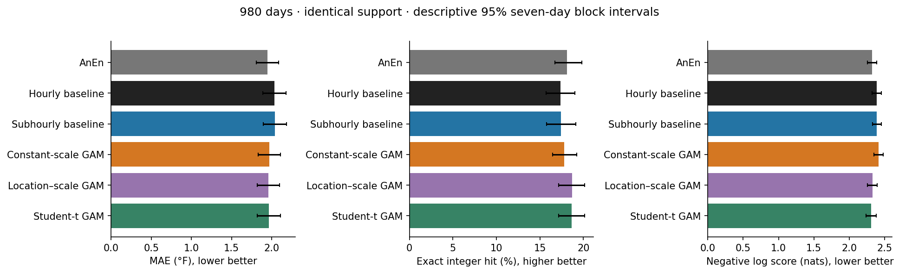

Every cell and slice is available with expected row denominators, scored rows, contributing days, sparse-support flags and descriptive intervals in [scorecards.json](scorecards.json). Tail quantiles, signed warm/cold failures, named point metrics, threshold Brier scores, interval coverage/width and score-floor diagnostics are included.

## Paired uncertainty

Five predeclared primary negative-log-score contrasts use paired seven-calendar-day noncircular moving-block resampling within each fold, 5,000 draws and seed 3750925. All rows from a day stay together; missing calendar slots are retained; each fold retains its original eligible-day mass. The displayed 0.5th/99.5th percentile bounds implement the registered five-comparison Bonferroni procedure: nominal approximate familywise 95% coverage, not a finite-sample guarantee.

| Contrast | Difference, nats | Seven-day familywise interval | Fourteen-day sensitivity |
|---|---:|---:|---:|
| AnEn − Hourly baseline | -0.0647 | [-0.084, -0.045] | [-0.086, -0.044] |
| AnEn − Subhourly baseline | -0.0658 | [-0.085, -0.046] | [-0.088, -0.045] |
| Location–scale normal GAM − Hourly baseline | -0.0612 | [-0.091, -0.036] | [-0.096, -0.035] |
| Location–scale normal GAM − Subhourly baseline | -0.0623 | [-0.092, -0.037] | [-0.097, -0.036] |
| Location–scale normal GAM − AnEn | 0.0035 | [-0.023, 0.026] | [-0.024, 0.026] |

Negative differences favor the first model. These intervals quantify sampling variation for this fixed historical comparison; they do not account for every earlier research decision. Other metric/slice intervals are unadjusted descriptive 95% intervals and cannot support claims from searching many subsets. No practical promotion margins were registered, so no binary model-promotion decision is made.

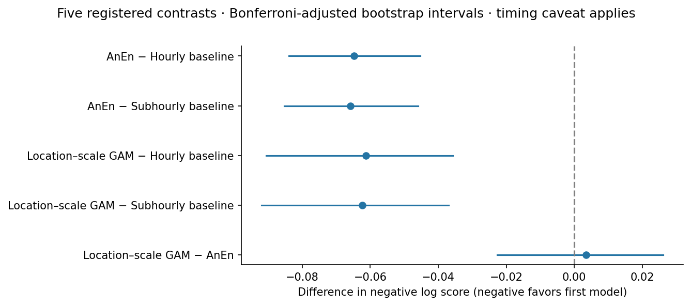

## Generalization and failure patterns

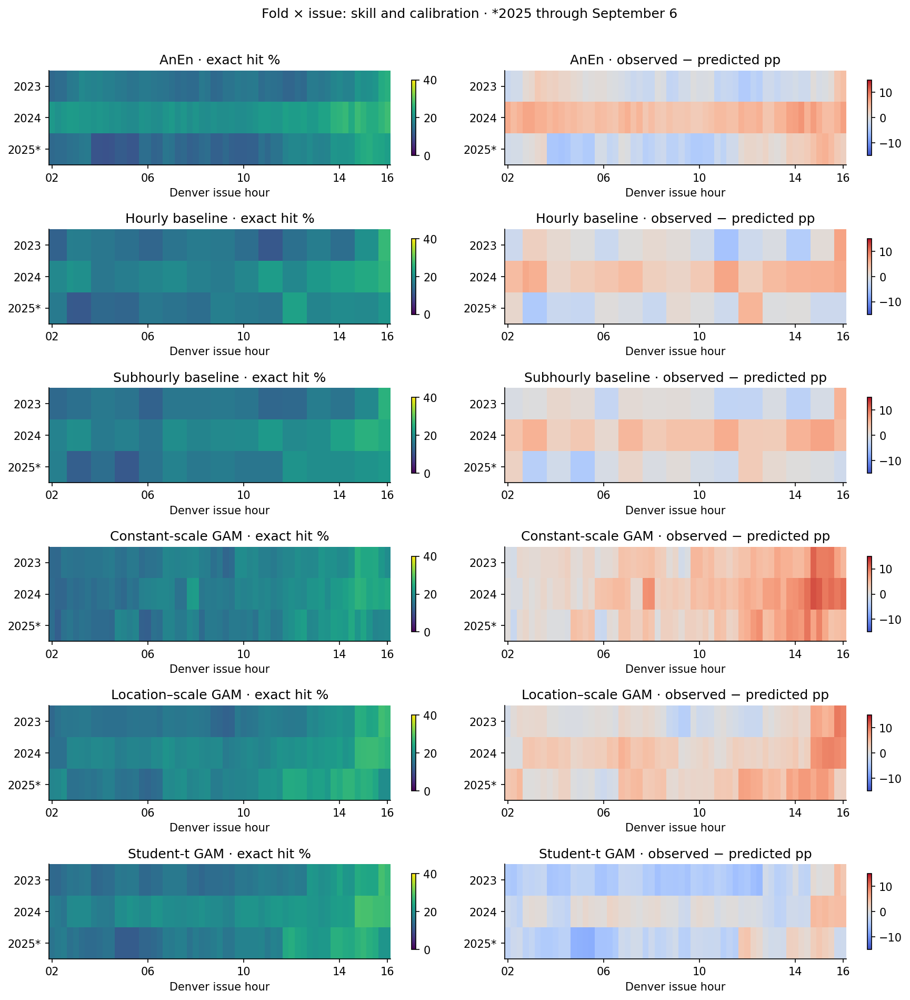

The scorecard includes fold/year, month, meteorological season, all 57 issue times, four issue bands, the registered season-by-issue interaction, forecast temperature, ex-post realized temperature, cycle age and new-versus-same-cycle transitions. Nine meteorological proxy slices use the frozen registry. Tertiles are learned from eligible outer training predictors at each exact issue; missingness remains a named category and empty quantile categories are retained. These are model forecast-state proxies, not observed weather or causal mechanisms.

AnEn kth-distance and effective-neighbor quartiles use selected inner forecasts at the same issue. Their exact S5 operationalization is documented as descriptive after earlier outcome inspection. Extrapolation diagnostics are reported by model; baseline extrapolation was not recorded. Source/model eras remain UNKNOWN without independently verified version history. Slices under 60 distinct days are flagged exploratory; reliability bins under 30 days use the frozen calibration sparsity rule. Neither cutoff guarantees adequate power.

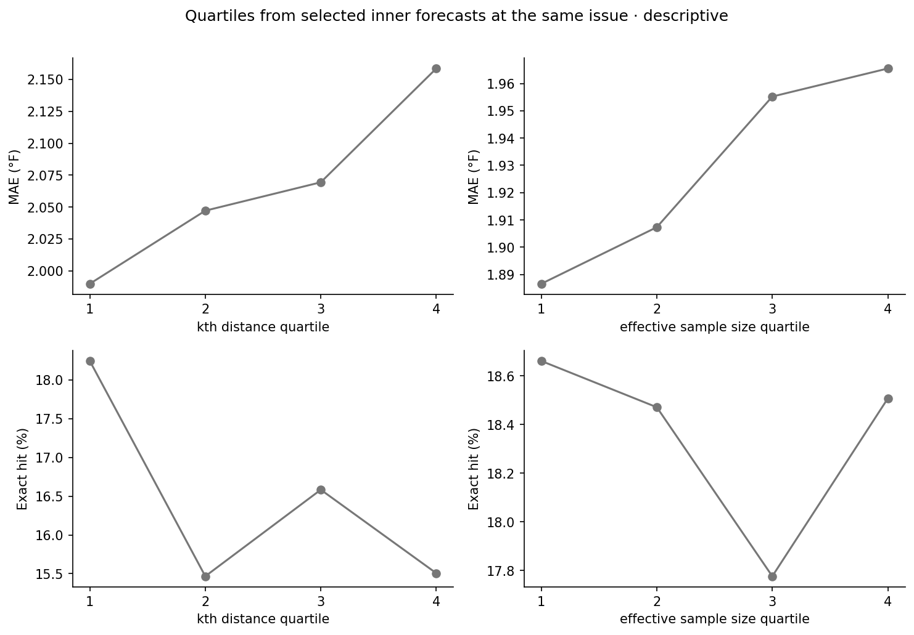

## Calibration and native-confidence selection

Exact-integer, fixed two-integer partitions in both alignments, fixed five-integer partitions, and cumulative temperature thresholds 32–100°F have separate reliability diagnostics. A partition’s modal band can differ from the band containing the modal integer; both are scored. The diagnostic partitions do not reconstruct or predict Kalshi listings.

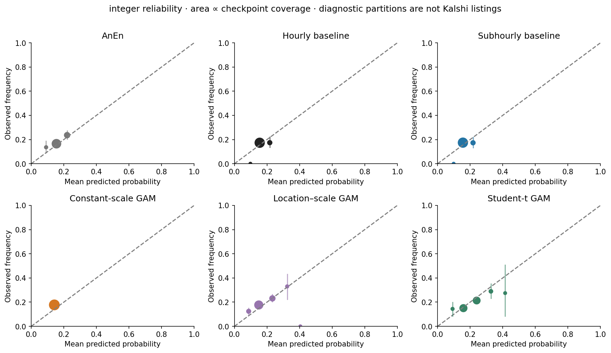

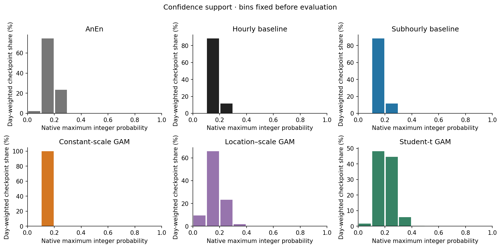

Each outer vintage uses thresholds obtained from its selected model’s earlier included inner forecasts. The target coverages are 100%, 75%, 50%, 25% and 10%; all ties are admitted. No outer quantile is chosen to force a target coverage. Entropy and interval-width rankings are secondary, not probabilities. The selected inner forecasts also selected base settings, so they are tuning evidence and must not be repurposed as independently validated training data for a learned gate. The base-selection timing qualification above remains applicable.

| Model | Intended inner coverage | Actual outer day-weighted coverage | Exact hit among admitted | Same-case Q baseline hit | Days admitted |
|---|---:|---:|---:|---:|---:|
| Subhourly baseline | 50% | 41.48% | 18.04% | 18.04% | 977 |
| Subhourly baseline | 25% | 18.85% | 18.59% | 18.59% | 730 |
| Subhourly baseline | 10% | 7.67% | 19.42% | 19.42% | 374 |
| AnEn | 50% | 47.88% | 21.67% | 20.38% | 906 |
| AnEn | 25% | 25.85% | 23.14% | 21.33% | 712 |
| AnEn | 10% | 10.29% | 25.20% | 22.68% | 479 |
| Location–scale normal GAM | 50% | 41.26% | 22.72% | 20.71% | 685 |
| Location–scale normal GAM | 25% | 17.64% | 24.95% | 23.41% | 452 |
| Location–scale normal GAM | 10% | 5.88% | 27.74% | 26.00% | 235 |
| Student-t GAM diagnostic | 50% | 42.91% | 22.72% | 20.84% | 735 |
| Student-t GAM diagnostic | 25% | 18.14% | 25.39% | 23.13% | 528 |
| Student-t GAM diagnostic | 10% | 5.73% | 28.92% | 25.05% | 282 |

Native selection is a diagnostic policy, not a trained trading gate. Separate model selectors do not generally admit identical cases, even at the same nominal target. Consult the same-case baseline results, actual coverage and fold/season/issue tables before comparing selected accuracies. Undefined no-admission metrics remain null; bootstrap no-admission fractions are reported.

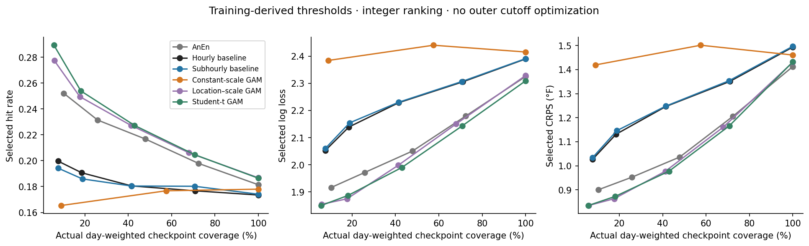

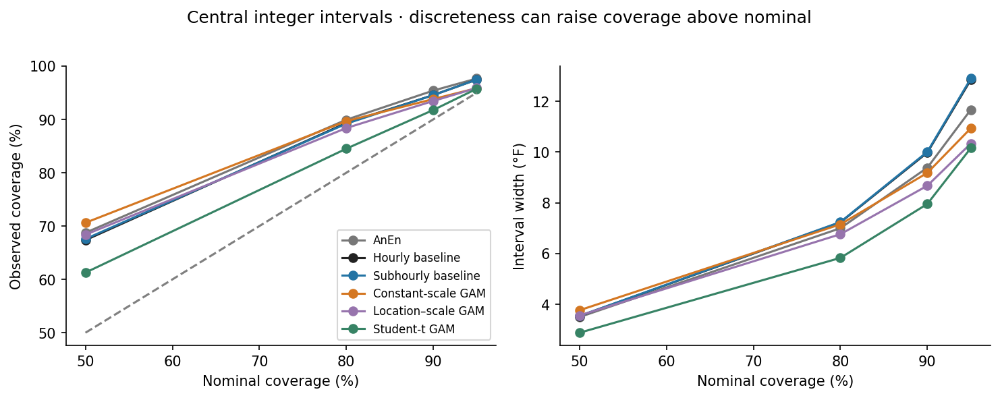

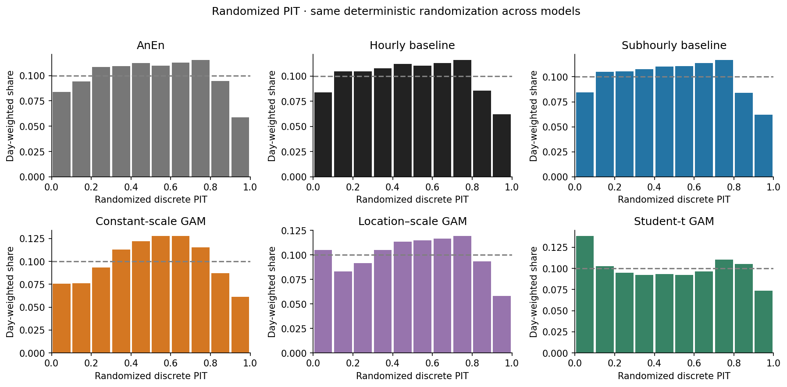

Integer interval discreteness can produce coverage above nominal without proving broad-distribution miscalibration on its own. PIT, event reliability, widths and tails must be interpreted together. Confidence-bin summaries can hide year-to-year failures; the per-fold tables remain essential.

## Model effects and intraday behavior

GAM location and scale-eta contributions are reconstructed from the saved fitted coefficients, knots, centering and scaling. Curves stop at each vintage’s training range; differing vintage curves illustrate fitted variability, not confidence bands. No saved coefficient covariance or refit bootstrap exists, so inferential effect uncertainty is unavailable. Correlated features and the raw-Q offset prevent interpreting these curves causally. Scale-eta effects are not temperature corrections.

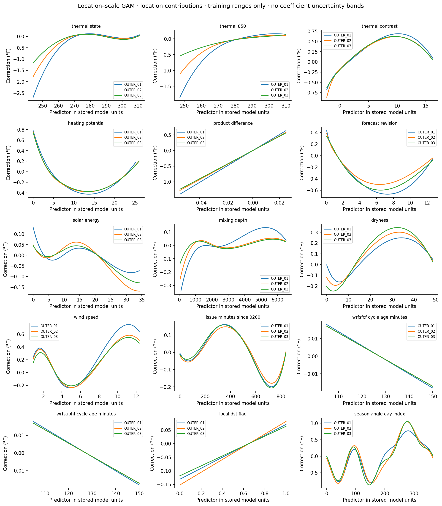

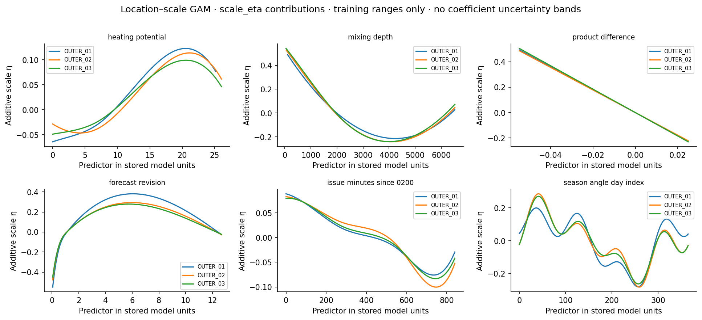

Adjacent mean/mode revisions, Jensen–Shannon PMF changes, and changes in error/hit outcomes are saved for new-cycle and same-cycle transitions. First checkpoints are excluded from adjacent-change summaries. These observational comparisons do not isolate the causal value of new cycles from time of day or weather.

For every model, five largest day-average error cases plus five deterministic 10:00 hit and five miss cases are selected using the registered hash rule. Their intraday paths are illustrative ex-post hypotheses only. The [Not bundled: case index](../../../../../DATA_AVAILABILITY.md#not-bundled) and figures preserve successes as well as failures; no gate is validated using these cases.

## Operations and integrity

Frozen fit/forecast unit wall times are recorded. Separate historical fit versus prediction timings and peak memory were not collected, so the report marks them unavailable rather than estimating them as measurements. S5’s own elapsed time and process memory are recorded separately in provenance. All models had full outer support and no operational fallback. The original scorecard near-scale-bound definition (≤0.26 or ≥19.9°F) is kept distinct from the S3 diagnostic flag (<0.275 or >18°F).

Outer forecast file hashes, release manifests, expected issue/date joins, development-only truth provenance and PMF validity were checked. Earlier limited headline scores were reproduced. Only selected inner forecast files needed for thresholds—and the bounded late-date baseline audit—were read; this is not a redundant exhaustive reread of all candidate fit arrays.

## Scientific conclusions and bounded S6 recommendation

- AnEn: assess its modest average-error/distribution gains separately from exact-hit stability and analog support. A pooled improvement does not establish uniform seasonal or annual benefit.
- Location–scale normal GAM: assess conditional uncertainty and annual exact-hit behavior alongside tail errors and probability calibration. Its additive effects are descriptive, not a causal weather explanation.
- Constant-scale and t5 variants: interpret as registered diagnostics. Better performance on one distribution score does not automatically promote a variant.
- Selective forecasting: distinguish concentration of hits from stable calibration and sufficient opportunity. Use the frozen selector’s later-fold coverage and same-case baselines; do not optimize a cutoff from these outer curves.

Before successor fits, repair and test the tuning-label availability boundary. S6 should then register a bounded conditional-reliability experiment and, if justified by the diagnostics, a single distributional tree challenger. Any learned gate needs genuinely forward-selected base forecasts and its own chronological evaluation; historically inspected outcomes remain development evidence. No new model, gate, calibration or prospective period is silently registered by this report. Commercial value remains untested until actual listed bands and contemporaneous executable-price assumptions are evaluated separately.

## Machine-readable outputs and figures

- [Scorecards and descriptive intervals](scorecards.json)
- [Paired primary inference](paired_inference.json)
- [Not bundled: Calibration](../../../../../DATA_AVAILABILITY.md#not-bundled)
- [Not bundled: Frozen confidence thresholds](../../../../../DATA_AVAILABILITY.md#not-bundled)
- [Not bundled: Selection, coverage, same-case baselines and per-day admissions](../../../../../DATA_AVAILABILITY.md#not-bundled)
- [Not bundled: Training-only regime thresholds](../../../../../DATA_AVAILABILITY.md#not-bundled)
- [Not bundled: GAM effects](../../../../../DATA_AVAILABILITY.md#not-bundled)
- [Operations](operations.json)
- [Provenance](provenance.json)

The full original 122-figure archive is not bundled. See the repository data-availability guide.
